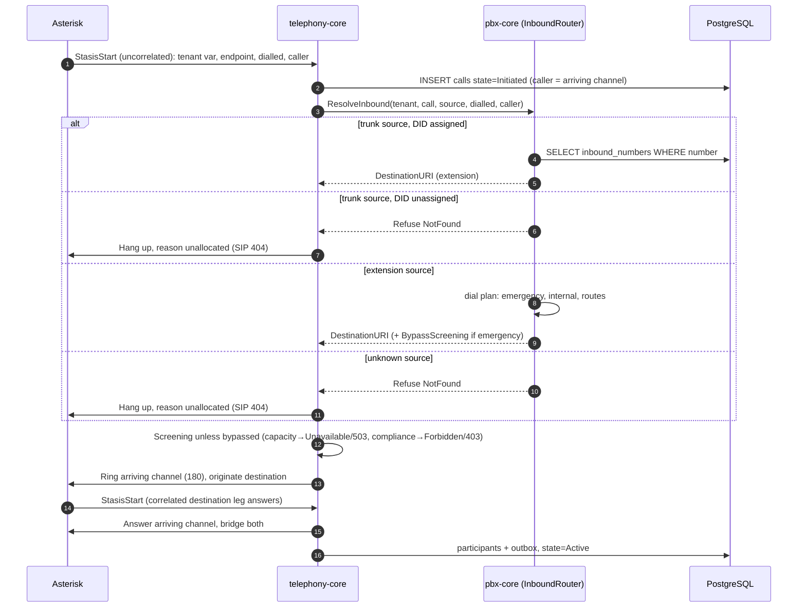
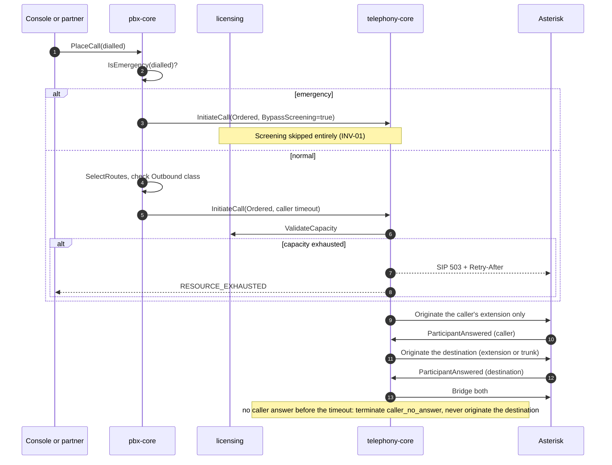

# LLD-03 — PBX Core

| | |
|---|---|
| **Bounded context** | `pbx-core` (Tier 1 — see [`04-bounded-contexts.md` §10](../hld/04-bounded-contexts.md#10-bounded-context-build--dependency-graph)) |
| **Status** | **Phase A implemented & archived; Phase B in progress** — ownership, reporting attribution, IVR time-routing and the IVR menu are delivered; queues/agents and voicemail are designed in §3.3–3.4, not built |
| **Traces to** | BRD FBR-R1-01/§16; PRD principle 4, EPIC-03 (US-03.1–03.10, AC-03.1–03.10), EPIC-10 (console), INV-01/INV-03/INV-10; TRD domain model; HLD [01-architecture.md](../hld/01-architecture.md) §1.2, [03-domain-model.md](../hld/03-domain-model.md) §5, [04-bounded-contexts.md](../hld/04-bounded-contexts.md) §2, [05-security.md](../hld/05-security.md), [17-data-model-erd.md](../hld/17-data-model-erd.md), [18-phase-a-user-flows.md](../hld/18-phase-a-user-flows.md); DECISIONS D-02, D-22, D-24, D-41, D-43, D-46, D-47 |
| **Why this is LLD-03** | LLD-01 proved the media path and LLD-02 landed identity; neither made a single extension exist. Every remaining LLD needs configuration that Asterisk can act on: `compliance` gates dialling that `pbx-core` routes, `reporting` reports on calls `pbx-core` places, and the console (D-46) has nothing to configure until this exists. D-26 (dependency-first) puts it here. |

## Document history

| Date | Change |
|---|---|
| 2026-11-02 | **§7.1: WEBRTC extensions are projected as browser endpoints** (`console-browser-phone`, D-81). Migration 0018 adds the realtime columns; a WEBRTC endpoint uses the configured WebRTC transport, DTLS media, ICE, AVPF and RTCP multiplexing, with ulaw/alaw (the engine has no codec_opus). The console registers it with SIP.js over WS on the dev rig (WSS in production) and the password is entered, never read back. `from_domain` is the installation's domain, not the engine hostname. |
| 2026-11-02 | **§7.5/§7.6: trunk health follows HLD T-6** (`pbx-trunk-health-thresholds`, D-80). Checks every 10 s; 3 consecutive failures or a >20 % call-setup failure rate over a rolling 60 s window (min 5) make a trunk Degraded; recovery needs 5 continuous healthy minutes. Configuration failures stay Unhealthy at once. Observations are stored in `trunk_health_samples`; a failure transition emails the tenant administrators and `ATSAPBX_CARRIER_ALERT_EMAILS` (BR-08). |
| 2026-11-02 | **§4.1 and §11.2: placement rings the caller first** (`console-click-to-call`, design D1). `InitiateCall` gains an ordered mode: the caller's leg is originated alone, the destination's from the caller's `ParticipantAnswered`, and a placement timeout (default 30 s) ends an unanswered caller with `caller_no_answer`, never ringing the destination and releasing the licence channel. The engine's alerting window is set longer than the placement timer so the platform owns the reason. The console gets Place a call and Hang up on Call history. |
| 2026-11-01 | **§7.7: carrier traffic enters through one ingress and is attributed by the platform** (`pbx-carrier-ingress`, D-77). Per-trunk identify rows are gone. One tenantless `carrier-ingress` endpoint recognises every trunk's addresses, and each call is attributed by its transport source address (`CHANNEL(pjsip,remote_addr)`) and the dialled number: exactly one trunk routes, none or several refuse 404. Two tenants on one carrier each receive their own numbers. One flag-guarded cross-tenant read (migration 0016). Also: the identify match is TEXT (migration 0015), and an unreachable destination is refused 480, never left ringing. |
| 2026-11-01 | **§7.5–7.6 and §10.5: carriers recognised from their published ranges; non-carrier addresses refused** (`pbx-carrier-addresses`, D-76). `Trunk` gains `InboundAddresses` (migration 0014); identify is the union of the host's carrier addresses and those ranges. Hosts and addresses that cannot be a carrier (localhost, loopback, link-local, unspecified, multicast) are refused, never checked and never recognised; such a trunk reads "Address not allowed". |
| 2026-11-01 | **§7.5: a carrier is recognised by address, never by name** (`pbx-trunk-host-resolution`, D-75). The engine resolved every trunk host name in its identify rows while identifying each carrier request, so one tenant's typo (`locslhodt`) stalled carrier calls for all tenants. The platform now resolves names in the trunk check and projects addresses only; `Trunk` gains `ResolvedAddresses` and `ResolvedAt` (migration 0013). |
| 2026-10-14 | **Trunk health is checked, not assumed** (`pbx-trunk-health-probing`, D-74). A trunk starts `Unknown`, and the platform checks every carrier with SIP OPTIONS, because Asterisk 22 does not qualify realtime AORs (measured). Each observation records a reason and a time. An `Unhealthy` trunk is skipped only while another can carry the call (design D7). |
| 2026-09-07 | Initial draft. |
| 2026-10-13 | **§6 gains `GetSipRegistrar`** (`pbx-sip-registrar-settings`): the console can tell an administrator where a phone registers, so flow A3 completes without leaving the console (HLD-18 §7). Configured per installation; read with the extension-read permission. |
| 2026-10-11 | **§3 `Trunk` gains `AuthUsername`** (`pbx-trunks-routes` design D7). Carrier digest auth needs a username as well as the secret; both are optional, matching SIP-trunk convention, so an IP-authenticated carrier carries neither. Outbound carrier registration stays out: it needs `ps_registrations` and a new engine grant. |
| 2026-10-11 | **§4.2/§11.1 widened for `pbx-inbound-and-emergency`** (design D1/D2/D4): `ResolveInbound` takes a source endpoint and call id, not just tenant + dialled, so `pbx-core` can tell trunk from extension and reserve a trunk channel keyed by the call; DID resolution for trunk sources and desk-phone dialling through the `PlaceCall` dial plan; the tenant arrives on the channel via endpoint-configured `ATSA_TENANT_ID` (D1), never a cross-tenant lookup. `Retry-After` on the 503 is a recorded gap: Asterisk 22.11.0 cannot emit it on an unanswered inbound channel, so a plain 503 with the Q.850 reason ships (design D8). |
| 2026-11-04 | **§3.2–3.4 added: IVR menu, queues/agents/hot-desk and voicemail design**, grounded in 3CX/FusionPBX/Vodia/Asterisk documentation. `pbx-ivr-routing` (time routing), ownership and participant attribution have since shipped; the menu/queue/voicemail execution remains. |
| 2026-11-07 | **§3.2.1 added: IVR review against 3CX, VitalPBX, FreePBX, FusionPBX and Amazon Connect** (D-91). The shipped single-level, extension-only, UTC-window menu is recorded; the target is typed destinations, a five-kind node graph, weekly schedules in an IANA time zone with a manual override, re-prompt and direct dial, delivered by `pbx-ivr-flow-graph` before `pbx-queues`. |
| 2026-11-09 | **Round 3 (D-99, D-100).** Park keeps the parked party in the main bridge with bridge MOH, telephony owns the timer, `ParkTimeout` may return nothing, `FELL_BACK`/`ABANDONED` aligned with LLD-01 §16; `RingLeg.Pickable`; LLD-01 `PartyRef` and sink kinds; `Prompt` returns only an error with digits via `DtmfPressed(PromptID)`; callback capacity is telephony's, `CallbackAborted` agent event, supervisor-booked callback ends through a hangup destination; live view notifies on `MonitorStarted/Stopped`; barge beep follows the notice setting, `ErrMonitorBusy` wording; voicemail composite FKs and PIN window; `call.control` roles; hot-desk INV-01 (OD-13); migration numbers provisional (D-100). |
| 2026-11-09 | **Verifier fixes (D-98).** ACD aligned to LLD-01 §23.1 (2 s `Answered` deadline; DB outage rejects late answers; `Leave` routing, `LiveCalls.List(tenant)`, `Missed(PartyRef)`, new `QueueMedia.Prompt` request); callback state fixes and API-booked callbacks (`call_id` nullable); restart tests split by FL-04; `AgentStates` takes/returns the reservation ref, `ReservationReleased`, `dialer_wake`; dialler `Presentation` port; voicemail settings, email notifier, shared-mailbox PIN; busy/unavailable tests and interim presence reader; pickup `directed_any` and cross-LLD `call.*` permissions; full `parked_calls` states; room moderators table and PIN lock; paging reserved at `*60`; MOH pending a D-47 amendment; hot-desk migration 0034; OD-11, OD-12. |
| 2026-11-07 | **§3.1, §3.3 and §3.17: contact centre to the Flow Definition of Ready** (D-97, D-98). Agent states adopt HLD-21 (`LoggedOut`, `Ready`, `Reserved`, `Busy`, `WrapUp`, `NotReady(reason)`) with a full transition table, a shared reason-code catalogue and the `AgentStates` reservation port the dialler uses (LLD-06); six R1.0 strategies in penalty tiers (skills and penalty escalation R2); durable `queue_entries`, one dispatcher per queue under a session advisory lock with LISTEN/NOTIFY wake and recovery; announcements, EWT, overflow/join/leave rules, agent-first queue callback (AC-03.17); live view pushed on commit by LISTEN/NOTIFY with a 2 s stale marker (AC-16.3) and no Redis (D-56); `queue_events` log, SL and abandon-rate definitions; supervision policy over LLD-01 §20 primitives (AC-16.1–16.2). Migrations 0045–0049; OD-7..OD-10; SPIKE-Q1..Q3. Cross-file: Participant states `Ringing`/`Disconnected`, `ErrNotRinging`, `Stasis:` device states, park retrieve into the kept main bridge (LLD-01). |
| 2026-11-07 | **§3.2.1 cross-references and §3.4–§3.16: routing features to the Flow Definition of Ready** (D-98). Voicemail rewritten (DDL, phone menu, MWI over ARI mailboxes); new shared foundations (telephony port contract, `RingPlan`, permissions, migrations 0035–0044, numbering plan); per-extension evaluation order (unconditional forward → DND → unavailable → busy → ring/follow-me → no answer, 5-hop guard); ring groups (six strategies); presence/BLF via custom device state; pickup groups; park lots; conference rooms; caller-ID inventory and precedence (BR-06); feature codes; hot-desking; MOH classes; owner decisions OD-1..OD-6 and spikes P1, M1, V1. §3.1/§3.3 untouched. |
| 2026-10-11 | **§3.1 added: extensions and the people who use them (D-65), Phase B design.** `ExtensionAssignment` (owner) and `Agent` (queue membership, state, hot-desk device), both keyed by `PrincipalID`; call participants gain the extension and owner. New Phase B change `pbx-extension-assignment` heads §12's Phase B list. Phase A is unchanged, and its console works without the link (HLD 18 §7). |

## 1. Scope

`pbx-core` is a large context and is **not** built in one pass. D-46
splits it across two delivery phases, and this LLD is written for the
whole context with the phase marked on every part.

**Phase A (in scope now):**

- **Extensions.** Tenant-local numbers, generated SIP credentials,
  WebRTC and desk-phone device types, registration status surfaced as a
  domain-level state (never an Asterisk one).
- **Carrier trunks.** BYOT SIP trunks, per-trunk channel limits, observed
  health.
- **Basic routing.** Prefix-matched outbound route selection by priority
  (the first, deliberately simple, form of LCR), and inbound resolution
  from a dialled number to an extension.
- **Emergency-number recognition and bypass** (INV-01) — deferred to this
  LLD by LLD-02 §1, because no inbound path existed to trigger it.
- **Capacity rejection at the SIP edge**: `503` when licensing
  declines a call — also deferred here by LLD-02 §1. (`Retry-After` was
  intended, but the engine cannot emit it on an unanswered inbound
  channel — recorded gap, see the 2026-10-11 history row.)
- **The Asterisk projection** (D-47): domain rows become live PJSIP
  Realtime state inside the same transaction.
- **The ConnectRPC surface** for all of the above, because every one of
  these is a console screen (§6).

**Phase B (designed here, built later):**

| Deferred to Phase B | Why it is designed now anyway |
|---|---|
| IVR flow execution (`FlowInterpreter`, flow-as-data per D-22) | Its node graph constrains the routing columns Phase A writes; getting `carrier_routes` wrong now is expensive later |
| Auto-attendant, business hours, holidays | Same table, same matcher, one more condition |
| ACD queues | `Queue` is a `pbx-core` aggregate (HLD 04 §2); leaving it out of the design invites a competing one |
| Voicemail (US-03.5) | Needs recording governance, which is Phase B |
| Desk-phone zero-touch provisioning (US-03.6, AC-03.5) | Needs the encrypted provisioning endpoint in the edge gateway |
| Extension ownership, agents, hot-desking (US-03.4), and calls recording extension and owner (§3.1, D-65) | Phase A screens must leave room for "assigned to" and "agent", and the console's Users and Extensions screens are built in Phase A |

**Explicitly out of scope (owned elsewhere):**

| Deferred | Owning LLD | Why not here |
|---|---|---|
| Real DNC / calling hours / spend verdicts | LLD-04 | `stub_compliance.go` stays permit-all; `pbx-core` consumes verdicts, it does not author them |
| Call detail reporting and quality views | LLD-09 | Reads the rows this LLD writes; no shared code |
| Predictive and power dialling | LLD-06 | Tier 2; `dialer` calls `pbx-core`, never the reverse |

## 2. Go package layout

```
api/internal/
├── shared/
│   └── domain/          # ADD: ExtensionID, TrunkID, RouteID (typed UUID wrappers)
├── pbx/                 # NEW bounded context root
│   ├── domain/          # NEW: Extension, Trunk, CarrierRoute, Destination,
│   │                    #      prefix matcher, emergency matcher, credential
│   │                    #      generation — all pure, no I/O
│   ├── ports/           # NEW: ConfigService, RoutePlanner (exactly HLD 04 §2),
│   │                    #      ExtensionStore, TrunkStore, RouteStore,
│   │                    #      EndpointProjector
│   ├── application/     # NEW: configuration orchestrator, route planner,
│   │                    #      inbound resolver, call placer
│   ├── acl/
│   │   └── asterisk/    # NEW: the PJSIP Realtime projector. The ONLY package
│   │                    #      in the codebase that names ps_endpoints,
│   │                    #      ps_auths or ps_aors (D-41, D-47)
│   ├── postgres/        # NEW: stores for the domain tables
│   └── rpc/             # NEW: PbxService ConnectRPC handlers
└── telephony/
    ├── ports/           # CHANGED: adds the InboundRouter port and a screening
    │                    #          bypass field — see §4.3
    └── application/     # CHANGED: Stasis inbound path consults InboundRouter
```

**`pbx/acl/asterisk/` is an ACL, and the same rules apply to it as to
`telephony/acl/`.** It is the only place Asterisk's table shapes are
named, it exports domain-shaped operations, and `depguard` gets a rule
saying so (§8 item 7). Nothing in `pbx/domain`, `pbx/application` or
`pbx/rpc` may reference a `ps_*` table or a projected identifier.

## 3. Domain types

```go
// pbx/domain — pure; no database, no engine, no clock except injected
type Extension struct {
    ID           shared.ExtensionID
    TenantID     shared.TenantID
    Number       string        // tenant-local; UNIQUE(tenant_id, number)
    DisplayName  string
    DepartmentID *uuid.UUID
    AuthUsername string        // generated, never the number (§10.3)
    SecretDigest string        // MD5 HA1, never plaintext, never Argon2id (§7.3)
    DeviceType   DeviceType    // WebRTC | SIP
    Outbound     OutboundClass // Internal | National | International (§10.2)
}

type Trunk struct {
    ID             shared.TrunkID
    TenantID       shared.TenantID
    Name           string
    Host           string
    Port           int
    AuthUsername   string        // optional; configuration, not a secret (D7)
    CredentialRef  string        // reference; the secret is fetched, not stored here
    ChannelLimit   int
    Priority       int
    Health         TrunkHealth   // Unknown | Healthy | Degraded | Unhealthy — observed, never set by a user
    HealthReason   HealthReason  // why: answering, slow response, host not found, no response, carrier error, address not allowed
    HealthObservedAt *time.Time  // when; nil until first observed
    ResolvedAddresses []netip.Addr   // what the host last resolved to (D-75); carrier addresses only (D-76)
    InboundAddresses  []netip.Prefix // the carrier's published signalling ranges, ≤ 20, /16 or /32 at broadest (D-76)
}

type CarrierRoute struct {
    ID             shared.RouteID
    TenantID       shared.TenantID
    PrefixPattern  string
    TrunkID        shared.TrunkID
    CostPerMinute  int64         // micros
    Priority       int           // lower wins
}

// Destination is what routing returns: a domain answer, never an
// Asterisk endpoint name. The ACL turns it into one.
type Destination struct {
    Kind        DestinationKind // Extension | Trunk
    ExtensionID *shared.ExtensionID
    TrunkID     *shared.TrunkID
    DialledE164 string
}
```

Three pure functions carry the logic that must be testable without a
database, in the shape D-21 sets for `compliance`:

```go
// Longest-prefix wins; ties broken by Priority, then by cost. Deterministic
// for a given input set — the same list always yields the same order.
func SelectRoutes(dialled string, routes []CarrierRoute, trunks []Trunk) []CarrierRoute

// INV-01. Matched BEFORE any other evaluation, on the digits as dialled.
func IsEmergency(dialled string, set EmergencyNumberSet) bool

// Generates the SIP credential and its digest together; the plaintext is
// returned once, for display, and is never persisted (§7.3).
func NewExtensionCredential(username, realm string, rand io.Reader) (plaintext string, digest string, err error)
```

### 3.1 Extensions and the people who use them (D-65, D-87)

> **Ownership is built** (`pbx-extension-ownership`, D-87). The agent
> part (§3.1.1) is designed here and built by `pbx-agents`.

A user (identity) signs in; an extension (this context) is a line a
device registers to. Either exists without the other. The link is owned
here and keyed by `PrincipalID`, the user's membership of the tenant, so
it is tenant-scoped by construction and identity never learns that
phones exist.

```go
// pbx/domain
type ExtensionAssignment struct {   // configuration: "this is Ana's line"
    TenantID    shared.TenantID
    ExtensionID ExtensionID          // UNIQUE: at most one owner per extension
    PrincipalID shared.PrincipalID   // a person may own several (desk + softphone)
    AssignedAt  time.Time
}
```

| Rule | Why |
|---|---|
| An extension has 0..1 owner; a person owns 0..n extensions | Shared phones and people without phones are both normal |
| Hot-desking (§3.14) changes where a person's extension rings for a shift; it never changes ownership | Ownership is configuration, audited, and rarely changed |
| Deleting an extension removes its assignment; disabling a membership logs its agent out (§3.1.1) | No ringing a device for someone who can no longer act |
| `call_participants` carries `extension_id` and `principal_id` (owner or logged-in agent at the time), filled from the endpoint being called | "My calls", per-agent reports and agent-scoped visibility read these, not engine endpoints (D-87; LLD-09) |

**What Phase A writes that Phase B relies on.**
- The extension **number** is the source of every call placed from a
  phone or the API, and the DID is the destination of every inbound call.
- `call_participants.role` already has `AGENT`, `QUEUE` and `SUPERVISOR`
  values (migration `0001`), so no enum change is needed.

#### 3.1.1 Agents and agent state (IC-03; IC-10 reservation contract)

An **agent** is a tenant membership that takes queue or campaign calls.
The agent row is the single source of truth for availability: the queue
dispatcher (§3.3.1), the dialler pacer (LLD-06 §5.4, §6.3) and the live
view (§3.3.4) all read and change the **same row**, so an agent is
reserved by at most one of them (HLD-21 §3, blended rule).

**State set (adopted from HLD-21 §3; replaces the earlier
`Available/OnCall/Paused` names).** Mapping for older text:
`Available → Ready`, `OnCall → Busy`, `Paused → NotReady(reason)`.

| State | Meaning | Offered calls? |
|---|---|---|
| `LoggedOut` | Not working; the row may still exist | No |
| `Ready` | Waiting for work | Yes |
| `Reserved` | Chosen for one queue entry or one dialler attempt; the offer is ringing or about to | No (held by exactly one reservation) |
| `Busy` | Connected to the reserved work | No |
| `WrapUp` | After-call work; timer running | No |
| `NotReady(reason)` | Logged in, unavailable, with a reason code | No |

**State is global, not per queue.** One agent has one state across all
queues and a campaign. Per-queue availability is the membership's
`enabled` flag (§3.3, set by a supervisor or administrator), not a
per-queue pause. This is a deliberate difference from app_queue's
per-queue pause (see item 12).

**1. Trigger and actors**

| Trigger | Actor / permission |
|---|---|
| Console **Log in / Log out**, **Ready**, **Not ready ▸ reason**, **Finish wrap-up** | The agent: `pbx.agent.self` (AGENT, SUPERVISOR) |
| Phone `*45` (toggle login on the dialling extension), `*46` (toggle Ready ↔ NotReady with the default reason), `*46<digits>` (NotReady with the reason whose `phone_digits` match) | The extension's owner, or the person hot-desked on it (§3.14); the registered extension authenticates (§3.5.3) |
| Supervisor force: log out, or set NotReady(reason) | `pbx.agent.manage`, scoped to agents in queues the supervisor supervises (`queue_supervisors`); TENANT_ADMIN unscoped |
| Engine/system: offer answered, offer missed, call ended, wrap-up timer, reservation expiry, device unregistered, DND switched on, membership disabled | System |
| Dialler (LLD-06): reserve, claim, leg connected/lost, disposition, campaign stopped | `dialer` through the `AgentStates` port (item 6) |

**2. Preconditions**

| Condition | When it does not hold |
|---|---|
| The person has an **agent profile** (row in `agents`) and is a member of ≥ 1 queue or joins a campaign | Console: `FailedPrecondition` "You are not in any queue"; phone `*45`: prompt `pbx-agent-not-member`, hang up |
| The login extension is owned by the person or hot-desked by them (§3.14), and has a registered contact or a hot-desk device | Console: `FailedPrecondition` "Extension 1001 has no phone connected"; phone: impossible (the extension dialled) |
| One extension serves at most one logged-in agent | `AlreadyExists` "Extension 1001 is in use by Ana Ndip" |
| Membership `Active` | Login refused `PermissionDenied`; if disabled while logged in → forced logout (item 4) |
| Reason code exists, enabled and selectable | `InvalidArgument` "Choose a reason from the list" |

**3. Sequence**

Login (console or `*45`):
1. pbx-core, one transaction: `SELECT … FROM agents WHERE … FOR UPDATE`;
   `NextAgentState(cur, Login{extension}, policy)` (pure); `UPDATE
   agents` (state = tenant `login_state`, default `Ready`;
   `extension_id`, `logged_in_at`, `calls_since_login = 0`,
   `missed_in_row = 0`); insert `queue_events` `AGENT_LOGIN`; outbox
   `pbx.agent_state_changed`; `pg_notify('pbx_live', tenant||':*')`
   (§3.3.4) and `pg_notify('acd_wake', …)` for each member queue.
2. Phone path: the feature-code match (§3.13) returns a `Program`:
   `Answer` → `Play(pbx-agent-logged-in | pbx-agent-logged-out |
   pbx-agent-ready | pbx-agent-not-ready)` → `Hangup`.
3. Login while the extension is already on a call is allowed: the state
   is set, and the dispatcher's in-use filter (§3.3.1, `ring_in_use =
   false`) withholds offers until that call ends.

Every other transition: the actor's port or RPC calls
`AgentService.Apply(tenant, principal, event)`, which runs the same
lock-compute-write-notify transaction. Offers and claims use the
conditional reservation SQL (item 5), not `FOR UPDATE`, so a pacer and
a dispatcher never wait on each other.

**4. State machine — `NextAgentState` (pure)**

`*` = any logged-in state. "Pending" means the request is stored in
`pending_state`/`pending_reason` and applied when the agent next leaves
`WrapUp` (or `Busy`/`Reserved` if there is no wrap-up), instead of
`Ready`.

| From | Event | Guard | To | Side effect |
|---|---|---|---|---|
| `LoggedOut` | `Login{ext}` | item 2 holds | `Ready` (or `NotReady(login)` if tenant `login_state = not_ready`) | `AGENT_LOGIN`; counters reset |
| `Ready` | `SetReady` | — | `Ready` | no-op, no event |
| `NotReady(r)` | `SetReady` (agent) | — | `Ready` | `missed_in_row = 0` |
| `Ready` | `SetNotReady(r)` (agent or supervisor) | `r` selectable | `NotReady(r)` | `AGENT_PAUSE` |
| `NotReady(r)` | `SetNotReady(r2)` | — | `NotReady(r2)` | reason change logged |
| `Ready` | `Reserve{kind, ref, until}` (dispatcher or dialler) | conditional row update succeeds | `Reserved` | reservation columns set |
| `Reserved` | `OfferAnswered{ref}` / dialler `CustomerBridged` | `ref` = current reservation | `Busy` | `calls_since_login + 1`; `missed_in_row = 0` |
| `Ready` | dialler `ClaimLongestReady` | conditional update | `Busy` | as above; `reserved_kind = campaign` |
| `Reserved` | `OfferMissed{ref}` (ring timeout, 486/603/480) | `missed_in_row + 1 < autopause_after` or autopause off | `Ready` | `missed_in_row + 1`; `RINGNOANSWER` event |
| `Reserved` | `OfferMissed{ref}` | `missed_in_row + 1 ≥ autopause_after` (default 2) | `NotReady(missed)` | `AGENT_PAUSE` reason `missed`; console toast "You missed 2 calls and were set to Not ready" |
| `Reserved` | `OfferCancelled{ref}` (caller abandoned, another agent answered under ring-all, entry overflowed) | — | `Ready` (or pending) | not counted as missed |
| `Reserved` | `ReservationExpired` (sweeper, `reserved_until < now()`) | — | `Ready` | `RESERVATION_EXPIRED` (orphan recovery, §3.3.1 item 9) |
| `Reserved` (`reserved_kind = campaign`) | dialler `ReservationReleased{ref}` (attempt ended without a connect: no answer, machine, blocked, abandoned) | `ref` = current `reserved_ref` | `Ready` (or pending) | not counted as missed; `missed_in_row` unchanged |
| `Busy` (queue callback) | `CallbackAborted{ref}` (gate or capacity refused, customer no answer/busy/no confirmation, §3.3.3 steps 7, 10) | `ref` = current reservation | `Ready` (or pending) | no wrap-up; not missed; `last_call_ended_at` unchanged |
| `Busy` | `WorkEnded{ref}` (customer or agent left; transfer out) | queue `wrapup_seconds > 0` (inbound) or campaign wrap-up | `WrapUp` | `wrapup_until = now + seconds`; `last_call_ended_at = now` |
| `Busy` | `WorkEnded{ref}` | wrap-up 0 | `Ready` or pending | `last_call_ended_at = now` |
| `WrapUp` | `WrapUpEnded` (agent clicks Finish, or dialler `Disposed`) | — | `Ready` or pending | — |
| `WrapUp` | `WrapUpExpired` (inbound) | — | `Ready` or pending | — |
| `WrapUp` | `WrapUpExpired` (campaign; LLD-06 §5.4) | — | `NotReady(dispo_timeout)` | dialler auto-disposition |
| `Reserved`/`Busy`/`WrapUp` | `SetNotReady(r)` or supervisor force NotReady | — | unchanged | pending = `NotReady(r)` ("Not ready after this call") |
| `*` | `Logout` (agent) | state ∈ {`Ready`, `NotReady`} | `LoggedOut` | `AGENT_LOGOUT` |
| `Reserved`/`Busy`/`WrapUp` | `Logout` (agent or supervisor force) | — | unchanged | pending = `LoggedOut` (INV-03: the call continues) |
| `*` | `DeviceUnregistered` | no registered contact on the login extension for `offline_grace_seconds` (60 s) and state ∈ {`Ready`} | `NotReady(offline)` | `AGENT_PAUSE`; reason `offline` |
| `NotReady(offline)` | `DeviceRegistered` | — | unchanged | the agent chooses Ready (no flapping back) |
| `Ready` | `DndOn` on the login extension (§3.6) | — | `NotReady(dnd)` | DND and Ready cannot coexist; DND off does not restore Ready |
| `*` | `MembershipDisabled` / extension deleted / hot-desk session ended for the login extension | — | `LoggedOut` now if idle, else pending `LoggedOut` | reason recorded in the event |
| dialler session | `LegConnected` / `LegFailed` / `LegLost` / `CampaignStopped` | LLD-06 §5.4 | `Ready` or `NotReady(reason)` / `NotReady(leg_failed)` / `NotReady(leg_lost)` / `NotReady(campaign_stopped)` | LLD-06 §5.4 table is the authority for the session side |
| `LoggedOut` | anything but `Login` | — | refused | `FailedPrecondition` "You are logged out" |
| `Reserved`/`Busy` | `SetReady` | — | refused | `FailedPrecondition` "You are on a call" |

An agent in a campaign session (`campaign_id` not null) is not offered
inbound queue calls in R1.0; blended dispatch (IC-10) is R2 and needs
only a dispatcher filter change, because the row and the reservation
SQL are already shared.

**Reason-code catalogue (shared with the dialler's pause codes, LLD-06
§7 "Pause codes").** Tenant codes are managed by the tenant administrator
(`pbx.queue.write`); system codes are fixed and never selectable by a
person.

| Code | Kind | Selectable | Default `phone_digits` | Set by |
|---|---|---|---|---|
| `BREAK` | tenant (seeded) | yes; tenant default for `*46` | `1` | agent, supervisor |
| `LUNCH` | tenant (seeded) | yes | `2` | agent, supervisor |
| `MEETING` | tenant (seeded) | yes | `3` | agent, supervisor |
| `TRAINING` | tenant (seeded) | yes | `4` | agent, supervisor |
| `ADMIN` | tenant (seeded) | yes | `5` | agent, supervisor |
| `missed` | system | no | — | autopause |
| `offline` | system | no | — | device unregistered |
| `dnd` | system | no | — | DND switched on |
| `login` | system | no | — | `login_state = not_ready` |
| `supervisor` | system | no | — | supervisor force without a tenant reason |
| `leg_failed`, `leg_lost`, `dispo_timeout`, `campaign_stopped` | system (LLD-06) | no | — | dialler |

Up to 30 tenant codes; a code may be disabled (kept for reports) but not
deleted once used. `alert_after_minutes` (optional) marks the agent red
in the live view; it never changes state.

**5. Data model — migration `0045_agents`**

```sql
CREATE TABLE agent_reason_codes (
  tenant_id UUID NOT NULL REFERENCES tenants(id) ON DELETE CASCADE,
  code VARCHAR(24) NOT NULL CHECK (code ~ '^[A-Z][A-Z0-9_]{1,23}$'),   -- tenant codes upper-case; system codes are lower-case constants in code
  label VARCHAR(60) NOT NULL,
  phone_digits VARCHAR(2) CHECK (phone_digits ~ '^[0-9]{1,2}$'),
  productive BOOLEAN NOT NULL DEFAULT FALSE,     -- reporting: counted as paid work time
  alert_after_minutes INT CHECK (alert_after_minutes BETWEEN 1 AND 480),
  is_default BOOLEAN NOT NULL DEFAULT FALSE,     -- *46 without digits
  enabled BOOLEAN NOT NULL DEFAULT TRUE,
  PRIMARY KEY (tenant_id, code), UNIQUE (tenant_id, phone_digits));
CREATE UNIQUE INDEX ON agent_reason_codes (tenant_id) WHERE is_default;

-- Composite FKs to principals need a (tenant_id, id) key; identity's table has only the PK.
-- Added here with identity's agreement (no data change; id is already unique):
ALTER TABLE principals ADD CONSTRAINT principals_tenant_id_key UNIQUE (tenant_id, id);

CREATE TABLE agents (
  tenant_id UUID NOT NULL REFERENCES tenants(id) ON DELETE CASCADE,
  principal_id UUID NOT NULL,
  state VARCHAR(10) NOT NULL DEFAULT 'LoggedOut'
    CHECK (state IN ('LoggedOut','Ready','Reserved','Busy','WrapUp','NotReady')),
  reason_code VARCHAR(24),                       -- tenant or system code; NotReady only
  extension_id UUID,                             -- login extension; NULL when LoggedOut
  pending_state VARCHAR(10) CHECK (pending_state IN ('LoggedOut','NotReady')),
  pending_reason VARCHAR(24),
  reservation_id UUID,                           -- set in Reserved and Busy
  reserved_kind VARCHAR(8) CHECK (reserved_kind IN ('queue','campaign')),
  reserved_ref UUID,                             -- queue_entries.id or dialer_attempts.id
  reserved_until TIMESTAMPTZ,                    -- Reserved only: orphan sweeper deadline
  campaign_id UUID,                              -- dialler session (LLD-06); NULL = inbound
  pre_campaign_state VARCHAR(10),                -- restored on LeaveCampaign (LLD-06 §5.4)
  missed_in_row SMALLINT NOT NULL DEFAULT 0,
  calls_since_login INT NOT NULL DEFAULT 0,
  logged_in_at TIMESTAMPTZ, last_call_ended_at TIMESTAMPTZ, wrapup_until TIMESTAMPTZ,
  state_since TIMESTAMPTZ NOT NULL DEFAULT NOW(),
  version BIGINT NOT NULL DEFAULT 0,
  PRIMARY KEY (tenant_id, principal_id),
  FOREIGN KEY (tenant_id, principal_id) REFERENCES principals (tenant_id, id) ON DELETE CASCADE,
  UNIQUE (tenant_id, extension_id),
  FOREIGN KEY (tenant_id, extension_id) REFERENCES extensions (tenant_id, id) ON DELETE SET NULL,
  CHECK ((state = 'NotReady') = (reason_code IS NOT NULL)),
  CHECK ((state IN ('Reserved','Busy')) = (reservation_id IS NOT NULL)),
  CHECK ((state = 'Reserved') = (reserved_until IS NOT NULL)),
  CHECK (state <> 'LoggedOut' OR (extension_id IS NULL AND campaign_id IS NULL)));
CREATE INDEX agents_ready ON agents (tenant_id, last_call_ended_at NULLS FIRST) WHERE state = 'Ready';
CREATE INDEX agents_reserved ON agents (reserved_until) WHERE state = 'Reserved';

CREATE TABLE tenant_agent_settings (
  tenant_id UUID PRIMARY KEY REFERENCES tenants(id) ON DELETE CASCADE,
  login_state VARCHAR(10) NOT NULL DEFAULT 'ready' CHECK (login_state IN ('ready','not_ready')),
  offline_grace_seconds INT NOT NULL DEFAULT 60 CHECK (offline_grace_seconds BETWEEN 15 AND 600));

-- RLS on every table above (the §3.4 block):
ALTER TABLE agents ENABLE ROW LEVEL SECURITY; ALTER TABLE agents FORCE ROW LEVEL SECURITY;
CREATE POLICY tenant_isolation ON agents
  USING (tenant_id = (NULLIF(current_setting('app.tenant_id', true), ''))::uuid)
  WITH CHECK (tenant_id = (NULLIF(current_setting('app.tenant_id', true), ''))::uuid);
GRANT SELECT, INSERT, UPDATE, DELETE ON agents TO atsapbx_app;
```

An agent profile is created by `AddQueueMember` (or by the dialler's
campaign assignment) and deleted with the membership's cascade. The
`agents_reserved` index is read cross-tenant by the sweeper through the
flag-guarded system read already used by D-77 (migration 0016 pattern),
returning ids only. Retention: one row per agent, no history (history is
`queue_events`, §3.3.5).

**Wake-ups on commit.** Every transaction that moves an agent **into**
`Ready` (login, SetReady, wrap-up end, release, expiry, missed) also runs
`pg_notify('acd_wake', tenant||':'||queue)` for each member queue and,
when `campaign_id` is set, `pg_notify('dialer_wake', tenant||':'||campaign)`
so the dialler pacer (LLD-06 §6.3) wakes without waiting for its tick.
Payloads carry ids only.

**Reservation SQL (the IC-10 contract; the only way any context leaves
`Ready`):**

```sql
-- Reserve a named agent (dispatcher; dialler reserved mode)
UPDATE agents
   SET state = 'Reserved', reservation_id = $res, reserved_kind = $kind, reserved_ref = $ref,
       reserved_until = NOW() + make_interval(secs => $ttl), state_since = NOW(), version = version + 1
 WHERE tenant_id = $tenant AND principal_id = $principal
   AND state = 'Ready' AND pending_state IS NULL
RETURNING version;                      -- 0 rows: someone else took the agent; try the next candidate

-- Claim the longest-ready campaign agent (dialler dial-ahead mode, LLD-06 §6.3 step 7)
UPDATE agents a
   SET state = 'Busy', reservation_id = $res, reserved_kind = 'campaign', reserved_ref = $attempt,
       state_since = NOW(), calls_since_login = calls_since_login + 1, version = version + 1
 WHERE (a.tenant_id, a.principal_id) = (
        SELECT tenant_id, principal_id FROM agents
         WHERE tenant_id = $tenant AND campaign_id = $campaign AND state = 'Ready' AND pending_state IS NULL
         ORDER BY last_call_ended_at NULLS FIRST, state_since
         LIMIT 1 FOR UPDATE SKIP LOCKED)
RETURNING a.principal_id;
```

**6. Ports and interfaces**

```go
// pbx/domain — pure
type AgentSnapshot struct {
    State AgentState; Reason ReasonCode; Pending *PendingState
    Reservation *Reservation  // {ID, Kind, Ref, Until}
    CampaignID *shared.CampaignID; MissedInRow int; StateSince time.Time
}
type AgentPolicy struct { AutopauseAfter int; WrapUp time.Duration; Mode AgentMode /* Inbound | Campaign */ }
func NextAgentState(cur AgentSnapshot, ev AgentEvent, p AgentPolicy, now time.Time) (AgentSnapshot, []AgentEffect, error)
func ResolveReasonDigits(digits string, codes []ReasonCode) (ReasonCode, bool)

// pbx/ports — implemented by pbx/application over the SQL above; consumed by dialer (LLD-06 §6.3)
type AgentStates interface {
    CountReady(ctx context.Context, tx pgx.Tx, tenant shared.TenantID, campaign shared.CampaignID) (int, error)
    // Ready→Reserved; reserved_kind=campaign, reserved_ref = the dialler attempt id,
    // reserved_until = now + campaign_reservation_seconds (120 s): the cap the dialler respects —
    // it must convert (CustomerBridged) or release (ReservationReleased) before then, or the
    // sweeper releases it. false = the agent was not Ready.
    Reserve(ctx context.Context, tx pgx.Tx, tenant shared.TenantID, principal shared.PrincipalID, reservedRef uuid.UUID) (bool, error)
    // Ready→Busy for the longest-ready agent in the campaign (dial-ahead); ok=false when none.
    // Returns the agent and the reservation id written to agents.reservation_id (reserved_ref = attempt).
    ClaimLongestReady(ctx context.Context, tx pgx.Tx, tenant shared.TenantID, campaign shared.CampaignID, attempt uuid.UUID) (principal shared.PrincipalID, reservationID uuid.UUID, ok bool, err error)
    // Every other event (LegConnected, CustomerBridged, CustomerLeft, Disposed, WrapUpExpired,
    // SetPause{code}, SetReady, LegFailed, LegLost, CampaignStopped, ReservationReleased, Join/LeaveCampaign).
    Transition(ctx context.Context, tx pgx.Tx, tenant shared.TenantID, principal shared.PrincipalID, ev AgentEvent) error
    ReasonCodes(ctx context.Context, tx pgx.Tx, tenant shared.TenantID) ([]ReasonCode, error)
}

// pbx/application
type AgentService interface {
    Apply(ctx context.Context, tenant shared.TenantID, principal shared.PrincipalID, ev AgentEvent, actor Actor) (AgentSnapshot, error)
    Sweep(ctx context.Context, now time.Time) error // every 5 s: expired reservations, wrap-up expiry, offline grace
}
```

The dialler passes its own transaction so its attempt row and the agent
row commit together; `Transition` returns `ErrIllegalTransition`
(`FailedPrecondition`) for an event the table above refuses.

**7. API (`PbxService`)**

| RPC | Request → response | Permission | Refusals (Connect code, console words) |
|---|---|---|---|
| `LoginAgent` | `{extension_id?}` (default: the agent's only owned/hot-desked extension) → `Agent` | `pbx.agent.self` | `FailedPrecondition` "You are not in any queue" / "Extension 1001 has no phone connected" / "Choose which of your extensions to use"; `AlreadyExists` "Extension 1001 is in use by Ana Ndip"; `PermissionDenied` "You don't own extension 1001" |
| `LogoutAgent` | `{principal_id?}` (absent = self) → `Agent` (with `pending_state` if on a call) | self / `pbx.agent.manage` | `PermissionDenied` "You don't supervise this agent"; `NotFound` "No such agent" |
| `SetAgentState` | `{principal_id?, state: READY\|NOT_READY, reason_code?, expected_version?}` → `Agent` | self (READY, NOT_READY) / `pbx.agent.manage` (NOT_READY only) | `FailedPrecondition` "You are logged out" / "You are on a call" (READY while Busy); `InvalidArgument` "Choose a reason from the list"; `PermissionDenied` "A supervisor can't make an agent ready"; `Aborted` "The agent's state changed; refresh" (version mismatch) |
| `FinishWrapUp` | `{}` → `Agent` | self | `FailedPrecondition` "You are not in wrap-up" |
| `GetMyAgent` | `{}` → `Agent` + member queues with waiting counts | self | `NotFound` "You are not an agent" |
| `ListReasonCodes` | `{include_system}` → codes | any member | — |
| `UpsertReasonCode` / `DisableReasonCode` | `{code, label, phone_digits, productive, alert_after_minutes, is_default}` | `pbx.queue.write` | `InvalidArgument` "Use capital letters, digits and _"; `AlreadyExists` "Digits 2 are used by LUNCH"; `ResourceExhausted` "A tenant can have 30 reason codes"; `FailedPrecondition` "System reasons can't be changed" |
| `UpdateAgentSettings` | `{login_state, offline_grace_seconds}` | `pbx.queue.write` | `InvalidArgument` |

`Agent` = `{principal_id, display_name, state, reason_code, reason_label,
pending_state, extension_number, state_since, wrapup_until,
calls_since_login, campaign_id, version}`; never an engine identifier.

**8. Configuration**

| Setting | Default | Range | Scope |
|---|---|---|---|
| `login_state` | `ready` | `ready`, `not_ready` | tenant |
| `offline_grace_seconds` | 60 | 15–600 | tenant |
| `autopause_after_missed` | 2 | 0 (off)–10 | queue (§3.3); the dispatching queue's value applies |
| `wrapup_seconds` | 15 | 0–600 | queue (inbound); campaign `wrapup_max_s` (LLD-06) |
| `queue_reservation_ttl` | ring time + 10 s | derived | queue |
| `campaign_reservation_seconds` | 120 | 30–300 | installation; the maximum time a dialler reservation may stay `Reserved` — LLD-06 sets its ring timeout and AMD within it |
| Sweep interval | 5 s | 1–30 s | installation |
| Reason codes | 5 seeded | ≤ 30 | tenant |

No per-agent wrap-up override in R1.0 (deliberate: one rule per queue is
what supervisors reason about).

**9. Failure and recovery**

| Situation | Behaviour |
|---|---|
| App restart | State is in rows; nothing is lost. The sweeper returns any `Reserved` whose `reserved_until` passed to `Ready`; the ACD recovery (§3.3.1 item 9) reconciles `Busy` against live calls |
| `Busy` with no live call after recovery | `WorkEnded` applied → `WrapUp`/`Ready`; event reason `reconciled` |
| Dispatcher and pacer race for one agent | The conditional `UPDATE … WHERE state = 'Ready'` lets exactly one win; the loser gets 0 rows and tries its next candidate |
| Agent clicks Ready while a reservation lands | `version` check: the RPC returns `Aborted` "The agent's state changed; refresh" |
| Two console tabs | Same row; the second write sees the new version |
| Database unavailable | State RPCs return `Unavailable` "Agent state can't be changed right now; calls are not affected". Calls in progress continue (INV-03). Phone `*45/*46` play `pbx-try-later` |
| Membership disabled mid-call | Pending `LoggedOut`; the call finishes (INV-03) |
| Device reboots | `offline_grace_seconds` absorbs a reboot; longer → `NotReady(offline)`, never `LoggedOut` |

**10. Invariants, events, audit**

- INV-03: no transition ends a call; logout and force-state while busy
  are pending.
- INV-10: composite FKs to `extensions`; RLS on all tables; a supervisor's
  scope is checked per target agent.
- Event `tenant.<id>.event.pbx.agent_state_changed` `{principal_id,
  from, to, reason_code, pending_state, cause, actor_type, queue_id?,
  campaign_id?, at}`; every transition also appends a `queue_events` row
  (§3.3.5).
- Audit (`audit_logs`): supervisor force-state and force-logout (actor,
  target, from, to, reason); reason-code and setting changes. An agent's
  own state change is telephony state, not an audit event (D-65).

**11. Tests**

| Tier | Given / When / Then |
|---|---|
| U | Table-driven: every row of item 4, plus every refused (state, event) pair returns `ErrIllegalTransition` |
| U | `autopause_after = 2`: first miss → `Ready`, second → `NotReady(missed)`; an answered offer resets the count |
| U | Logout while `Busy` → pending; `WorkEnded` with wrap-up 0 → `LoggedOut` |
| U | Campaign mode: `WrapUpExpired` → `NotReady(dispo_timeout)`; inbound mode → `Ready` |
| I | Two goroutines `Reserve` the same agent → exactly one row returned |
| I | `ClaimLongestReady` picks the oldest `last_call_ended_at`, skips locked rows |
| I | RLS: tenant B cannot read or reserve tenant A's agent; FK refuses tenant B's extension |
| I | Sweeper: `reserved_until` in the past → `Ready` and a `RESERVATION_EXPIRED` row |
| W | `SetAgentState{READY}` by a supervisor → `PermissionDenied`; unknown reason → `InvalidArgument` |
| W | `LoginAgent` on an extension used by another agent → `AlreadyExists` with the name |
| E | `*45` on 1001 → logged in, `*46` → `NotReady(BREAK)`, `*462` → `NotReady(LUNCH)`, `*45` → logged out |
| E | Unregister the softphone for 60 s while `Ready` → `NotReady(offline)` |
| C | State picker shows reasons, pending badge "Not ready after this call", wrap-up countdown |
| B | Agent logs in, goes Ready, receives a queue call, finishes wrap-up early |
| A | Desk phone `*45`/`*46` with spoken confirmations |

**12. Industry parity**

| Product | What it does | Ours |
|---|---|---|
| Asterisk app_queue | `AddQueueMember`/`PauseQueueMember` with reason, per-queue or all-queue pause; `autopause` (yes/all) after a missed call; `wrapuptime` per queue; `ringinuse` | Global state; per-queue `enabled` instead of per-queue pause; autopause after N (default 2) not 1, to tolerate a browser phone's slow first answer; wrap-up per queue |
| FusionPBX mod_callcenter | Agent status (Logged Out, Available, Available On Demand, On Break) and state (Waiting, Receiving, In a queue call, Idle); `wrap_up_time`, `reject_delay_time`, `no_answer_delay_time`, `max_no_answer` | Same separation collapsed into one state set; `max_no_answer` ≈ `autopause_after_missed` |
| VitalPBX / 3CX | Agent login/logout codes, pause with reasons, wrap-up per queue | Feature codes `*45`/`*46` and reason codes by digit |
| Amazon Connect | Agent status list (Available, Offline, custom), After Call Work per routing profile, Missed state after a missed contact | Our `NotReady(missed)` is the same idea; Reserved ≈ "Incoming" |
| VICIdial | Pause codes, agent "dead" call detection, one state shared by inbound and outbound for blended | Shared row and reservation SQL now; blended dispatch is R2 |

### 3.2 IVR menu execution — next slice after `pbx-ivr-routing`

`pbx-ivr-routing` delivers the open/closed destination and versioned flow
(D-89); `pbx-ivr-menu` adds the prompt/DTMF execution below (D-90).

- A revision's `prompt` is a media reference (`sound:<name>` or an
  uploaded object key); prompt uploads are 8 kHz/16-bit mono WAV/MP3
  converted server-side, matching what 3CX and Vodia document for
  auto-attendant prompts.
- A flow has up to ten digit branches plus **no-input** and
  **invalid-input** destinations; 3CX documents the same 10-option ceiling
  and both fallbacks. The no-input timeout is per flow and re-prompts a
  bounded number of times before the fallback.
- A branch may target an extension, a queue (3.3), voicemail (3.4) or a
  nested flow, bounded to a small depth; the builder refuses a dead end or
  an unreachable target before publish (AC-03.7).
- Execution is in `telephony-core` over ARI: answer the arriving channel,
  `Playback` the prompt, collect `ChannelDtmfReceived` events, and hand the
  selected destination back to the existing inbound decision. No dialplan
  is generated (D-47); ARI is the call-control surface (LLD-01).
- A published flow is immutable; publish/rollback and the inactive-call
  guarantee are already proven by `pbx-ivr-routing`. A live call keeps the
  revision it started on.
- Test-before-publish (US-03.8) calls a flow's current revision through a
  `TestFlow` API that simulates time/holiday and returns the branch tree; it
  places no real call.

#### 3.2.1 What shipped, and the target model (review 2026-11-07, D-91)

**Shipped** (`pbx-ivr-routing` D-89, `pbx-ivr-menu` D-90): a DID-owned
flow; immutable revisions with publish/rollback; one UTC business window
applied to every day; a tenant holiday calendar; a built-in `sound:`
prompt; up to ten digits; no-input/invalid fallbacks; ARI execution.
Every destination is an **extension**, and there is **one menu level**.

**Not yet built from this section:** re-prompt before the fallback,
nested flows, queue/voicemail destinations, prompt upload and
`TestFlow`.

**Target model (`pbx-ivr-flow-graph`, before `pbx-queues`):**

```text
FlowRevision v2 { schema_version: 2, entry: NodeID, nodes: map[NodeID]Node }
Node =
  schedule { schedule_id, open: NodeID, closed: NodeID, holiday?: NodeID }
  menu     { prompt, timeout_s, retries (default 2), options: {"0".."9","*","#"} -> NodeID,
             direct_dial: bool, no_input: NodeID, invalid: NodeID }
  play     { prompt, next: NodeID }
  goto     { destination: Destination }
  hangup   { reason }
Destination { kind: extension | flow | hangup | queue | ring_group | voicemail | voicemail_main
              | conference | park_lot | external, ref }   // kinds and refs: table below
Schedule  { id, name, time_zone (IANA; tenant default), ranges: [{weekday, start, end}],
            override: none | open_until_next | closed_until_next | open | closed }
```

- The interpreter is a pure function `(revision, node, event, now) ->
  (next node, commands)` (D-22); telephony executes the commands over ARI.
- Publish refuses dead ends, unreachable nodes, menu depth above five, and
  a destination kind whose context has not shipped.
- v1 revisions are converted on read (schedule → menu → goto), never
  rewritten. New publishes write v2 only.
- Deleting an extension refuses, or names the flows it breaks, while an
  active revision targets it.

**API additions:** prompt upload/list/delete, menu branch CRUD inside a
revision, `TestFlow`. **Tests:** DTMF selection, timeout/invalid fallback,
prompt failure, nested depth, publish during a live call, a non-engineer
builds a two-level menu in under 30 minutes (AC-03.6), dead-end publish
refused (AC-03.7).

**Destination kinds the routing features register (2026-11-07).** Each
section below adds its kind to the D-91 registry at start-up, so a DID, an
IVR option, a forwarding rule, a ring group's no-answer and a queue
overflow all reach it the same way. Publish refuses a kind whose change has
not shipped (D-91).

| Kind | `ref` | Registered by | Resolves to |
|---|---|---|---|
| `extension` | extension id | shipped (`pbx-ivr-menu`, D-90) | §3.6 per-extension evaluation once `pbx-extension-routing` ships; a direct ring until then |
| `flow` | flow id (nested menu) | proposed in `pbx-ivr-flow-graph` (D-91) | the flow's current revision, depth ≤ 5 |
| `hangup` | reason | proposed in `pbx-ivr-flow-graph` (D-91; a graph node, also usable as a terminal) | end the call with the reason |
| `external` | E.164 number | **proposed** in `pbx-ivr-flow-graph` (D-91), not shipped | an external leg under §3.6.4's class and §3.12's caller ID |
| `ring_group` | ring group id | `pbx-ring-groups` (§3.7) | a `RingPlan` (§3.5.2) |
| `voicemail` | mailbox id + greeting (`unavailable`\|`busy`) | `pbx-voicemail` (§3.4) | the deposit program |
| `voicemail_main` | none (caller's own mailbox) or mailbox id | `pbx-voicemail` (§3.4) | the retrieval program |
| `park_lot` | lot id | `pbx-pickup-park` (§3.10) | park in the next free slot (transfer target only) |
| `conference` | room id | `pbx-conference-rooms` (§3.11) | the room entry program |
| `queue` | queue id + `priority` (0–9, default 0) | `pbx-queues` (§3.3) | a queue entry (§3.3.1) |

A **park slot** and a **feature code** are not destinations: they are
dialled numbers recognised by §3.13, never stored in a revision.

### 3.3 Queues and automatic call distribution (IC-01, IC-02, IC-04, IC-05; US-03.9, US/AC-03.17)

Queues are a `pbx-core` aggregate (HLD 04 §2). `pbx-core` decides who is
offered which caller; `telephony-core` holds the waiting callers and the
agent legs (§3.5.1 ports). Agents and their state are §3.1.1. Read §3.5
first: the shared ports, `RingPlan`/`Program`, permission, event and
migration conventions apply here unchanged.

**Strategies — one list (resolves LLD-03 vs HLD-21).** Every strategy
works inside **penalty tiers**: members with the lowest `penalty` (0–9)
among the eligible are tried first; a higher tier is used only when no
member of a lower tier is eligible (app_queue semantics, static in R1.0).

| Strategy | Order inside the tier | Release | Asterisk name |
|---|---|---|---|
| `ring_all` | every eligible member at once (≤ 32 legs); first answer wins | **R1.0** | `ringall` |
| `longest_idle` (default) | oldest `last_call_ended_at` (never since login first), then longest `state_since` | **R1.0** | `leastrecent` |
| `round_robin` | next member by `position` after the queue's `rr_last_position` (memory kept per queue) | **R1.0** | `rrmemory` |
| `fewest_calls` | lowest `calls_since_login`, then `longest_idle` | **R1.0** | `fewestcalls` |
| `linear` | lowest `position` always first (fixed hunt) | **R1.0** | `linear` |
| `random` | uniform shuffle, seeded per entry (seed in the trace) | **R1.0** | `random` |
| `skills` (skill and level match, then penalty) | — | R2 (catalogue IC-02) | — |
| Penalty escalation over time (penalty rules) | — | R2 | `queuerules` |
| `weighted_random`, `rr_ordered` | — | R2 if asked; `round_robin` covers `rr_ordered` closely | `wrandom`, `rrordered` |

**Eligibility** (pure `Eligible`): membership `enabled`; agent `Ready`,
`campaign_id` null, `pending_state` null; login extension has a
registered contact or hot-desk device (§3.14 `EffectiveDevices`); when
`ring_in_use = false` (default) the extension's presence is not
`busy`/`ringing` (§3.8 hub snapshot); not a member of a **higher-weight**
queue that has a waiting entry (queue `weight`, 0–9, default 0).

**Permissions (added to §3.5.3 by the changes that ship them)**

| Action | Default roles | Covers |
|---|---|---|
| `pbx.agent.self` | AGENT, SUPERVISOR | Own login, state, wrap-up |
| `pbx.agent.manage` | SUPERVISOR (scoped by `queue_supervisors`), TENANT_ADMIN (all) | Force NotReady / logout |
| `pbx.queue.read` | SUPERVISOR, TENANT_ADMIN | Queue configuration, members, reports |
| `pbx.queue.write` | TENANT_ADMIN | Queue, member, supervisor-assignment and reason-code CRUD; agent settings |
| `pbx.queue.live` | SUPERVISOR (scoped), TENANT_ADMIN | `GetQueueLive`, `StreamQueueLive` |
| `pbx.supervise.listen` / `.whisper` / `.barge` | SUPERVISOR (scoped), TENANT_ADMIN | §3.17 |
| `pbx.supervise.settings` | TENANT_ADMIN | Tenant monitoring switch (§3.17) |

**Migrations (provisional labels 0045–0049, D-100: each change takes the next free number when proposed)**

| Migration | Contents | Section |
|---|---|---|
| `0045_agents` | `agents`, `agent_reason_codes`, `tenant_agent_settings` | §3.1.1 |
| `0046_queues` | `queues`, `queue_members`, `queue_supervisors` | §3.3 |
| `0047_queue_entries` | `queue_entries` (live entries and callbacks) | §3.3.1–§3.3.3 |
| `0048_queue_events` | `queue_events` (append-only, monthly partitions) | §3.3.5 |
| `0049_supervision` | `tenant_supervision_settings` (`monitor_sessions` is LLD-01's 0033) | §3.17 |

**Data model — migration `0046_queues`**

```sql
CREATE TABLE queues (
  id UUID PRIMARY KEY, tenant_id UUID NOT NULL REFERENCES tenants(id) ON DELETE CASCADE,
  number VARCHAR(16),                                   -- optional; numbering plan (§3.5.5)
  name VARCHAR(100) NOT NULL,
  strategy VARCHAR(16) NOT NULL DEFAULT 'longest_idle'
    CHECK (strategy IN ('ring_all','longest_idle','round_robin','fewest_calls','linear','random')),
  rr_last_position SMALLINT NOT NULL DEFAULT 0,
  weight SMALLINT NOT NULL DEFAULT 0 CHECK (weight BETWEEN 0 AND 9),
  ring_seconds INT NOT NULL DEFAULT 15 CHECK (ring_seconds BETWEEN 5 AND 120),
  retry_seconds INT NOT NULL DEFAULT 5 CHECK (retry_seconds BETWEEN 0 AND 60),
  ring_in_use BOOLEAN NOT NULL DEFAULT FALSE,
  autopause_after_missed SMALLINT NOT NULL DEFAULT 2 CHECK (autopause_after_missed BETWEEN 0 AND 10),
  wrapup_seconds INT NOT NULL DEFAULT 15 CHECK (wrapup_seconds BETWEEN 0 AND 600),
  max_wait_seconds INT NOT NULL DEFAULT 600 CHECK (max_wait_seconds BETWEEN 30 AND 7200),
  max_waiting INT NOT NULL DEFAULT 50 CHECK (max_waiting BETWEEN 1 AND 500),
  join_when VARCHAR(8) NOT NULL DEFAULT 'staffed' CHECK (join_when IN ('always','staffed','ready')),
  leave_when VARCHAR(8) NOT NULL DEFAULT 'unstaffed' CHECK (leave_when IN ('never','unstaffed')),
  leave_grace_seconds INT NOT NULL DEFAULT 30 CHECK (leave_grace_seconds BETWEEN 0 AND 300),
  overflow_destination JSONB NOT NULL,                 -- D-91 Destination; max wait (required)
  no_agents_destination JSONB,                         -- join/leave refused; NULL = overflow_destination
  full_destination JSONB,                              -- max_waiting reached; NULL = refuse busy
  moh_class_id UUID,                                   -- §3.15 precedence
  join_prompt TEXT,                                    -- media ref; played once on entry
  announce_mode VARCHAR(8) NOT NULL DEFAULT 'both' CHECK (announce_mode IN ('none','position','ewt','both')),
  announce_first_seconds INT NOT NULL DEFAULT 15 CHECK (announce_first_seconds BETWEEN 0 AND 120),
  announce_every_seconds INT NOT NULL DEFAULT 60 CHECK (announce_every_seconds = 0 OR announce_every_seconds BETWEEN 30 AND 600),
  periodic_prompt TEXT,                                 -- media ref; custom periodic announcement
  periodic_every_seconds INT NOT NULL DEFAULT 0 CHECK (periodic_every_seconds = 0 OR periodic_every_seconds BETWEEN 30 AND 600),
  agent_announce_prompt TEXT,                           -- played to the agent on answer (queue name); NULL = none
  sl_threshold_seconds INT NOT NULL DEFAULT 20 CHECK (sl_threshold_seconds BETWEEN 5 AND 600),
  short_abandon_seconds INT NOT NULL DEFAULT 5 CHECK (short_abandon_seconds BETWEEN 0 AND 30),
  callback_enabled BOOLEAN NOT NULL DEFAULT FALSE,
  callback_key CHAR(1) NOT NULL DEFAULT '1' CHECK (callback_key ~ '^[0-9*#]$'),
  callback_offer_after_seconds INT NOT NULL DEFAULT 60 CHECK (callback_offer_after_seconds BETWEEN 0 AND 1800),
  callback_max_attempts SMALLINT NOT NULL DEFAULT 3 CHECK (callback_max_attempts BETWEEN 1 AND 5),
  callback_retry_seconds INT NOT NULL DEFAULT 120 CHECK (callback_retry_seconds BETWEEN 60 AND 900),
  callback_expiry_minutes INT NOT NULL DEFAULT 120 CHECK (callback_expiry_minutes BETWEEN 15 AND 1440),
  callback_max_pending INT NOT NULL DEFAULT 100 CHECK (callback_max_pending BETWEEN 1 AND 1000),
  callback_class VARCHAR(16) NOT NULL DEFAULT 'NATIONAL' CHECK (callback_class IN ('INTERNAL','NATIONAL','INTERNATIONAL')),
  monitoring_allowed BOOLEAN NOT NULL DEFAULT TRUE,     -- §3.17; ANDed with the tenant switch
  recording_policy VARCHAR(16) NOT NULL DEFAULT 'inherit', -- LLD-09 owns the values
  enabled BOOLEAN NOT NULL DEFAULT TRUE,
  UNIQUE (tenant_id, number), UNIQUE (tenant_id, name), UNIQUE (tenant_id, id));
CREATE TABLE queue_members (
  tenant_id UUID NOT NULL, queue_id UUID NOT NULL, principal_id UUID NOT NULL,
  penalty SMALLINT NOT NULL DEFAULT 0 CHECK (penalty BETWEEN 0 AND 9),
  position SMALLINT NOT NULL CHECK (position BETWEEN 1 AND 500),
  enabled BOOLEAN NOT NULL DEFAULT TRUE,
  PRIMARY KEY (tenant_id, queue_id, principal_id), UNIQUE (tenant_id, queue_id, position),
  FOREIGN KEY (tenant_id, queue_id) REFERENCES queues (tenant_id, id) ON DELETE CASCADE,
  FOREIGN KEY (tenant_id, principal_id) REFERENCES agents (tenant_id, principal_id) ON DELETE CASCADE);
CREATE TABLE queue_supervisors (
  tenant_id UUID NOT NULL, queue_id UUID NOT NULL, principal_id UUID NOT NULL,
  PRIMARY KEY (tenant_id, queue_id, principal_id),
  FOREIGN KEY (tenant_id, queue_id) REFERENCES queues (tenant_id, id) ON DELETE CASCADE,
  FOREIGN KEY (tenant_id, principal_id) REFERENCES principals (tenant_id, id) ON DELETE CASCADE);
-- RLS + grants as §3.4 / §3.1.1 on all three.
```

The D-91 `queue` destination's `ref` is `{queue_id, priority}`;
`priority` 0–9 (default 0) is the caller's priority in that queue, so an
IVR "premium" branch can enter the same queue ahead of others.

**Configuration summary (all per queue unless stated).** Defaults and
ranges are in the DDL above. Installation: dispatcher safety tick 1 s
(250 ms–5 s); lock retry 5 s; live-view heartbeat 1 s; debounce 200 ms;
callback number max 15 digits; ring-all legs ≤ 32; max queues per tenant
200; max members per queue 500.

#### 3.3.1 Realtime ACD sequence: queue entry and distribution (IC-01, IC-02)

The call features once outlined in this section (park, pickup, ring
groups, forwarding, follow-me, DND, conference rooms) are now designed
in §3.6–§3.11.

**1. Trigger and actors.** A destination of kind `queue` is resolved (DID,
IVR option, forward rule, ring-group or another queue's overflow,
transfer target). Actors: the caller (no permission), the dispatcher
(system), agents (§3.1.1). Configuration: `pbx.queue.write`.

**2. Preconditions**

| Condition | When it does not hold |
|---|---|
| Queue exists and `enabled` | `Continue` follows `no_agents_destination` (else overflow); a disabled queue named by a published flow is refused at publish (D-91) |
| Join rule (`join_when`) holds | §3.3.2 |
| `waiting` count < `max_waiting` | §3.3.2 |
| The call is not already a live entry (one live entry per call) | Second entry refused by the partial unique index; `Continue` treats it as overflow (loop guard, §3.6.5 hop counter also applies) |
| Licence: the inbound call already holds its capacity (LLD-08); agent legs are internal legs of the same call | Not re-checked per offer |

**3. Sequence**

Entry:
1. telephony → `InboundRouter.ResolveInbound`/`Continue` → pbx-core
   resolves `queue` → `QueueService.Join(tenant, call, queue, priority,
   caller)`: one transaction — lock nothing global; `INSERT
   queue_entries` (status `waiting`, `entered_at = now()`); `queue_events`
   `ENTERQUEUE`; outbox `pbx.queue_entry_joined`; `pg_notify('acd_wake',
   tenant||':'||queue)` and `pg_notify('pbx_live', …)` (delivered at
   commit).
2. Decision returned to telephony: `Program` = `Answer` →
   `Play(join_prompt)` (if set) → `HoldInQueue{entry_id, HoldClass}`.
3. telephony (`QueueMedia.Hold`, port contract below): `POST
   /channels/{id}/answer`; `POST /bridges?type=holding` (one per caller,
   HLD-21 §1.1 `H_A`); `addChannel`; `POST /bridges/{id}/moh?mohClass=`
   (§3.15 class).
4. Announcements (pbx-core timer per entry, owned by the dispatcher):
   `DueAnnouncements(queue, entry, now)` (pure) →
   `QueueMedia.Announce(entry, prompts)` → telephony `DELETE
   /bridges/{id}/moh`, `POST /channels/{id}/play?media=…` (sequence of
   `sound:` and digit media), on `PlaybackFinished` restart MOH
   (SPIKE-Q2 proves the gap is < 300 ms).

Announcement rules:

| Rule | Value |
|---|---|
| First position/EWT announcement | `announce_first_seconds` (15 s) after entry |
| Repeat | every `announce_every_seconds` (60 s); 0 = once only |
| Content | `announce_mode`: position ("You are caller number 3"), EWT ("Your expected wait is about 4 minutes"), both (position then EWT) |
| Position | 1-based rank among `waiting` and due `callback_pending` entries by (`priority` DESC, `entered_at` ASC) |
| EWT | `EWT(p) = ceil(p × AHT / max(1, staffed))`, where AHT = mean of (connected → work ended + wrap-up) over the queue's last 20 completed entries in the last 60 min, and `staffed` = members logged in and not `NotReady` |
| EWT unknown | fewer than 5 samples, or `staffed = 0` → EWT not spoken; position only (or "Please continue to hold" when `announce_mode = ewt`) |
| Rounding | up to whole minutes; < 1 min → "less than a minute"; > 30 min → "more than 30 minutes" |
| Periodic custom prompt | `periodic_prompt` every `periodic_every_seconds` (0 = off) |
| Collisions | due together → position/EWT, then periodic, then the callback offer (§3.3.3); no two announcements start within 10 s |

Dispatch (one dispatcher per tenant queue):
5. **Ownership.** An instance holds the queue's dispatcher by a
   **session** advisory lock on a dedicated connection:
   `pg_try_advisory_lock(hashtextextended('acd:'||tenant_id||':'||queue_id, 0))`.
   Every dispatch write runs **on that same connection**, so a dispatcher
   that lost its connection cannot write (natural fencing). Instances
   without the lock retry every 5 s. Postgres TCP keepalives (idle 10 s,
   interval 5 s, count 3) release a dead holder's lock in ≤ 25 s; a
   clean shutdown or process exit releases it at once. Takeover therefore
   completes in ≤ 30 s after a host death and ≤ 5 s after a restart.
6. **Wake.** The holder `LISTEN acd_wake`; payload `tenant:queue`.
   Notifications are sent in the transactions that change an entry or an
   agent's availability (join, abandon, agent Ready, wrap-up end,
   reservation release). A 1 s safety tick covers lost notifications and
   drives timers (announcements, max wait, callbacks).
7. **Plan.** On wake: load the queue's waiting/due entries and member
   snapshots (one query each) → `PlanDispatch(queue, entries, members,
   now, seed)` (pure) → offers `[(entry, [agents])]`. Entries are taken in
   (`priority` DESC, `entered_at` ASC); each entry has at most one offer
   in flight (`ring_all` = one offer with several agents).
8. **Reserve.** Per offered agent, the §3.1.1 reservation SQL with
   `reserved_kind = 'queue'`, `reserved_ref = entry.id`, TTL
   `ring_seconds + 10 s`; zero rows → next candidate. Then `UPDATE
   queue_entries SET status = CASE status WHEN 'waiting' THEN 'offered'
   ELSE 'callback_dialing' END, offer_id = $offer, offered_count =
   offered_count + 1 WHERE id = $entry AND status IN
   ('waiting','callback_pending')` (a live caller becomes `offered`; a
   callback becomes `callback_dialing`, §3.3.3); `queue_events` `OFFER`; outbox
   `pbx.queue_entry_offered`. `round_robin` updates
   `rr_last_position`. Commit.
9. **Originate (after commit).** `QueueMedia.Offer{offer_id, entry,
   agents[{principal, devices}], ring_seconds, caller_id}` → telephony
   originates each agent device with an **explicit channel id**
   `acdo-<offer_id>-<n>` (`POST /channels/{channelId}`, `app=<configured ARI app name>` (`voip-app` on the rig),
   `timeout=ring_seconds`, caller ID = the original caller with the
   queue name as the display-name prefix). A repeated originate with the
   same id returns 409 from ARI and is treated as already sent
   (idempotent retry after a restart; SPIKE-Q3).
10. **Answer.** First agent `StasisStart(answered)` → telephony calls
    `QueueOutcome.Answered(offer_id, principal)` synchronously → pbx-core
    one transaction: entry `offered → connected` (`WHERE offer_id =
    $offer`), agent `Reserved → Busy` (`WHERE reservation_id = $res`),
    other ring-all agents → `Ready` (`OfferCancelled`), `CONNECT` event,
    outbox `pbx.queue_entry_connected` → returns `Connect` (or `Reject`
    when the entry is gone: telephony hangs that leg up with
    `answered_elsewhere`). On `Connect`: optional
    `Play(agent_announce_prompt)` on the agent channel only; recording
    consent per LLD-09 (BR-03); `QueueMedia.Connect` moves the caller from
    the holding bridge into the call's existing main bridge with the agent
    (the main bridge is never replaced: D-99, LLD-01 §23.1); cancel the other legs
    (`answered_elsewhere`). The agent's Participant gets role `AGENT`
    and D-87 attribution (extension, principal).
11. **No answer / reject** (`ring_seconds`, 486, 603, 480): telephony
    `QueueOutcome.Missed(offer_id, principal, cause)` → agent
    `OfferMissed` (§3.1.1 autopause); entry back to `waiting`
    (`RINGNOANSWER` event). The entry is re-offered at once if another
    agent is eligible; otherwise after `retry_seconds` (5 s).
12. **Completion.** Agent or caller leaves the main bridge, or the
    agent transfers the caller away → `QueueOutcome.Ended(entry,
    reason)` → entry `completed` (`COMPLETEAGENT`/`COMPLETECALLER`/
    `TRANSFER`), agent `WorkEnded` → `WrapUp` (queue `wrapup_seconds`).

**Port contract with telephony** — defined in LLD-01 §23.1 (`QueueMedia`,
`QueueOutcome`, `LiveCalls`); the table summarises it, and LLD-01's Go
signatures are authoritative:

| Port | Contract | ARI |
|---|---|---|
| `QueueMedia.Hold(entry, call, mohClass)` | Answered caller in a per-caller holding bridge with MOH | `bridges?type=holding`, `addChannel`, `bridges/{id}/moh` |
| `QueueMedia.Announce(entry, prompts)` | Stop MOH, play the prompt list, restart MOH; a DTMF during playback is reported | `DELETE …/moh`, `channels/{id}/play`, `PlaybackFinished`, `ChannelDtmfReceived` |
| `QueueMedia.Offer(offer)` / `Cancel(offer, reason)` | Originate/cancel agent legs with explicit ids | `POST /channels/{channelId}`, `DELETE /channels/{id}` |
| `QueueMedia.Connect(offer, principal)` | Optional agent-only prompt, then move the caller from the holding bridge into the call's main bridge with the agent (LLD-01 §23.1) | `channels/{id}/play`, `bridges/{id}/removeChannel`, `addChannel` |
| `QueueMedia.DialCallback(offer, decision)` | New outbound call whose first party is the agent (MOH) until the customer presses 1 (§3.3.3; LLD-01 §23.1) | `channels` originate, `moh`, `addChannel` |
| `QueueMedia.Leave(entry, destination, routing)` | Leave the holding bridge and continue at a destination (overflow) through `InboundRouter.Continue`; `routing` is the opaque `{hops, visited}` blob (§3.5.2) | `removeChannel` |
| `QueueMedia.Prompt(entry, prompt_id, program)` → `error` | Stop MOH, run a `Play`/`Collect` `Program` on the queued caller's channel inside `Q` through LLD-01's Program runner (§3.5.1), restart MOH. Returns only an error; collected digits arrive through `QueueOutcome.DtmfPressed` carrying the `PromptID` (LLD-01 §23.1). Used by the callback request (§3.3.3) | `DELETE …/moh`, `channels/{id}/play`, `ChannelDtmfReceived` |
| `QueueOutcome` (pbx implements) | `Answered(offer, agent)` (synchronous, **2 s deadline**: on timeout or error telephony treats it as `Reject`), `Missed(offer, who PartyRef, cause)` with LLD-01's `PartyRef{PrincipalID *PrincipalID (agent leg), Number string (callback customer E.164), ParticipantID}`, `Ended`, `CallerLeft(entry)`, `DtmfPressed(entry, digit, prompt *PromptID)` (nil outside a `Prompt`) | `StasisStart`, `ChannelDestroyed`, `ChannelLeftBridge`, `ChannelDtmfReceived` |
| `LiveCalls.List(tenant)` | Live calls of one tenant with their entry/offer ids, for recovery | `GET /channels` |

**4. State machines**

Queue entry (`queue_entries.status`):

| From | Event | Guard | To |
|---|---|---|---|
| — | `Join` | §3.3.2 join rules pass | `waiting` |
| `waiting` | agent reserved | — | `offered` |
| `offered` | agent answered (first) | `offer_id` matches | `connected` |
| `offered` | missed / rejected / reservation expired | — | `waiting` |
| `waiting`/`offered` | caller hangs up | — | `abandoned` (offer cancelled `caller_abandoned`) |
| `waiting`/`offered` | max wait, leave-empty, or full overflow at join | §3.3.2 | `overflowed` |
| `waiting` | caller accepts callback | §3.3.3 | `callback_pending` |
| `callback_pending` | head of queue, agent reserved | `callback_next_at ≤ now` | `callback_dialing` |
| `callback_dialing` | the reserved agent misses, rejects or the reservation expires (customer not yet dialled) | — | `callback_pending` (`callback_next_at = now`, attempt **not** counted; never `waiting`, there is no caller on the line) |
| `callback_dialing` | caller confirmed and bridged | — | `connected` |
| `callback_dialing` | no answer / busy / no confirmation / capacity refused | attempts < max and not expired | `callback_pending` |
| `callback_dialing`/`callback_pending` | attempts exhausted or expired | — | `callback_failed` |
| `connected` | caller or agent leaves, or transferred | — | `completed` |

Dispatcher ownership: `Standby → Acquiring (try lock every 5 s) →
Recovering (item 9) → Active → Standby` (lock or connection lost).

**5. Data model — migration `0047_queue_entries`**

```sql
CREATE TABLE queue_entries (
  id UUID PRIMARY KEY, tenant_id UUID NOT NULL REFERENCES tenants(id) ON DELETE CASCADE,
  queue_id UUID NOT NULL,
  call_id UUID,                                         -- NULL only for a callback booked without a call
  origin VARCHAR(8) NOT NULL DEFAULT 'call' CHECK (origin IN ('call','api')),  -- api = RequestCallback without entry_id
  status VARCHAR(16) NOT NULL CHECK (status IN ('waiting','offered','connected','abandoned','overflowed',
         'callback_pending','callback_dialing','callback_failed','completed')),
  priority SMALLINT NOT NULL DEFAULT 0 CHECK (priority BETWEEN 0 AND 9),
  entered_at TIMESTAMPTZ NOT NULL DEFAULT NOW(),       -- the place in line; kept by callbacks
  caller_number VARCHAR(32) NOT NULL DEFAULT '', dialled_number VARCHAR(32) NOT NULL DEFAULT '',
  offer_id UUID, offered_count INT NOT NULL DEFAULT 0, last_offer_at TIMESTAMPTZ,
  agent_principal_id UUID, connected_at TIMESTAMPTZ, ended_at TIMESTAMPTZ,
  end_reason VARCHAR(32),                               -- abandoned | max_wait | leave_empty | lost | transferred | …
  overflow_destination JSONB,                           -- where it went
  callback_number VARCHAR(16),                          -- E.164
  callback_requested_at TIMESTAMPTZ, callback_attempts SMALLINT NOT NULL DEFAULT 0,
  callback_next_at TIMESTAMPTZ, callback_expires_at TIMESTAMPTZ, callback_call_id UUID,
  last_announced_at TIMESTAMPTZ, last_periodic_at TIMESTAMPTZ, callback_offered_at TIMESTAMPTZ,
  version BIGINT NOT NULL DEFAULT 0,
  FOREIGN KEY (tenant_id, queue_id) REFERENCES queues (tenant_id, id),
  CHECK ((status IN ('callback_pending','callback_dialing')) <= (callback_number IS NOT NULL)),
  CHECK (call_id IS NOT NULL OR (origin = 'api' AND status IN ('callback_pending','callback_dialing','callback_failed','completed'))));
CREATE UNIQUE INDEX queue_entries_live_call ON queue_entries (tenant_id, call_id)
  WHERE status IN ('waiting','offered','connected','callback_dialing');
CREATE UNIQUE INDEX queue_entries_one_callback ON queue_entries (tenant_id, queue_id, callback_number)
  WHERE status IN ('callback_pending','callback_dialing');
CREATE INDEX queue_entries_dispatch ON queue_entries (tenant_id, queue_id, priority DESC, entered_at)
  WHERE status IN ('waiting','offered','callback_pending');
-- RLS + grants as §3.4.
```

**Retention:** terminal rows (`abandoned`, `overflowed`,
`callback_failed`, `completed`) are deleted 30 days after `ended_at` by
the nightly job; reporting reads `queue_events` (§3.3.5), not this
table. Deleting a queue is refused while it has a non-terminal entry.

**6. Ports and interfaces**

```go
// pbx/domain — pure
func Eligible(q QueueConfig, m MemberSnapshot, higherWeightWaiting bool) bool
func SelectCandidates(s Strategy, members []MemberSnapshot, rrLast int, seed uint64) []shared.PrincipalID
func PlanDispatch(q QueueConfig, entries []EntryView, members []MemberSnapshot, now time.Time, seed uint64) []Offer
func NextEntryState(cur EntryView, ev EntryEvent, q QueueConfig, now time.Time) (EntryView, []EntryEffect, error)
func EstimateWait(position int, samples []time.Duration, staffed int) (time.Duration, bool) // false = unknown
func DueAnnouncements(q QueueConfig, e EntryView, ewt *time.Duration, position int, now time.Time) []Announcement

// pbx/application
type QueueService interface {
    Join(ctx context.Context, req JoinRequest) (Decision, error)        // called from ResolveInbound/Continue
}
type Dispatcher interface { Run(ctx context.Context, tenant shared.TenantID, queue QueueID) error } // one per held lock
type QueueStore interface { /* CRUD within caller tx; ListReferencing(queueID) for the D-91 delete guard */ }
```

**7. API — queue and member configuration**

| RPC | Fields | Permission | Refusals |
|---|---|---|---|
| `CreateQueue` / `UpdateQueue` | every `queues` column above except counters; `etag` | `pbx.queue.write` | `InvalidArgument` "Choose where calls go after the maximum wait"; "Announcements every 20 s are too frequent (30–600)"; `AlreadyExists` numbering text (§3.5.5) or "A queue called Support exists"; `Aborted` "Someone else changed this queue; reload" (etag) |
| `ListQueues` / `GetQueue` | → configuration + member count | `pbx.queue.read` | — |
| `DeleteQueue` | `{id}` | write | `FailedPrecondition` "Used by: Main menu option 1" / "3 callers are waiting" |
| `AddQueueMember` / `UpdateQueueMember` | `{queue_id, principal_id, penalty, position, enabled}` | write (`enabled` also `pbx.agent.manage`) | `NotFound` "No such user"; `FailedPrecondition` "Ana has no extension"; `ResourceExhausted` "A queue can have 500 members" |
| `RemoveQueueMember` | `{queue_id, principal_id}` | write | — (a call in progress continues) |
| `SetQueueSupervisors` | `{queue_id, principal_ids[]}` | write | `FailedPrecondition` "Ana is not a supervisor" |

Updates apply to the **next** offer and the next announcement; a live
entry keeps its queue, priority and `entered_at` (AC-03.8 spirit).

**8. Configuration.** See the `queues` DDL and the summary above.

**9. Failure and recovery**

| Situation | Behaviour |
|---|---|
| Dispatcher instance dies | Lock released (≤ 25 s keepalive; at once on exit); another instance acquires within 5 s and runs **recovery** |
| Recovery | For the queue: (a) `LiveCalls.List(tenant)`; (b) `offered` entries with no live offer leg → `waiting`, their agents' reservations released (`OfferCancelled`, not missed); (c) `waiting`/`offered`/`connected` entries with no live call → `abandoned`/`completed` with `end_reason = lost`; (d) `connected` entries with a live call → kept, agent `Busy` confirmed; (e) live offer legs without a matching `offered` entry → hung up `answered_elsewhere`; (f) `callback_dialing` without a live call → attempt counted failed → `callback_pending` |
| Orphaned `Reserved` | The §3.1.1 sweeper (every 5 s, any instance) frees reservations past `reserved_until`; for a queue reservation it also returns the entry to `waiting` (or a `callback_dialing` entry whose agent never answered to `callback_pending`, attempt not counted) |
| Originate retried after restart | Explicit channel id; 409 = already originated |
| Agent answers after the caller hung up | `Answered` finds no `offered` entry → `Reject`; agent leg hung up; agent `Ready` |
| `Answered` near the 2 s deadline (slow database) | pbx-core runs the `Answered` transaction with `SET LOCAL statement_timeout = '1500ms'` and a 1.5 s context, so it either commits before telephony's deadline or rolls back and returns an error; it can never commit after telephony rejected the leg. On error: leg rejected, entry stays `offered` until the sweeper returns it to `waiting` |
| Two agents answer a ring-all offer within ms | Conditional update on `offer_id`: the first commits, the second gets `Reject` |
| Engine restart | All channels gone; recovery marks entries `lost`; agents `Busy` → `WorkEnded` |
| **Database outage** | Consistent with INV-03: (1) callers already waiting **stay in their holding bridges on MOH** (telephony needs no database); (2) **no new reservations or offers** (the dispatcher's connection is gone, so it cannot write); (3) an agent answering an offer that was already ringing is **not** connected: `Answered` cannot commit `offered → connected` and `Reserved → Busy`, so it returns an error within LLD-01 §23.1's 2 s deadline and telephony treats it as `Reject` — the agent leg is hung up, the caller stays on MOH, and the entry and reservation are restored by recovery and the sweeper when the database returns (the agent is not counted as missed); (4) announcements continue with the last known position; EWT is suppressed; (5) max-wait overflow is deferred until the database returns (overflow needs `Continue`), then applied at once; (6) new calls follow the existing inbound failure path (`ResolveInbound` error → 503, LLD-03 §4.2); (7) alarm: metric `pbx_acd_db_unavailable` and an operator email after 30 s (BR-08 pattern). On return the dispatcher re-acquires its lock and runs recovery |
| Queue configuration changed mid-call | Next offer uses the new values; no live entry is moved |

**10. Invariants and events**

- INV-03: no queue rule ends a connected call; a waiting caller is never
  hung up by the platform except through a configured destination
  (overflow, busy refusal at join).
- INV-10: entries, members and supervisors carry composite FKs; the
  dispatcher sets `app.tenant_id` on its connection for each queue's
  work; NOTIFY payloads carry ids only.
- BR-03: recording consent plays before an agent is bridged when the
  queue records (LLD-09).
- INV-01 is unaffected: an emergency number never resolves to a queue.
- Events (subject `tenant.<id>.event.pbx.<action>`): `queue_entry_joined
  {entry_id, queue_id, call_id, priority}`, `queue_entry_offered
  {entry_id, principal_ids[]}`, `queue_entry_connected {entry_id,
  principal_id, waited_ms}`, `queue_entry_abandoned {entry_id, waited_ms,
  position}`, `queue_entry_overflowed {entry_id, reason, destination
  kind}`, `queue_entry_completed {entry_id, talk_ms, reason}`,
  `queue_created|updated|deleted`. Audit: queue, member and supervisor
  changes.

**11. Tests**

| Tier | Given / When / Then |
|---|---|
| U | `SelectCandidates` for each strategy with 3 members in 2 penalty tiers: tier 0 first; tier 1 only when tier 0 has no eligible member |
| U | `round_robin` continues after `rr_last_position` and wraps |
| U | `fewest_calls` tie → longest idle; `random` deterministic for a seed |
| U | `Eligible` excludes `ring_in_use = false` busy presence, campaign agents, pending state, higher-weight waiting |
| U | `EstimateWait`: 4 samples → unknown; staffed 0 → unknown; p=3, AHT 120 s, staffed 2 → 3 min |
| U | `DueAnnouncements`: first at 15 s, then 60 s; collision spacing 10 s; rounding texts |
| U | `NextEntryState` every row of item 4 |
| I | Two dispatchers race for the lock → one holds it; kill its connection → the other takes over within 30 s and recovery returns `offered` → `waiting` |
| I | Unique live entry per call; one pending callback per number per queue |
| I | `LISTEN acd_wake` receives the notify only after commit |
| E | Two agents, `longest_idle`: three calls are distributed to the longer-idle agent first; caller hears MOH and "caller number 1" |
| E | Agent does not answer twice → `NotReady(missed)`; the call goes to the other agent |
| E | `ring_all` with 2 agents: answer one, the other stops ringing (`answered_elsewhere`) |
| E | Caller hangs up while an agent rings → offer cancelled, agent `Ready`, not missed; `ABANDON` event |
| E | **Today (FL-04 = end calls, LLD-01 §22, HLD-09):** restart the app with one caller waiting and one connected → both calls end; on startup recovery closes both entries with `end_reason = lost`, agents `Busy` → `WorkEnded`, and no `acdo-`/`atsa-q-` channel survives |
| E | **Only if FL-04 re-adopts calls:** restart the app with one caller waiting and one connected → the waiting caller is offered again and the connected call continues (INV-03) |
| E | Stop Postgres for 20 s with a caller waiting: caller keeps MOH, no offer; restart → offer within 2 s |
| E | Stop Postgres while an offer rings; the agent answers → `Answered` fails within 2 s, agent leg hung up, caller still on MOH; after restart the entry is `waiting` and offered again |
| C | Queue form validation; member drag-order and penalty; strategy help text |
| B | Administrator creates a queue, adds two agents, routes a DID to it, a call is answered |
| A | Two desk phones as agents; caller on a mobile hears position and EWT announcements |

**12. Industry parity**

| Product | Ours |
|---|---|
| Asterisk app_queue (strategies ringall, leastrecent, fewestcalls, random, rrmemory, rrordered, linear, wrandom; penalty and penaltymemberslimit; queue `weight`; caller priority `QUEUE_PRIO`; `ringinuse`; `retry`; `timeout`; `announce-frequency`, `min-announce-frequency`, `announce-holdtime`, `announce-position`, `announce-round-seconds`, `periodic-announce`; `reportholdtime`; member `wrapuptime`; `servicelevel`) | Six of eight strategies in R1.0 with app_queue semantics; weight and caller priority; `ring_in_use` default off; 15 s ring and 5 s retry match app_queue defaults; agent hears the queue name (`announce` option) via `agent_announce_prompt`; EWT rounded to minutes |
| FusionPBX mod_callcenter (ring-all, longest-idle-agent, round-robin, top-down, agent-with-least-talk-time, agent-with-fewest-calls, sequentially-by-agent-order, random; tiers with level/position; `max_wait_time`, `max_wait_time_with_no_agent`, `tier_rules_apply`; `discard_abandoned_after`, `abandoned_resume_allowed`) | Tiers = penalty; `top-down` = `linear`; "max wait with no agent" = leave-empty with grace; we do not resume abandoned callers (a returning caller re-joins at the back) |
| VitalPBX / 3CX | 3CX queue strategies (ring all, hunt random/prioritized, least talk time, fewest answered, longest waiting), queue callback, wrap-up time, SLA time and real-time queue view | Callback (§3.3.3) and SL (§3.3.5) as 3CX; "least talk time" not in R1.0 |
| Amazon Connect | Queue routing by routing profile priority and delay, EWT in flows, queued callback with agent-first dialling | Agent-first callback (§3.3.3); priority 0–9 instead of profile delay |
| VICIdial (inbound groups, `next_agent_call` longest wait / fewest calls / random / ring-all, `queue_priority`, drop/after-hours actions) | Same choices; blended in R2 |
| **Deliberate differences** | Durable entries in Postgres (callers survive a dispatcher restart); one dispatcher per queue by advisory lock; no skills or penalty escalation in R1.0 |

#### 3.3.2 Overflow, maximum wait and empty queues (IC-04)

**1. Trigger and actors.** The dispatcher (system) at join and on every
tick; configuration `pbx.queue.write`.

**2. Preconditions.** `overflow_destination` is required (no caller waits
without a defined end); destinations are D-91 kinds already shipped.

**3. Sequence.** Evaluated by `NextEntryState` in this order; the first
that applies wins:

| Order | Rule | When | Outcome |
|---|---|---|---|
| 1 | Offer | an agent is eligible and reserved | `offered` (§3.3.1) |
| 2 | **Full** (at join only) | `waiting` count ≥ `max_waiting` | `full_destination` if set, else refuse: before answer SIP **486 Busy Here** (Q.850 cause 17); after answer (from an IVR) busy tone 3 s and hang up (§3.5.2 `Refuse`); `queue_events` `FULL` |
| 3 | **Join empty** (at join only) | `join_when = staffed` and no member logged in (all `LoggedOut`); `join_when = ready` and no member `Ready`/`Reserved`/`Busy`/`WrapUp`; `always` never refuses | `no_agents_destination` (else overflow); `JOINEMPTY` |
| 4 | **Max wait** | `now − entered_at ≥ max_wait_seconds` and status `waiting` (an `offered` entry finishes its offer first) | `overflowed` → `overflow_destination`; `EXITWITHTIMEOUT` |
| 5 | **Leave empty** | `leave_when = unstaffed` and no member logged in for `leave_grace_seconds` (30 s) | `overflowed` → `no_agents_destination` (else overflow); `EXITEMPTY` |
| 6 | Callback offer | §3.3.3 | prompt |
| 7 | Announcements | §3.3.1 | prompt |

Max wait does not apply to `callback_pending` (it has its own expiry).
Overflow: one transaction (entry `overflowed`, event, outbox
`pbx.queue_entry_overflowed`) → `QueueMedia.Leave(entry, destination)`
→ `InboundRouter.Continue` with `Routing.hops + 1` (§3.6.5 guard: 5 hops;
a queue overflowing to itself is refused at save).

**4. State machine.** §3.3.1 item 4 (`overflowed`).

**5. Data model.** `queues` columns above; `queue_entries.end_reason`,
`overflow_destination`.

**6. Ports.** `NextEntryState`, `JoinAllowed(q, members) (bool, Reason)`
(pure).

**7. API.** Part of `CreateQueue`/`UpdateQueue`; refusals: `InvalidArgument`
"Choose where calls go after the maximum wait"; `FailedPrecondition`
"A queue can't overflow to itself".

**8. Configuration.** `max_wait_seconds` 600 (30–7200); `max_waiting` 50
(1–500); `join_when` `staffed`; `leave_when` `unstaffed`;
`leave_grace_seconds` 30 (0–300).

**9. Failure and recovery.** Destination unavailable at overflow time
(deleted after save is refused, so: engine refuses) → the destination's
own failure rule; caller never left in a holding bridge without an
entry — recovery hangs up a holding bridge with no entry only after
`Continue` failed twice (`end_reason = overflow_failed`, alarm).
Database outage: overflow deferred (§3.3.1 item 9).

**10. Invariants and events.** INV-03 (only waiting callers move);
events as §3.3.1.

**11. Tests**

| Tier | Given / When / Then |
|---|---|
| U | Order table: full beats join-empty; max wait beats leave-empty; an `offered` entry is not overflowed mid-ring |
| W | Save with overflow to itself → `FailedPrecondition` |
| E | `max_wait_seconds = 30`, no agent answers → after 30 s the call reaches the ring group overflow (AC-03.14 reachability) |
| E | All agents log out with a caller waiting → after 30 s grace the caller reaches the no-agents destination |
| E | `max_waiting = 1`, second DID call → 486 Busy at the carrier |

**12. Industry parity.** app_queue `joinempty`/`leaveempty` (penalty,
paused, inuse, ringing, unavailable, invalid, unknown, wrapup) and
`maxlen` (returns `QUEUESTATUS=FULL`); FusionPBX `max_wait_time_with_no_agent`;
3CX "if no answer within" and "max queue wait". We expose three simple
join rules instead of app_queue's eight flags, and a grace period instead
of an immediate leave.

#### 3.3.3 Queue callback (IC-05; US/AC-03.17)

**1. Trigger and actors.** The caller presses `callback_key` (`1`) during
the callback offer; the dispatcher (system) later dials. No permission;
configuration `pbx.queue.write`.

**2. Preconditions**

| Condition | When it does not hold |
|---|---|
| `callback_enabled` | No offer is played |
| Waited ≥ `callback_offer_after_seconds` (60 s), and EWT unknown or ≥ 60 s | Offer not yet played |
| Pending callbacks < `callback_max_pending` | Offer not played |
| A number to call: the caller's CLI if it is a valid E.164 and not withheld, or one the caller enters | Withheld CLI → "Please enter your number followed by hash" |
| Number allowed by `callback_class` and the fraud guard (D-82, D-85); not an emergency number (INV-01) | "We can't call that number" → back to waiting, keeps place |
| No pending callback for the same number in this queue | "A callback is already booked for this number" → caller stays waiting |

**3. Sequence**

Request (the caller keeps their place: `entered_at` never changes):
1. Offer prompt (as an announcement, §3.3.1 collisions): "To be called back
   without losing your place, press 1." Re-offered with each
   position/EWT announcement.
2. `ChannelDtmfReceived` = key → `QueueOutcome.DtmfPressed(entry, key,
   nil)` → pbx-core calls `QueueMedia.Prompt(entry, prompt_id, program)`
   (§3.3.1 port table; returns only an error, and each collected digit
   comes back as `DtmfPressed(entry, digit, &prompt_id)`, which pbx-core
   feeds to the pure prompt step until it completes): MOH stops
   and LLD-01's Program runner runs this `Program` on the caller's channel
   **inside the holding bridge `Q`**, so the caller never leaves the queue
   while answering: `Play("We will call you on" + digits)` → `Collect{1,
   timeout 5 s}`: `1` confirm, `2` enter another (`Collect{max 15,
   interdigit 3 s, terminator #}`, normalised to E.164 with the tenant's
   default country, validated as above; 2 tries) → `Play("Thank you. You
   keep your place in the queue. Goodbye.")` → hang up. Timeout or
   invalid input twice → "Let's continue holding", MOH restarts, the entry
   stays `waiting` (offer repeated at the next announcement).
3. pbx-core, one transaction: entry `waiting → callback_pending`
   (`callback_number`, `callback_requested_at`, `callback_next_at = now`,
   `callback_expires_at = now + callback_expiry_minutes`); `queue_events`
   `CALLBACK_REQUESTED`; outbox `pbx.callback_scheduled`.
4. Caller hang-up during steps 1–2 before confirmation → normal
   `abandoned`.

Delivery (**agent-first**):
5. When the entry is at the head (same ordering as live callers) and
   `callback_next_at ≤ now`, the dispatcher reserves an agent exactly as
   §3.3.1 step 8, which moves the entry `callback_pending →
   callback_dialing` in the same statement.
6. `QueueMedia.Offer{Callback{number}}` (`CallID` nil): telephony creates a
   **new** outbound call whose first Participant is the agent (LLD-01
   §23.1), announced "Callback for <queue>" with the number in the
   console; agent answers → `Answered` → agent `Busy`; the agent hears MOH
   while the customer is dialled. If the agent misses, rejects or the
   reservation expires → `Missed(offer, PartyRef{PrincipalID: agent})` → agent
   `OfferMissed` (autopause rules) and the entry returns to
   `callback_pending` with `callback_next_at = now`, attempt not counted.
7. Gates before dialling, in one transaction: LLD-04 `Gate.Decide{kind:
   QUEUE_CALLBACK}` (calling-hours rule per LLD-04; DNC does not apply to
   a requested callback, LLD-04 owns that rule); presentation
   `ChoosePresentation{origin: queue_callback}` = the DID the caller
   originally dialled (`dialled_number`), else the tenant default (§3.12,
   BR-06). pbx-core does **not** check licence capacity: telephony
   reserves the customer leg inside `DialCallback` and is the only
   `ValidateCapacity` caller (LLD-01 §23.1, LLD-08). A refusal here, or
   `DialCallback` returning the capacity error → attempt not counted;
   `callback_next_at = now + callback_retry_seconds`; agent event
   `CallbackAborted` (`Busy → Ready`, no wrap-up, §3.1.1); telephony hangs
   up the agent leg.
8. `QueueMedia.DialCallback(offer, decision)` with the gated route plan
   (route selection §4.1, class `callback_class`); on answer the
   decision's confirm `Program`: "This is your callback from <tenant>. Press 1 to
   speak to an agent now." `Collect{1, 10 s}`.
9. `1` → caller joins the agent in the callback call's main bridge
   (`QueueMedia.DialCallback`, LLD-01 §23.1) →
   `connected`; `CALLBACK_CONNECTED`, outbox `pbx.callback_completed`.
10. No answer (30 s), busy, rejected, unreachable, or no confirmation in
    10 s (answering machines land here) → `callback_attempts + 1`; if <
    `callback_max_attempts` and before expiry → `callback_pending` with
    `callback_next_at = now + callback_retry_seconds`; else
    `callback_failed` (`end_reason` = last cause); outbox
    `pbx.callback_failed`. Telephony reports the customer side as
    `Missed(offer, PartyRef{Number: customer}, cause)` and hangs up the
    agent leg; agent event `CallbackAborted` (`Busy → Ready`, no wrap-up,
    not missed).

**4. State machine.** §3.3.1 item 4 (`callback_*` rows).

| Attempt outcome | Counted | Next |
|---|---|---|
| Gate refused (pbx-core) or capacity refused (telephony, in `DialCallback`) | no | retry after `callback_retry_seconds` |
| No answer / busy / rejected / unreachable / no confirmation | yes | retry or `callback_failed` |
| Agent did not answer, rejected, or reservation expired | no (agent missed) | `callback_pending`, `callback_next_at = now`; next agent at once — never `waiting` |
| Expired (`callback_expires_at`) | — | `callback_failed` `expired` |

**5. Data model.** `queue_entries.callback_*` columns and the
one-callback-per-number index (§3.3.1).

**6. Ports.** `CallbackOfferDue(q, e, ewt, now) bool`,
`NormaliseCallbackNumber(digits, country) (E164, error)` (pure);
`Gate` and `Presentation` (LLD-04, §3.12); capacity is telephony's inside
`DialCallback`; `RequestCallback` RPC for the console.

**7. API**

| RPC | Fields | Permission | Refusals |
|---|---|---|---|
| `RequestCallback` | `{queue_id, number, entry_id?}`. With `entry_id`: a supervisor converts a waiting caller; their place is kept and the queued call ends **through a configured destination, never a bare hang-up** (INV-03): pbx-core calls `QueueMedia.Leave(entry, Destination{kind: hangup, ref: callback_booked}, routing)` whose decision is a `Program` — `Play("You will be called back on <number>. Goodbye.")` then the `hangup` destination with reason `callback_booked`. Without: a booking with no call (web form, back office) creates an entry with `origin = api`, `call_id` NULL, `status = callback_pending`, `entered_at = now()` (joins at the back) | `pbx.queue.live` | `InvalidArgument` "Enter a full phone number"; `PermissionDenied` "This queue may not call international numbers"; `AlreadyExists` "A callback is already booked for this number"; `ResourceExhausted` "The queue has 100 callbacks waiting" |
| `CancelCallback` | `{entry_id}` | `pbx.queue.live` | `FailedPrecondition` "The callback is already being dialled" |
| `ListCallbacks` | `{queue_id, status}` → entries | `pbx.queue.read` | — |

**8. Configuration.** `callback_enabled` false; `callback_key` `1`;
`callback_offer_after_seconds` 60 (0–1800); `callback_max_attempts` 3
(1–5); `callback_retry_seconds` 120 (60–900); `callback_expiry_minutes`
120 (15–1440); `callback_max_pending` 100 (1–1000); `callback_class`
NATIONAL; confirm timeout 10 s; caller ring 30 s. Mode: agent-first only
in R1.0.

**9. Failure and recovery.** Entries are rows: a restart loses no
callback. `callback_dialing` without a live call at recovery → failed
attempt. Agent hangs up while the caller is being dialled → caller leg
cancelled; attempt not counted; agent `WrapUp`. Caller answers, agent leg
lost → caller hears "Sorry, we will call you again", attempt not counted.
Database outage: no callback is dialled (no reservations).

**10. Invariants and events.** BR-06 presentation; INV-01 (emergency
numbers refused); D-82/D-85 class and fraud guard; INV-03. Events
`pbx.callback_scheduled {entry_id, queue_id, number_masked}`,
`pbx.callback_attempted {entry_id, attempt, outcome}`,
`pbx.callback_completed`, `pbx.callback_failed {entry_id, reason}`;
`queue_events` rows for each (AC-03.17 "reported"). Numbers in events
are masked to the last 4 digits; the full number is in the row only.

**11. Tests**

| Tier | Given / When / Then |
|---|---|
| U | Offer due after 60 s; not offered at max pending; key press confirmed vs re-entered; withheld CLI forces entry |
| U | Outcome table: refused gate not counted; 3 failures → `callback_failed` |
| I | Callback keeps `entered_at`: a caller who joined earlier and chose callback is dispatched before a later live caller of the same priority |
| I | `RequestCallback` without `entry_id` → row with `call_id` NULL, `origin = api`; a `waiting` row with NULL `call_id` is refused by the CHECK |
| U | Agent misses a callback offer → entry `callback_pending`, attempts unchanged; `NextEntryState` never yields `waiting` from `callback_dialing` |
| E | Caller presses 1 while queued → `QueueMedia.Prompt` plays the confirmation inside `Q`, caller presses 1, hears goodbye; no time outside the holding bridge |
| E | Caller presses 1, confirms, hangs up; agent becomes Ready → agent rings first, then the caller's phone; caller presses 1 → connected (AC-03.17) |
| E | Caller does not answer three times → `callback_failed`, visible in `ListCallbacks` and the report |
| B | Supervisor sees the callback in the live view and cancels it |
| A | Mobile caller requests a callback and receives it presenting the DID they dialled |

**12. Industry parity.** 3CX queue callback (callback number prompt,
"keep position"), Amazon Connect queued callback (agent-first, retries and
interval, initial delay), FreePBX VQPlus queue callback, VICIdial
"in-group callback queue". Ours: agent-first like Amazon Connect;
confirmation key on answer instead of AMD (no AMD in R1.0); compliance and
licence gates as for any outbound call.

#### 3.3.4 Live queue and agent view (supervision feed; AC-16.3 freshness)

**1. Trigger and actors.** A supervisor or administrator opens the queue
monitor (`pbx.queue.live`, scoped to supervised queues); the agent's own
panel uses `GetMyAgent`. US-16.1's full one-screen workspace and
wallboards (AC-16.4) are R2; this R1.0 view is what listen/whisper/barge
(§3.17) needs to pick a call, built to AC-16.3's 2 s target now.

**2. Preconditions.** Signed in; the queues requested are in scope;
otherwise `PermissionDenied` "You don't supervise this queue".

**3. Sequence — freshness without Redis (D-56):**
1. Every transaction that changes an agent row or a queue entry calls
   `pg_notify('pbx_live', tenant_id||':'||queue_id)` (agent changes
   notify each member queue). Monitor sessions are written by telephony
   (LLD-01 §20), so pbx-core issues the notify itself when it receives the
   `CallEventSink` kinds `MonitorStarted` / `MonitorStopped`: it appends the
   `MONITOR_START`/`MONITOR_STOP` row to `queue_events` and calls
   `pg_notify('pbx_live', …)` for the monitored agent's queues in that
   transaction. Postgres delivers the
   notification only at commit, so readers never see uncommitted state.
2. Each app instance runs one **LiveHub** with one dedicated `LISTEN
   pbx_live` connection.
3. On a notification the hub debounces 200 ms per queue, then rebuilds
   that queue's snapshot with one query per table (`SET app.tenant_id`
   for RLS) and pushes it to the `StreamQueueLive` subscribers of that
   tenant and queue.
4. The hub sends a heartbeat every 1 s carrying `as_of` (the database
   `now()` of the last snapshot or a `SELECT now()` probe).
5. The console marks the view **stale** — grey overlay "Live data paused —
   last updated 4 s ago" — when `client_now − as_of > 2 s` (clock skew
   corrected from the first message) or the stream drops; it reconnects
   with backoff 1, 2, 5 s and takes a full snapshot first.
6. If the LISTEN connection drops, the hub sends `stale=true` to every
   subscriber at once and rebuilds all subscribed snapshots after
   reconnecting.

Budget: commit → notify ≤ 50 ms; debounce 200 ms; query ≤ 100 ms; push
≤ 100 ms; ≤ 0.5 s typical, < 2 s at p99 (AC-16.3). The outbox → NATS path
is **not** used for the live view: it adds the outbox worker's polling
latency and makes an in-product read depend on NATS; it stays the path for
webhooks (LLD-05) and reporting.

**4. State.** None persisted; the snapshot is derived.

**5. Data model.** None new; reads `agents`, `queue_members`,
`queue_entries`, `monitor_sessions` and today's `queue_events`
aggregates (§3.3.5).

**6. Ports.** `func BuildQueueSnapshot(q, members, entries, todayStats,
now) QueueSnapshot` (pure); `LiveHub{Subscribe(tenant, queues) (<-chan
LiveMessage, cancel)}`.

**7. API**

| RPC | Request → response | Permission | Refusals |
|---|---|---|---|
| `GetQueueLive` | `{queue_ids[]}` → `[QueueSnapshot]` | `pbx.queue.live` | `PermissionDenied` "You don't supervise this queue" |
| `StreamQueueLive` (server stream) | `{queue_ids[]}` → `LiveMessage{snapshot \| heartbeat{as_of} \| stale}` | `pbx.queue.live` | as above; `ResourceExhausted` "Too many open live views" (20 per principal) |

`QueueSnapshot` = `{queue_id, as_of, waiting, longest_wait_ms,
callbacks_pending, agents_by_state{…}, today{offered, answered,
abandoned, overflowed, sl_percent, abandon_rate, aht_ms}, entries[{entry_id,
position, waited_ms, caller_number, status, priority}], agents[{principal_id,
name, state, reason_label, since, alert, pending_state, current_call_id?,
call_duration_ms?, monitored_by?}]}`. Permission is re-checked on stream
open and every 60 s (D-56: authorisation is never cached longer).

**8. Configuration.** Debounce 200 ms; heartbeat 1 s; stale threshold 2 s
(installation); 20 streams per principal.

**9. Failure and recovery.** Hub restart → clients reconnect and get a full
snapshot. Database outage → heartbeats stop; the console shows stale
within 2 s.

**10. Invariants and events.** INV-10: notification payloads carry ids;
snapshots are built under RLS for the subscriber's tenant. No events
emitted.

**11. Tests**

| Tier | Given / When / Then |
|---|---|
| U | `BuildQueueSnapshot` counts and positions |
| I | Commit an agent change → subscriber message within 1 s; rollback → no message |
| I | Tenant B subscriber never receives tenant A snapshots |
| W | Stream for an unsupervised queue → `PermissionDenied` |
| E | Agent goes NotReady on the phone → live view shows it within 2 s (AC-16.3) |
| C | Stale overlay after 2 s without heartbeat |
| B | Kill the LISTEN connection → view shows stale, then recovers |

**12. Industry parity.** app_queue `QueueStatus`/`QueueSummary` AMI and
queue_log; FusionPBX call-centre active view; 3CX and VitalPBX real-time
queue views; Amazon Connect real-time metrics (15 s refresh by default).
Ours: push on commit, 2 s stale marker; full wallboard is R2.

#### 3.3.5 Queue event log, service level and abandon rate

**`queue_events` (migration `0048_queue_events`)** is the append-only
equivalent of Asterisk's `queue_log`: reporting (LLD-09) and the live
view's "today" figures read it; nothing updates or deletes a row except
the retention job.

```sql
CREATE TABLE queue_events (
  id BIGSERIAL, tenant_id UUID NOT NULL, occurred_at TIMESTAMPTZ NOT NULL DEFAULT NOW(),
  queue_id UUID, entry_id UUID, call_id UUID, principal_id UUID,
  event VARCHAR(24) NOT NULL CHECK (event IN (
    'ENTERQUEUE','OFFER','RINGNOANSWER','CONNECT','COMPLETECALLER','COMPLETEAGENT','TRANSFER',
    'ABANDON','EXITWITHTIMEOUT','EXITEMPTY','JOINEMPTY','FULL',
    'CALLBACK_REQUESTED','CALLBACK_ATTEMPT','CALLBACK_CONNECTED','CALLBACK_FAILED',
    'AGENT_LOGIN','AGENT_LOGOUT','AGENT_PAUSE','AGENT_READY','AGENT_WRAPUP','RESERVATION_EXPIRED',
    'MONITOR_START','MONITOR_MODE','MONITOR_STOP')),
  data JSONB NOT NULL DEFAULT '{}',   -- waited_ms, talk_ms, position, reason_code, cause…
  PRIMARY KEY (tenant_id, occurred_at, id)) PARTITION BY RANGE (occurred_at);
-- Monthly partitions created 2 months ahead by the maintenance job.
-- RLS as §3.4; GRANT SELECT, INSERT only to atsapbx_app (no UPDATE/DELETE).
-- Retention: partitions older than 13 months are dropped (tenant reporting retention may
-- shorten it, LLD-09); queue_events is reporting data, not the CDR.
```

**Definitions (pure `ComputeQueueStats(events, q, window)`):**

| Metric | Definition |
|---|---|
| Offered | `ENTERQUEUE` count, minus abandons within `short_abandon_seconds` (5 s) |
| Answered | `CONNECT` count (live and callback) |
| Answered within SL | `CONNECT` with `waited_ms ≤ sl_threshold_seconds` (20 s); a callback's wait is measured from `ENTERQUEUE` to its `CALLBACK_REQUESTED` and counts as within SL only if that was ≤ the threshold |
| **Service level %** | answered within SL ÷ (answered + abandoned after short + overflowed by timeout) × 100; callbacks requested count in the denominator via their eventual outcome |
| **Abandon rate %** | abandoned after the short-abandon threshold ÷ offered × 100 |
| AHT | mean (talk + wrap-up) of completed entries |
| Window | live view: since local midnight in the tenant time zone; reports: any range (LLD-09) |

Default target 80/20 is shown as a reference line only.

**Tests.** U: `ComputeQueueStats` against a fixture day (short abandons
excluded; overflow counts against SL). I: `UPDATE`/`DELETE` on
`queue_events` refused for `atsapbx_app`; partitions exist two months
ahead.

#### 3.3.6 Owner decisions, spikes and delivery (contact centre)

| Id | Question | Recommendation |
|---|---|---|
| OD-7 | US-03.9 has no acceptance criterion. Add to PRD EPIC-03? | **Yes, as AC-03.18:** "A caller in a queue hears music and, within 15 seconds of joining and at the configured interval, their position and — when it can be estimated — their expected wait; is connected to a ready agent by the queue's strategy; and after the maximum wait, or when no agent is logged in, reaches the queue's configured destination. No caller waits without a defined end." |
| OD-8 | IC-07: R1.0 has no story for inbound disposition. Add a minimal manual one? | **Yes, minimal, as US-03.18 / AC-03.19:** an agent may pick one outcome from the tenant's disposition list (shared with campaign dispositions, LLD-06) during wrap-up; per queue `disposition_required` (default off); no free-text CRM write, no AI. Until the owner approves, nothing in this LLD depends on it, and the `queue_entries.disposition` column is not created |
| OD-9 | Supervision default when a tenant is created | **Monitoring enabled, agent beep off** (§3.17); a "calls may be monitored" notice to callers is the queue's `join_prompt`; the tenant administrator switches monitoring off where the law forbids (AC-16.2) |
| OD-10 | Callback mode | **Agent-first only in R1.0** (no caller waits for an agent on a call they did not place); caller-first is R2 if asked |

**Spikes**

| Id | Prove | Blocks |
|---|---|---|
| SPIKE-Q1 | = LLD-01 SPIKE-CC-3 (HLD-21 §10.3): `whisper=out` heard by the agent only, listen inaudible to both, by recording; if neither direction isolates, whisper is disabled | §3.17 |
| SPIKE-Q2 | Announcement on a channel in a holding bridge with bridge MOH: stop/play/restart gap < 300 ms, DTMF received during MOH and playback | §3.3.1 |
| SPIKE-Q3 | `POST /channels/{channelId}` with a reused id returns 409 on Asterisk 22 and creates nothing | §3.3.1 item 9 |

**Delivery (one OpenSpec change each, after `pbx-ivr-flow-graph`,
`pbx-presence` and `pbx-hot-desk`, because hot-desked agents must ring at
the desk; order as in §12):** `pbx-agents` (§3.1.1, `0045`, `*45`/`*46`, reason
codes, `AgentStates` port for LLD-06) → `pbx-queues` (§3.3–§3.3.2,
§3.3.4–§3.3.5, `0046`–`0048`, `queue` destination kind) →
`pbx-queue-callback` (§3.3.3) → `pbx-supervision` (§3.17, `0049`, after
`telephony-call-control` and SPIKE-Q1). `dialer-agent-session` (LLD-06)
needs `pbx-agents` first.

### 3.4 Voicemail (PB-19; US-03.5) — Phase B

Shared foundations (telephony ports, `RingPlan`, `Program`, permissions,
events, tiers) are in §3.5; read it first. Mailbox and PIN storage is
migration `0043`; the phone PIN is shared with hot-desking (§3.14).

**1. Trigger and actors**

| Flow | Trigger | Actor / permission |
|---|---|---|
| Deposit | A `voicemail` terminal or destination (§3.6 step 8, DND, ring group, IVR, park fallback) | Any caller; no permission |
| Phone retrieval | `*97` (own mailbox) or `*98` (any mailbox, asks for its number) from a registered extension; `voicemail_main` destination | The mailbox's phone PIN |
| Console retrieval | `ListVoicemails`, `GetVoicemailPlaybackURL` | Owner of the extension (D-87) or a shared-mailbox member: `pbx.self.voicemail`; anyone else: `pbx.voicemail.read_any` **with a reason** (BR-04) |
| Configuration | `UpdateMailbox`, greetings, `SetPhonePin` | Owner: `pbx.self.voicemail`; administrator: `pbx.voicemail.write` |
| Email notice | `pbx.voicemail_deposited` event | System (mailer) |

**2. Preconditions**

| Condition | When it does not hold |
|---|---|
| Mailbox exists and `enabled` | A `voicemail` terminal without one falls through to the plan's `Refuse(Unavailable)` (480); publish/config refuses a destination naming a missing mailbox |
| Messages < `max_messages` | Caller hears `vm-mailbox-full`, call ends `voicemail_full`; owner emailed at most once a day: `UPDATE voicemail_mailboxes SET full_notified_on = current_date WHERE id = $1 AND full_notified_on IS DISTINCT FROM current_date RETURNING id` — a row returned sends the email (tenant time zone date) |
| Object store reachable | Recording is kept on the engine volume and retried (§9 below); caller is never told |
| Phone retrieval: PIN set | `*97` plays "no PIN set, use the console" and hangs up |

**3. Sequence**

Deposit (`voicemail` terminal; telephony runs the `Program` pbx-core returns):

1. pbx-core `BuildDeposit(mailbox, greeting, caller)` (pure) → `Program`:
   `Answer` → `Play(greeting or name-prompt fallback)` → `Play(beep)` →
   `Record{max: max_message_seconds, silence: 10 s, terminate: '#', beep: false}`.
2. telephony: `POST /channels/{id}/answer`; `POST /channels/{id}/play`
   (greeting media); `POST /channels/{id}/record` (format `wav`,
   `maxDurationSeconds`, `maxSilenceSeconds`, `terminateOn=#`,
   `ifExists=fail`, name = random id).
3. `RecordingFinished` or the caller hangs up (`RecordingFinished` follows
   `ChannelHangupRequest`): telephony calls `MediaStore.Store(engineName,
   objectKey)` (shared with LLD-09) and then pbx-core
   `DepositVoicemail(callID, mailbox, objectKey, duration)`.
4. pbx-core, one transaction: reject below `min_message_seconds` (2 s;
   object deleted); insert `voicemail_messages` (folder `NEW`); outbox
   `pbx.voicemail_deposited`.
5. After commit: `MailboxPublisher.Set("vm_<mailbox hex>", new, saved)`
   → ARI `PUT /mailboxes/vm_<hex>?newMessages=&oldMessages=`; each
   extension endpoint carrying that mailbox has `mailboxes=vm_<hex>`
   projected (§7 ACL), so its phones get a SIP NOTIFY (MWI).
6. **Voicemail to email.** Owner: pbx-core's `VoicemailNotifier`, a
   consumer of `pbx.voicemail_deposited` (outbox → NATS, durable consumer
   `pbx-voicemail-notify`), which sends through the existing SMTP adapter
   in `internal/mail` (the adapter behind LLD-02's `Mailer`; pbx-core gets its own narrow
   port `VoicemailMailer.SendVoicemailNotice(ctx, to, notice)` wired in
   `cmd/`, identity's port is not reused). Steps: (a) load the message and
   mailbox under RLS; skip if `voicemail_messages.notified_at` is set
   (idempotent redelivery); (b) recipients = `notify_email`, else the
   owner's sign-in email, else (shared) every member's; (c) link =
   console URL `/voicemail/<message id>` (sign-in required; the link carries
   no token and expires after `email_link_days`: after that the console
   shows "This link has expired; open Voicemail"); audio attached only when
   `attach_audio` (OD-3); (d) send; on success `UPDATE voicemail_messages
   SET notified_at = now()`; on failure NAK with backoff 30 s, 2 min, 10 min,
   1 h, then give up and record `notify_failed` (no call impact). Target:
   email within 60 s of deposit.

Phone retrieval (`*97`, own mailbox): `Answer` → **PIN-less path** when the
call comes from the mailbox's own extension (or the extension hot-desked
to it, §3.14) **and** the tenant's `require_pin_own_device = false`: go
straight to the menu. Otherwise `Collect{PIN, max 10, '#'}` → verify
(pbx-core `VerifyPin`, Argon2id; owned mailboxes check `extension_pins`,
shared mailboxes `voicemail_mailboxes.pin_hash`) → menu below. `*98`
always asks for the PIN. each key a `Program` step
over `Play`/`Collect`; message playback uses the object's short-lived URL
or a pre-staged engine copy (SPIKE-V1).

| Level | Keys |
|---|---|
| Main | `1` new messages · `2` saved · `0` mailbox options · `*` help · `#` exit |
| Message | `5` repeat · `6` next · `4` previous · `7` delete · `9` save · `#` skip to end · `*` main |
| Options | `1` record unavailable greeting · `2` busy greeting · `3` name · `4` change PIN · `*` back |

Recording a greeting by phone runs the deposit `Record` command with
`max 60 s`, then `1` accept / `2` re-record / `*` cancel.

**4. State machines**

| Aggregate | From | Event / guard | To |
|---|---|---|---|
| Message | — | deposit committed, duration ≥ 2 s | `NEW` |
| Message | `NEW` | played to the end by phone, or `MarkVoicemail(SAVED)` | `SAVED` |
| Message | `SAVED` | `MarkVoicemail(NEW)` | `NEW` |
| Message | `NEW`/`SAVED` | delete (phone `7`, API), or retention expiry | deleted (row and object removed; audited) |
| Deposit session | `Greeting` | playback finished / `#` | `Recording` |
| Deposit session | `Recording` | `#`, silence, max, hang-up; ≥ 2 s | `Stored` |
| Deposit session | `Recording` | < 2 s | `Discarded` |
| Deposit session | any | store failure ×5 (§9) | `Failed` (alert, file kept) |
| PIN attempts | `n<3` | wrong PIN | `n+1`; at 3 the call ends `pin_failed` |
| PIN lock | open | 5 failures in 15 min per mailbox | locked 15 min (also refuses hot-desk login) |

**5. Data model — migration `0043_voicemail`** (the RLS block below is
repeated for every table in this LLD: `ENABLE` + `FORCE` + policy +
grant to `atsapbx_app`).

```sql
CREATE TABLE voicemail_mailboxes (
  id UUID PRIMARY KEY,
  tenant_id UUID NOT NULL REFERENCES tenants(id) ON DELETE CASCADE,
  extension_id UUID,                     -- NULL for a shared mailbox
  number VARCHAR(16) NOT NULL,           -- what *98 asks for; = extension number when owned
  name VARCHAR(100) NOT NULL,
  enabled BOOLEAN NOT NULL DEFAULT TRUE,
  notify_email VARCHAR(254),             -- NULL: owner's sign-in email
  attach_audio BOOLEAN NOT NULL DEFAULT FALSE,   -- OWNER DECISION OD-3
  max_messages INT NOT NULL DEFAULT 100 CHECK (max_messages BETWEEN 10 AND 1000),
  max_message_seconds INT NOT NULL DEFAULT 180 CHECK (max_message_seconds BETWEEN 10 AND 600),
  full_notified_on DATE,                 -- last "mailbox full" email (one per day)
  pin_hash TEXT,                         -- shared mailboxes only (Argon2id); owned mailboxes use extension_pins
  pin_failures INT NOT NULL DEFAULT 0,
  pin_window_started_at TIMESTAMPTZ,     -- start of the 15-minute failure window (5 failures → lock)
  pin_locked_until TIMESTAMPTZ,
  CHECK (extension_id IS NULL OR pin_hash IS NULL),
  UNIQUE (tenant_id, id),                -- target of the composite FKs below (INV-10)
  UNIQUE (tenant_id, number),
  UNIQUE (tenant_id, extension_id),
  FOREIGN KEY (tenant_id, extension_id) REFERENCES extensions (tenant_id, id) ON DELETE CASCADE
);
CREATE TABLE voicemail_mailbox_members (     -- shared mailboxes only
  tenant_id UUID NOT NULL, mailbox_id UUID NOT NULL,
  principal_id UUID NOT NULL, PRIMARY KEY (tenant_id, mailbox_id, principal_id),
  FOREIGN KEY (tenant_id, mailbox_id) REFERENCES voicemail_mailboxes (tenant_id, id) ON DELETE CASCADE,
  FOREIGN KEY (tenant_id, principal_id) REFERENCES principals (tenant_id, id) ON DELETE CASCADE); -- key added by 0045 (A24)
CREATE TABLE voicemail_greetings (
  tenant_id UUID NOT NULL, mailbox_id UUID NOT NULL,
  kind VARCHAR(12) NOT NULL CHECK (kind IN ('unavailable','busy','name')),
  object_key TEXT NOT NULL, duration_ms INT NOT NULL, updated_at TIMESTAMPTZ NOT NULL DEFAULT NOW(),
  PRIMARY KEY (tenant_id, mailbox_id, kind),
  FOREIGN KEY (tenant_id, mailbox_id) REFERENCES voicemail_mailboxes (tenant_id, id) ON DELETE CASCADE);
CREATE TABLE voicemail_messages (
  id UUID PRIMARY KEY, tenant_id UUID NOT NULL REFERENCES tenants(id) ON DELETE CASCADE,
  mailbox_id UUID NOT NULL,
  call_id UUID NOT NULL, caller_number VARCHAR(32) NOT NULL, caller_name VARCHAR(100) NOT NULL DEFAULT '',
  folder VARCHAR(8) NOT NULL DEFAULT 'NEW' CHECK (folder IN ('NEW','SAVED')),
  object_key TEXT NOT NULL, duration_ms INT NOT NULL CHECK (duration_ms >= 2000),
  received_at TIMESTAMPTZ NOT NULL DEFAULT NOW(), expires_at TIMESTAMPTZ NOT NULL,  -- received_at + retention_days
  notified_at TIMESTAMPTZ, notify_failed BOOLEAN NOT NULL DEFAULT FALSE,
  FOREIGN KEY (tenant_id, mailbox_id) REFERENCES voicemail_mailboxes (tenant_id, id) ON DELETE CASCADE);
CREATE INDEX ON voicemail_messages (tenant_id, mailbox_id, folder, received_at DESC);
CREATE INDEX ON voicemail_messages (expires_at);           -- retention sweeper
CREATE TABLE tenant_voicemail_settings (
  tenant_id UUID PRIMARY KEY REFERENCES tenants(id) ON DELETE CASCADE,
  retention_days INT NOT NULL DEFAULT 180 CHECK (retention_days BETWEEN 7 AND 3650),
  email_link_days INT NOT NULL DEFAULT 7 CHECK (email_link_days BETWEEN 1 AND 30),
  require_pin_own_device BOOLEAN NOT NULL DEFAULT TRUE);
CREATE TABLE extension_pins (                 -- phone PIN: voicemail and hot-desk
  tenant_id UUID NOT NULL, extension_id UUID NOT NULL,
  pin_hash TEXT NOT NULL,                     -- Argon2id; never logged, never returned
  failures INT NOT NULL DEFAULT 0, window_started_at TIMESTAMPTZ, locked_until TIMESTAMPTZ,
  changed_at TIMESTAMPTZ NOT NULL DEFAULT NOW(),
  PRIMARY KEY (tenant_id, extension_id),
  FOREIGN KEY (tenant_id, extension_id) REFERENCES extensions (tenant_id, id) ON DELETE CASCADE);
-- RLS, for each table above:
ALTER TABLE voicemail_messages ENABLE ROW LEVEL SECURITY;
ALTER TABLE voicemail_messages FORCE ROW LEVEL SECURITY;
CREATE POLICY tenant_isolation_voicemail_messages ON voicemail_messages
  USING (tenant_id = (NULLIF(current_setting('app.tenant_id', true), ''))::uuid)
  WITH CHECK (tenant_id = (NULLIF(current_setting('app.tenant_id', true), ''))::uuid);
GRANT SELECT, INSERT, UPDATE, DELETE ON voicemail_messages TO atsapbx_app;
```

- A mailbox is created with every extension (same transaction as
  `CreateExtension`; existing extensions backfilled by `0043`), enabled,
  with no PIN. Deleting the extension deletes its mailbox and messages
  (objects removed by the retention sweeper within 1 h; audited).
- Objects: `tenants/<tenant>/voicemail/<mailbox>/<message>.wav`,
  encrypted like recordings (LLD-09). `expires_at = received_at +
  tenant voicemail retention`.

**6. Ports (pbx/ports, pbx/domain)**

```go
// pure
func BuildDeposit(mb Mailbox, g GreetingKind, greetings Greetings, caller CallerInfo) (Program, error)
func RetrievalStep(state RetrievalState, ev ProgramEvent) (RetrievalState, []Command) // phone menu, pure
func ValidatePin(pin, extensionNumber string) error // 4–10 digits; refuses 1234-style runs, one repeated digit, the extension number
// application
type VoicemailService interface {
    DepositVoicemail(ctx context.Context, cmd DepositCommand) (MessageID, error) // called by telephony after MediaStore.Store
    VerifyPin(ctx context.Context, tenant TenantID, mailbox MailboxID, pin string) error // ErrPinWrong | ErrPinLocked
    ListVoicemails(ctx context.Context, q ListVoicemailsQuery) ([]VoicemailView, error)
    // Mark, Delete, PlaybackURL, UpdateMailbox, SetGreeting, SetPhonePin
}
type MailboxStore interface { /* CRUD within caller tx */ }
```

**7. API** (`PbxService`)

| RPC | Request → response | Permission | Refusals (Connect code → console words) |
|---|---|---|---|
| `ListMailboxes` | `{}` → `[{id, number, name, extension_id?, new, saved, enabled}]` | `pbx.self.voicemail` (own + member) / `pbx.voicemail.read_any` (all) | — |
| `ListVoicemails` | `{mailbox_id, folder?, page}` → `[{id, caller_number, caller_name, received_at, duration_ms, folder}]` | as above | `NotFound` "Mailbox not found" |
| `GetVoicemailPlaybackURL` | `{id, reason?}` → `{url, expires_at}` (5 min, single mailbox) | owner/member; else `read_any` + `reason` | `InvalidArgument` "Give a reason to listen to someone else's voicemail" |
| `MarkVoicemail` | `{ids[], folder}` → `{}` | owner/member/`read_any` | `NotFound` |
| `DeleteVoicemail` | `{ids[]}` → `{}` | owner/member/`pbx.voicemail.write` | `NotFound` |
| `UpdateMailbox` | `{id, enabled?, notify_email?, attach_audio?, max_messages?, max_message_seconds?}` | owner (email, attach) / `pbx.voicemail.write` (all) | `InvalidArgument` "Between 10 and 600 seconds" |
| `SetMailboxGreeting` | `{mailbox_id, kind, upload_id}` (upload as §3.2 prompts: WAV/MP3 ≤ 5 MB, ≤ 120 s) | owner / write | `InvalidArgument` "The file is not audio we can play" |
| `DeleteMailboxGreeting` | `{mailbox_id, kind}` | owner / write | `NotFound` |
| `CreateSharedMailbox` / `DeleteSharedMailbox` / `SetMailboxMembers` | `{number, name, principal_ids[]}` | `pbx.voicemail.write` | `AlreadyExists` "That number is already used" |
| `SetPhonePin` | `{extension_id, pin}` | owner `pbx.self.voicemail` / `pbx.voicemail.write` | `InvalidArgument` "Use 4–10 digits that are not easy to guess" |
| `SetSharedMailboxPin` | `{mailbox_id, pin}` | `pbx.voicemail.write` | as above; `FailedPrecondition` "This mailbox uses its extension's phone PIN" |
| `UpdateVoicemailSettings` | `{retention_days, email_link_days, require_pin_own_device}` | `pbx.voicemail.write` | `InvalidArgument` "Keep messages between 7 and 3650 days" |

The PIN is write-only; no RPC returns it or its hash. No RPC returns an
object key or engine path (PRD principle 4).

**8. Configuration**

| Setting | Default | Range | Scope |
|---|---|---|---|
| `max_message_seconds` | 180 | 10–600 | mailbox |
| `min_message_seconds` | 2 | fixed | installation |
| `max_silence_seconds` | 10 | fixed | installation |
| `max_messages` | 100 | 10–1000 | mailbox |
| Retention | 180 days | 7–3650 | tenant `tenant_voicemail_settings.retention_days` (BR-11) |
| PIN length | 4–10 | fixed | installation |
| PIN attempts per call / lockout | 3 / 5 in 15 min → 15 min | fixed | installation |
| Email link expiry | 7 days, opens the console (sign-in required) | 1–30 | tenant `email_link_days` |
| Require PIN from own device | true | bool | tenant (`tenant_voicemail_settings`) |

**9. Failure and recovery**

| Case | Behaviour |
|---|---|
| Caller hangs up during greeting | Nothing stored; no event |
| Caller hangs up while recording | Stored if ≥ 2 s (industry norm) |
| Object store down | File kept on the engine recording volume; telephony retries `Store` at 10 s, 30 s, 2 min, 10 min, 30 min, then `Failed` + operator alert; deposit row written only after the object exists |
| App restart mid-recording | **Today (FL-04 = end calls, LLD-01 §22):** startup hangs up the caller, which finishes the engine recording; telephony then lists `GET /recordings/stored` older than 1 min with no message row and replays step 3 (stored if ≥ 2 s). **If FL-04 re-adopts:** the recording continues and finishes normally |
| Engine restart mid-recording | Partial file (if any) is stored when ≥ 2 s, else lost; call recorded with `engine_lost` |
| MWI publish fails | Logged; re-published by the 60 s MWI reconciler, which re-PUTs every mailbox whose counts changed in the last 10 min and all on start |
| Concurrent deposit when 1 slot left | Insert counts under `SELECT … FOR UPDATE` on the mailbox; the loser gets the full prompt |

**10. Invariants, events, audit**

- INV-10: mailbox, message and greeting rows are RLS-scoped; playback URLs
  are minted per message after the RLS read.
- BR-04: every `GetVoicemailPlaybackURL` by a non-owner writes a
  recording-access audit entry with the reason (LLD-09 shape); owner plays
  write an access log, not an audit entry.
- BR-11: retention sweeper deletes rows and objects; each deletion audited.
- Events: `pbx.voicemail_deposited {mailbox_id, message_id, call_id,
  caller_number, duration_ms}`, `pbx.voicemail_folder_changed`,
  `pbx.voicemail_deleted {message_id, reason: user|retention|extension_deleted}`.
  No audio, no object key.
- Audit: mailbox config, greeting changes, PIN set/reset (value redacted),
  deletions, shared-mailbox membership.

**11. Tests**

| Tier | Given / When / Then |
|---|---|
| U | Given greetings unavailable+name, When `BuildDeposit(busy)` with no busy greeting, Then the program plays the name prompt + "is busy" |
| U | Given the retrieval menu at a message, When `7`, Then delete command and next message |
| U | `ValidatePin` refuses `1234`, `0000`, the extension number, 3 digits, 11 digits |
| I | Given a deposit of 1.5 s, Then no row and the object is deleted |
| I | Given tenant A's message id, When tenant B lists or fetches it, Then `NotFound` (RLS) |
| I | Given a full mailbox and two concurrent deposits, Then exactly one is stored |
| W | Non-owner `GetVoicemailPlaybackURL` without a reason → `InvalidArgument`; with one → URL + audit row |
| E | Given an unanswered extension call, When the caller speaks 5 s and hangs up, Then a message exists, the event is in the outbox and `PUT /mailboxes` shows 1 new |
| E | Object store stopped during deposit → recovered after restart, row created |
| E | **Today (FL-04 = end calls):** app restarted 5 s into a message → call ends, the partial message is stored (≥ 2 s) and appears after startup. **Only if FL-04 re-adopts:** the caller keeps recording and the message is complete |
| U | `VoicemailNotifier` picks recipients (notify_email → owner → shared members); skips when `notified_at` is set; link expiry computed from `email_link_days` |
| I | Redelivered `pbx.voicemail_deposited` sends one email (`notified_at`); mailbox full twice in a day → one `full_notified_on` email; retention sweeper deletes rows past `expires_at` and their objects |
| E | Leave a message → an email reaches the rig's SMTP sink (MailHog) within 60 s with a console link, no audio by default |
| E | `require_pin_own_device = false`: `*97` from the owner's extension goes straight to the menu; from another extension `*98` asks for the PIN |
| C | Voicemail list renders new/saved, play, delete with confirm |
| B | Owner signs in, plays a message from the email link |
| A | Real phone: leave a message, MWI lamp lights, `*97` + PIN plays it, `7` deletes, lamp goes out |

**12. Industry parity**

| Vendor | Behaviour | Ours |
|---|---|---|
| 3CX | Per-extension mailbox, PIN, email with WAV attached, greetings by phone/upload | Same, but **link not attachment** by default (OD-3): email is not a controlled channel (BR-04) |
| FreePBX / Asterisk `app_voicemail` | Spool on disk, `VoiceMailMain` key map (1/5/6/4/7/9), MWI by `mailboxes` | Same key map so desk-phone users need no retraining; storage in the object store, MWI via `res_mwi_external` + ARI (`app_voicemail` must not be loaded: the two conflict) |
| VitalPBX | Shared/group mailboxes, PIN-less from own phone option | Shared mailboxes; PIN required by default |
| FusionPBX | Voicemail to email, transcription | Transcription is LLD-10/R2 |

### 3.5 Shared foundations for the routing features (2026-11-07)

#### 3.5.1 Telephony ports pbx-core relies on (names owned by LLD-01 §11)

pbx-core decides; `telephony-core` executes. The table is the contract
pbx-core needs; **LLD-01 §11 owns the final names and signatures** and
this table follows it if they differ.

| Port (telephony/ports) | Direction | Contract pbx-core needs | ARI |
|---|---|---|---|
| `InboundRouter.ResolveInbound` (exists) | telephony → pbx | Decision gains `Plan *RingPlan`, `Program *Program`, `HoldClass string`, `Routing []byte` (opaque) and refusal `Busy` (486) | — |
| `InboundRouter.Continue` (new) | telephony → pbx | `{TenantID, CallID, Destination, Routing []byte, Reason}` → a new decision; called when a plan's terminal is a destination | — |
| Plan runner | pbx → telephony (decision data) | Executes `RingPlan` steps; first answer wins; others cancelled with `answered_elsewhere` (SIP `Reason: …;text="Call completed elsewhere"`) | `POST /channels` (originate, `variables` for `CALLERID(all)`, `PJSIP_HEADER(add,Alert-Info)`), `POST /bridges/{id}/addChannel`, `DELETE /channels/{id}` |
| Program runner | pbx → telephony | D-91 commands plus `Collect{max, interdigit 3 s, terminator}` and `Record{…}` | `answer`, `play`, `record`, `ChannelDtmfReceived` |
| `CallControl.Park` / `Retrieve` | pbx → telephony | Park: the parked party stays in the call's main bridge `M` with bridge MOH of the lot's class, the parker leaves (D-99, LLD-01 §16; no park bridge); telephony owns the park timer. Retrieve: the retriever joins `M`, MOH stops; recording continues | `bridges/{M}/moh`, `removeChannel`, `addChannel` |
| `CallControl.Pickup` | pbx → telephony | Atomically answer the picker, cancel the ringing leg (`picked_up`), bridge | as above |
| `ConferenceControl.Join/Mute/Remove/Lock` | pbx → telephony | Mixing bridge per room; capacity enforced atomically with the limit pbx supplies | `bridges?type=mixing`, `mute` |
| `DeviceStatePublisher.Set(name, state)` | pbx → telephony | Device state for BLF; the ACL writes `Stasis:<name>` (ARI controls only `Stasis:` devices, LLD-01) | `PUT /deviceStates/Stasis:<name>` |
| `MailboxPublisher.Set(name, new, old)` | pbx → telephony | MWI | `PUT /mailboxes/{name}` |
| `CallEventSink` (pbx implements) | telephony → pbx, in process | Kinds per LLD-01 §11.5: `ParticipantRinging` (with `Pickable`, `ringing_since`), `ParticipantAnswered`, `ParticipantHeld`, `ParticipantResumed`, `ParticipantParked`, `ParticipantTransferring`, `ParticipantLeft` (with `left_reason`), `MonitorStarted`, `MonitorStopped`, `RegistrationChanged`, `Resync` (canonical Participant states, D-99: Invited, Ringing, Connected, OnHold, Parked, Transferring, Disconnected); non-blocking (buffer 1024; overflow → full presence recompute) | `ChannelStateChange`, `ContactStatusChange` |
| `MediaStore.Store` | telephony → shared | Move an engine recording to the object store (LLD-09) | `GET /recordings/stored/{name}/file` |

#### 3.5.2 The ring plan and the program (pbx/domain, pure data)

```go
type RingPlan struct {
    Steps       []RingStep  // in order; first answered leg wins, the rest are cancelled
    CallerHears CallerAudio // Ringback | MOH{Class}
    OnExhausted Terminal    // after the last step, or when every leg failed
    OnAllBusy   *Terminal   // every leg of the last step answered 486
}
type RingStep struct {
    Legs    []RingLeg
    Seconds int // this step's ring time
}
type RingLeg struct {
    Target       LegTarget    // Extension{ID, DeviceURIs} | External{E164, Routes, Reservation}
    DelaySeconds int          // ringall-prim, follow-me pre-ring
    Confirm      *Confirm     // external legs: prompt, key "1", 10 s
    CallerID     Presentation // §3.12
    AlertInfo    string
    Attribution  Attribution  // extension and principal (D-87)
    Pickable     bool         // pbx-core sets it: true for extension legs (direct, forwarded,
                              // follow-me, ring-group); false for queue offers and external legs (LLD-01 §17)
}
type Terminal struct {
    Kind      TerminalKind     // Destination | Voicemail | Refuse
    Dest      *Destination     // re-entered through Continue with Hops+1
    Voicemail *VoicemailTarget // mailbox + greeting
    Refuse    RefusalCause     // Busy 486 | Unavailable 480 | NotFound 404
    Reason    string           // recorded end reason
}
type Program struct { Entry Command; /* D-91 command set + Collect + Record */ }
```

- After the caller's channel is answered (IVR, voicemail, confirm), a
  `Refuse` plays the busy/congestion tone for 3 s and hangs up with the
  reason.
- External legs are reserved by pbx-core when the plan is built (trunk
  channel limit, D-80; route selection, class and fraud guard, D-82,
  D-85) through the existing leg store, and released when the leg ends,
  exactly as `resolveDeskPhoneCall` does today.
- `Routing` (opaque to telephony) carries `{hops, visited[]}` for §3.6.5.

#### 3.5.3 Permissions (dot form, as identity's vocabulary)

| Action | Default roles | Covers |
|---|---|---|
| `pbx.self.routing` | AGENT, SUPERVISOR, TENANT_ADMIN | Own forwarding, follow-me, DND (owned extensions only, D-87) |
| `pbx.routing.write` | TENANT_ADMIN | Any extension's routing; ring groups; pickup groups; feature codes; MOH; park lots; conference rooms |
| `pbx.routing.read` | SUPERVISOR, TENANT_ADMIN | Read the above |
| `pbx.self.voicemail` / `pbx.voicemail.read_any` / `pbx.voicemail.write` | AGENT+ / TENANT_ADMIN / TENANT_ADMIN | §3.4 |
| `pbx.presence.read` | AGENT, SUPERVISOR, TENANT_ADMIN | §3.8 |
| `call.control` / `call.control.any` | every role that can `call.place` (LLD-01 rule) / SUPERVISOR, TENANT_ADMIN | Hold, transfer, park one's own call / anyone's (cross-LLD names, LLD-01) |
| `call.pickup` / `call.pickup.any` | AGENT+ / none (grant to receptionists) | Console pickup within one's groups / of any extension (§3.9) |
| `call.park` / `call.park.retrieve` | AGENT+ / AGENT+ | `ParkCall` / `RetrieveParkedCall` (§3.10) |
| `conference.moderate` | AGENT+ (room moderators only) | Mute, remove, lock in a room (§3.11) |
| `pbx.number.write` / `pbx.number.verify` | TENANT_ADMIN | §3.12 inventory |
| `pbx.callerid.choose` | TENANT_ADMIN | Per-call presentation number on `PlaceCall` |
| `pbx.self.hotdesk` / `pbx.hotdesk.write` | AGENT+ / TENANT_ADMIN | §3.14 |

Phone-originated actions authorise by the **extension** (it registered
with its credential) and, where they reach another person's data, by the
phone PIN; no principal is involved. Actions are added to
`DefaultPermissions` by the change that ships them.

#### 3.5.4 Events, audit, tiers and migrations

- Subject `tenant.<id>.event.pbx.<action>` through the outbox, same
  transaction as the write. Payloads carry ids and numbers, never PINs,
  object keys or engine identifiers.
- Every configuration mutation writes one `audit_logs` row (before/after,
  secrets redacted at construction, §10.4).
- Test tiers: **U** unit · **I** integration (`atsapbx_test`) · **W** wire
  (RPC) · **E** Go e2e on the rig · **C** console component · **B**
  browser e2e · **A** UAT with real phones.

Migration numbers in the table below are provisional labels (D-100).

| Migration | Contents | Section |
|---|---|---|
| `0035_number_inventory` | `tenant_numbers`, presentation columns | §3.12 |
| `0036_moh_classes` | `moh_classes`, `moh_files`, engine projection | §3.15 |
| `0037_extension_routing` | `extension_routing`, `forward_rules`, `follow_me_steps`, `dnd_exceptions` | §3.6 |
| `0038_ring_groups` | `ring_groups`, `ring_group_members` | §3.7 |
| `0039_feature_codes` | `feature_codes` | §3.13 |
| `0040_pickup_groups` | `pickup_groups`, `pickup_group_members` | §3.9 |
| `0041_park_lots` | `park_lots`, `parked_calls` | §3.10 |
| `0042_conference_rooms` | `conference_rooms` | §3.11 |
| `0043_voicemail` | mailboxes, messages, greetings, `extension_pins` | §3.4 |
| `0034_hot_desk` | `extensions.hot_desk_device`, `hot_desk_sessions`, `tenant_hot_desk_settings` (number released by LLD-01) | §3.14 |
| `0044_presence` | `extension_presence` | §3.8 |

#### 3.5.5 Numbering plan

Extension numbers, ring-group numbers, park-lot and slot numbers,
conference-room numbers and shared-mailbox numbers share one tenant
numbering plan. A pure `NumberingPlan.Claim(number, owner)` refuses a
collision across all of them (`AlreadyExists` "That number is already
used by <kind> <name>"), and no plan number may start with `*`
(reserved for §3.13) or equal or prefix a tenant emergency number
(INV-01). The check runs in the writing transaction under
`pg_advisory_xact_lock(hashtext('numplan:'||tenant))`.

### 3.6 Per-extension routing: forwarding, follow-me, DND (PB-15, PB-16, PB-17; US/AC-03.15)

**1. Trigger and actors.** Evaluation runs whenever a destination of kind
`extension` is resolved: a DID, an internal call, an IVR option, a
transfer, a forwarding rule. Configuration: the owner (`pbx.self.routing`,
console or feature code §3.13) or an administrator (`pbx.routing.write`).

**2. Preconditions.** The extension exists in the tenant; an external
target is permitted by the **extension's** outbound class (D-82) and the
tenant fraud guard (D-85) at save time *and* at call time; no target is an
emergency number or one of the tenant's own inventory numbers (§3.12), so
a forward can neither dial emergency by accident nor loop through the
carrier.

**3. Sequence — the evaluation order (pure `EvaluateExtension`)**

| Step | Check | Outcome |
|---|---|---|
| 0 | Origin is a ring group or queue leg | Skip steps 2, 5–8: ring the member's devices only; skip the member if DND or (`skip_busy`) busy. Personal rules never hijack a team call |
| 1 | Loop guard: `E ∈ visited` or `hops ≥ 5` | Ring `E`'s devices only for `ring_seconds`, then `E`'s mailbox, else `Refuse(Unavailable, routing_loop)` |
| 2 | **Unconditional forward** rule active now (schedule-matched rule beats `always`) | Resolve its destination with `hops+1`, `visited+E` (eager for internal kinds) |
| 3 | **DND** on (manual or schedule) and caller not in `dnd_exceptions` | `dnd_action`: `voicemail` (default, unavailable greeting) or `busy` (486) |
| 4 | Device set = `E`'s registered contacts ∪ hot-desk device (§3.14) ∪ follow-me externals | — |
| 5 | **Unavailable**: device set has no registered contact and no follow-me step | Unavailable rule → no-answer rule → mailbox → `Refuse(Unavailable)` |
| 6 | **Busy**: `E` has `≥ (call_waiting ? 2 : 1)` active participants | Busy rule → mailbox (busy greeting) → `Refuse(Busy)` |
| 7 | **Ring**: follow-me enabled → its steps (§3.6.3); else all devices for `ring_seconds` (default 20) | `RingPlan` |
| 8 | **No answer** (plan exhausted) | No-answer rule → mailbox (unavailable greeting) → `Refuse(Unavailable, no_answer)` |

Why this order: an unconditional forward does not ring the user, so it
does not breach DND and runs first (as FreePBX); DND beats every
ringing step; unavailable is decided before busy because a phone with no
registration cannot be "on a call"; hot-desk only changes *which devices*
ring, never the rules.

Telephony: pbx-core returns `Plan` (or a `voicemail` `Program`); on
`OnExhausted` telephony calls `InboundRouter.Continue` with the terminal's
destination and the opaque `Routing`.

**3.6.1 Rule semantics**

| Rule | Default | Notes |
|---|---|---|
| Unconditional / busy / no-answer / unavailable | off | Each: `Destination` (D-91: `extension`, `voicemail`, `ring_group`, `queue`, `flow`, `external`) + `active_when` (`always` \| `in_schedule` \| `out_of_schedule`) + `schedule_id` (D-91 schedules) |
| At most one rule per `(extension, type, active_when)` | — | So "office hours: ring me; out of hours: forward to mobile" is two rules |
| `ring_seconds` (no-answer timer) | 20 | 5–120 |
| `call_waiting` | true | false = busy at the first active call |
| `dnd_action` | `voicemail` | `voicemail` \| `busy` |
| `dnd_exceptions` | empty | ≤ 50 numbers (E.164 or internal extension numbers); matched on the caller number as received |

**3.6.2 Caller ID on forwarded legs.** Internal legs show the original
caller, name prefixed `Fwd:` when forwarded. External legs follow §3.12
with origin `forwarded`: the DID the caller dialled when the call came in
on one, else the forwarding extension's presentation number; **never the
original caller's number** unless OD-4 is taken.

**3.6.3 Follow-me (PB-16)**

| Field | Default | Range |
|---|---|---|
| `enabled` | false | — |
| `pre_ring_seconds` (own devices alone first) | 10 | 0–60; 0 = own devices join step 1 |
| Steps | — | ≤ 5 steps × ≤ 5 targets; target = own devices \| extension (devices only, no rules) \| external E.164 |
| Step `ring_seconds` | 20 | 5–120 |
| `confirm_external` | true | "Call for <name>, press 1 to accept" (10 s, 1 attempt); no key = no answer. Stops a mobile's own voicemail answering |
| `caller_hears` | ringback | ringback \| MOH class |

**3.6.4 External legs (AC-03.15).** Class = the forwarding extension's
outbound class; fraud guard counts the leg as the extension's call; a
refused external target at call time skips that leg (follow-me) or falls
to step 8's chain (forward) with `forward_refused` recorded — never a
silent drop.

**3.6.5 Loop and chain guard.** Max 5 hops per call (shared with the IVR
depth, D-91), counted across forwards, ring-group no-answer, park
fallbacks and `Continue`. Saving a rule that makes an `always`
unconditional cycle (A→B→A) is refused (`FailedPrecondition` "1002
already forwards all calls to 1001; this would make a loop"); cycles that
depend on schedules or busy/no-answer are allowed and guarded at run time.

**4. State machine.** Extension routing has no runtime state; the DND
flag and rule set are configuration. Plan execution states are LLD-01's
Participant states.

**5. Data model — migration `0037_extension_routing`**

```sql
CREATE TABLE extension_routing (
  tenant_id UUID NOT NULL, extension_id UUID NOT NULL,
  ring_seconds INT NOT NULL DEFAULT 20 CHECK (ring_seconds BETWEEN 5 AND 120),
  call_waiting BOOLEAN NOT NULL DEFAULT TRUE,
  dnd BOOLEAN NOT NULL DEFAULT FALSE,
  dnd_action VARCHAR(10) NOT NULL DEFAULT 'voicemail' CHECK (dnd_action IN ('voicemail','busy')),
  dnd_schedule_id UUID,                       -- DND on while this schedule is OPEN (e.g. nights)
  follow_me_enabled BOOLEAN NOT NULL DEFAULT FALSE,
  follow_me_pre_ring_seconds INT NOT NULL DEFAULT 10 CHECK (follow_me_pre_ring_seconds BETWEEN 0 AND 60),
  follow_me_confirm_external BOOLEAN NOT NULL DEFAULT TRUE,
  follow_me_moh_class_id UUID,
  presentation_number_id UUID,                -- §3.12
  updated_at TIMESTAMPTZ NOT NULL DEFAULT NOW(),
  PRIMARY KEY (tenant_id, extension_id),
  FOREIGN KEY (tenant_id, extension_id) REFERENCES extensions (tenant_id, id) ON DELETE CASCADE);
CREATE TABLE forward_rules (
  id UUID PRIMARY KEY, tenant_id UUID NOT NULL, extension_id UUID NOT NULL,
  kind VARCHAR(12) NOT NULL CHECK (kind IN ('unconditional','busy','no_answer','unavailable')),
  active_when VARCHAR(16) NOT NULL DEFAULT 'always' CHECK (active_when IN ('always','in_schedule','out_of_schedule')),
  schedule_id UUID, enabled BOOLEAN NOT NULL DEFAULT TRUE,
  destination JSONB NOT NULL,                 -- D-91 Destination {kind, ref}
  UNIQUE (tenant_id, extension_id, kind, active_when),
  CHECK ((active_when = 'always') = (schedule_id IS NULL)),
  FOREIGN KEY (tenant_id, extension_id) REFERENCES extensions (tenant_id, id) ON DELETE CASCADE);
CREATE TABLE follow_me_steps (
  tenant_id UUID NOT NULL, extension_id UUID NOT NULL, position SMALLINT NOT NULL CHECK (position BETWEEN 1 AND 5),
  ring_seconds INT NOT NULL DEFAULT 20 CHECK (ring_seconds BETWEEN 5 AND 120),
  targets JSONB NOT NULL,                     -- [{kind: own|extension|external, ref}] ≤ 5; extension refs re-checked same-tenant on save
  PRIMARY KEY (tenant_id, extension_id, position),
  FOREIGN KEY (tenant_id, extension_id) REFERENCES extensions (tenant_id, id) ON DELETE CASCADE);
CREATE TABLE dnd_exceptions (
  tenant_id UUID NOT NULL, extension_id UUID NOT NULL, number VARCHAR(32) NOT NULL,
  PRIMARY KEY (tenant_id, extension_id, number),
  FOREIGN KEY (tenant_id, extension_id) REFERENCES extensions (tenant_id, id) ON DELETE CASCADE);
-- RLS + grants on all four, as §3.4
```

A row in `extension_routing` is created with every extension (backfilled
by `0037`). Deleting a schedule, ring group, queue or mailbox that a rule
names is refused, naming the extensions (the D-91 delete guard pattern).

**6. Ports**

```go
// pure
func EvaluateExtension(in ExtensionRoutingInput) (Decision, Trace)
type ExtensionRoutingInput struct {
    Routing  ExtensionRouting  // rules, follow-me, DND, timers
    Presence PresenceSnapshot  // contacts, active participants, hot-desk device (§3.8)
    Caller   CallerInfo        // number, internal extension, trunk DID
    Origin   Origin            // Direct | RingGroupLeg | QueueLeg | Forwarded | Transfer | ParkComeback
    Now      time.Time; Schedules ScheduleSet; Holidays HolidaySet
    Hops     int; Visited []ExtensionID
}
func ValidateRuleSet(r ExtensionRouting, others map[ExtensionID]ExtensionRouting) error // static cycle check, pure
// application
type RoutingService interface {
    GetExtensionRouting(ctx, tenant, ext) (ExtensionRoutingView, error)
    UpdateExtensionRouting(ctx, cmd UpdateExtensionRoutingCommand) error
    SetDnd(ctx, tenant, ext, on bool, actor Actor) error // console, feature code
}
// PresenceSnapshot source. Until pbx-presence (§3.8) ships, an interim
// SnapshotReader builds it per call from two reads, with no hub and no table:
//   registered contacts — the extension's registration status (the Phase A
//     engine read used by ListExtensions, §9 "Registration status is read on demand");
//   active participants — telephony CallControl.LiveParticipants(tenant) filtered
//     to the extension (LLD-01 §11), plus hot_desk_sessions when §3.14 has shipped.
// pbx-presence later swaps in the hub-backed reader behind the same interface.
type PresenceSnapshotReader interface {
    Snapshot(ctx context.Context, tenant shared.TenantID, ext ExtensionID) (PresenceSnapshot, error)
}
```

`Trace` lists each step taken and why; `TestFlow` (§3.2) and the console's
"What happens when someone calls 1001?" preview render it.

**7. API**

| RPC | Fields | Permission | Refusals |
|---|---|---|---|
| `GetExtensionRouting` | `{extension_id}` → all §3.6.1 fields, rules, follow-me, exceptions | owner `pbx.self.routing` / `pbx.routing.read` | `NotFound` "Extension not found" |
| `UpdateExtensionRouting` | whole object (replace), `etag` | owner / `pbx.routing.write` | `InvalidArgument` "Ring time must be 5–120 seconds"; `PermissionDenied` "Your extension may not call international numbers" (class); `FailedPrecondition` loop text above; `FailedPrecondition` "You cannot forward to an emergency number"; `Aborted` "Someone else changed this; reload" (etag) |
| `SetDnd` | `{extension_id, on}` | owner / write | `NotFound` |
| `PreviewExtensionRouting` | `{extension_id, caller_number?, at?}` → `Trace` | owner / read | — |

**8. Configuration.** Defaults in §3.6.1/§3.6.3. Installation constants:
max hops 5, confirm timeout 10 s, follow-me ≤ 5×5.

**9. Failure and recovery**

| Case | Behaviour |
|---|---|
| Rule change while a call is ringing | The call keeps its plan; the next call uses the new rules (AC-03.15 "next call") |
| App restart mid-plan | Telephony owns legs; `Continue` after restart re-reads config. A plan whose runner died is ended by telephony reconcile (`engine_lost`/`app_restart`) — no orphaned leg |
| Caller hangs up mid-plan | All legs cancelled (`caller_abandoned`); trunk reservations released |
| External leg answered by a mobile's voicemail | Confirm prompt gets no `1` → treated as no answer |
| Forward target deleted after save | Refused at delete (guard); if it still disappears (hand edit), the step is skipped and `forward_target_missing` logged |

**10. Invariants and events.** INV-10 (all rows RLS, destinations
validated within the tenant); INV-01 (emergency never a forward target,
never subject to these rules: an outbound emergency call never reaches
§3.6). Events: `pbx.extension_routing_changed {extension_id, fields[]}`,
`pbx.dnd_changed {extension_id, on, source: console|phone|schedule}`.
Audit: every update, including feature-code changes (actor = extension).

**11. Tests**

| Tier | Given / When / Then |
|---|---|
| U | CFU always + DND on → CFU wins (step 2 before 3) |
| U | DND on, caller in exceptions → rings |
| U | No contacts, unavailable rule absent, no-answer rule to 1002 → plan goes to 1002 at once |
| U | **Busy:** 1 active participant, `call_waiting = false`, busy rule to 1003 → plan goes to 1003; `call_waiting = true` → rings (busy only at 2); no busy rule → mailbox busy greeting; no mailbox → `Refuse(Busy)` 486 |
| U | **Unavailable:** no registered contact, unavailable rule to `+237…` (class permits) → external leg; unavailable rule absent → no-answer rule; hot-desk device registered → not unavailable |
| I | Interim `PresenceSnapshotReader`: an extension with a live participant reports 1 active; an unregistered one reports no contacts; tenant B's participants never appear |
| U | A→B (no answer), B→A (no answer) → after B, A rings devices only, then A's mailbox; hops never exceed 5 |
| U | Ring-group leg to a member with CFU → member's devices ring, CFU ignored |
| U | `ValidateRuleSet` refuses A→B→A unconditional `always`; accepts the same with `out_of_schedule` |
| U | Schedule in `Africa/Douala`, 18:30 local → out-of-schedule rule applies (DST-free and DST zone cases) |
| I | Update with stale etag → `Aborted`; RLS isolation for all four tables |
| W | NATIONAL extension forwards to `+44…` → `PermissionDenied` |
| E | Call 1001 with no-answer → 1002 after 20 s ± 1 s; CFU change applies to the next call, not the ringing one |
| E | Follow-me to an external number: confirm prompt, `1` bridges, no key → next step |
| E | **Busy forward:** 1001 on a call with `call_waiting = false`, second call to 1001 → 1003 rings at once |
| E | **Unavailable forward:** stop 1001's softphone (unregistered), call 1001 → the unavailable destination rings at once (no 20 s wait) |
| C/B | Owner toggles DND in the console; the badge and next call reflect it |
| A | Desk phone `*78` → DND on, call goes to voicemail; `*79` off |

**12. Industry parity**

| Vendor | Behaviour | Ours |
|---|---|---|
| 3CX | Status profiles (Available/Away/DND/Lunch/Business trip) each with forwarding rules; office-hours vs out-of-office | Schedule-scoped rules give the same office/out-of-office split without profiles; a manual DND toggle covers "DND profile". Profiles: later if asked |
| FreePBX | `*72/*73` CFU, `*90/*91` CFB, `*52/*53` CFNA, `*78/*79` DND; Find-Me/Follow-Me with pre-ring and confirm | Same codes (§3.13), same pre-ring and confirm |
| VitalPBX | Per-extension diversions with time conditions | Same |
| FusionPBX | Follow-me with per-destination delay/timeout; DND | Steps instead of per-target delay (simpler; same reach) |
| Deliberate | Loop guard and save-time cycle refusal; external class is the forwarder's; no PSTN loop to own numbers | Most vendors rely on Max-Forwards and carrier limits |

### 3.7 Ring groups (PB-14; US/AC-03.14)

**1. Trigger and actors.** A destination of kind `ring_group` (DID, IVR
option, forward rule, queue overflow, park fallback) or the group's own
number dialled internally. Configured by `pbx.routing.write`.

**2. Preconditions.** ≥ 1 member; members' extensions exist; external
members permitted by the group's `external_class` and the fraud guard;
`no_answer_destination` set (publish/save refuses a group without one —
AC-03.14 "follows its no-answer destination").

**3. Sequence.** pbx-core loads group + members' presence snapshots →
`ExpandRingGroup` (pure) → `RingPlan` → telephony plan runner (§3.5.1).
On answer: the answered member's Participant becomes `Connected`
(attribution: member extension and owner); the rest are cancelled with
`answered_elsewhere`. On exhaustion: `Terminal{Destination:
no_answer_destination}` → `Continue`.

| Strategy | Plan shape (members in configured order, after skips) |
|---|---|
| `ringall` | one step, all members, `total_timeout` |
| `hunt` | one step per member, `ring_seconds` each, until `total_timeout` |
| `memoryhunt` | step *k* rings members 1..*k* (cumulative), `ring_seconds` each (FreePBX semantics) |
| `ringall_primary` | as `ringall`, but if the **first** member is busy or DND nobody rings → no-answer destination at once |
| `random` | `hunt` over a shuffled order (seeded per call; seed in `Trace`) |
| `first_available` | one step, the first member that is `Available` (§3.8) alone, `total_timeout` |

Skips: DND members always; busy members when `skip_busy` (default true).
All members skipped → no-answer destination immediately. Hunt-style plans
stop at `total_timeout` even mid-member.

**4. State machine.** None persisted. (A "last answered member" memory is
not needed: memory-hunt is cumulative, not rotating.)

**5. Data model — migration `0038_ring_groups`**

```sql
CREATE TABLE ring_groups (
  id UUID PRIMARY KEY, tenant_id UUID NOT NULL REFERENCES tenants(id) ON DELETE CASCADE,
  number VARCHAR(16),                         -- optional; numbering plan (§3.5.5)
  name VARCHAR(100) NOT NULL,
  strategy VARCHAR(16) NOT NULL DEFAULT 'ringall'
    CHECK (strategy IN ('ringall','hunt','memoryhunt','ringall_primary','random','first_available')),
  total_timeout_seconds INT NOT NULL DEFAULT 60 CHECK (total_timeout_seconds BETWEEN 10 AND 600),
  no_answer_destination JSONB NOT NULL,       -- D-91 Destination
  skip_busy BOOLEAN NOT NULL DEFAULT TRUE,
  cid_name_prefix VARCHAR(16) NOT NULL DEFAULT '',
  caller_hears VARCHAR(8) NOT NULL DEFAULT 'ringback' CHECK (caller_hears IN ('ringback','moh')),
  moh_class_id UUID,
  alert_info VARCHAR(32) NOT NULL DEFAULT '' CHECK (alert_info ~ '^[a-z0-9-]{0,32}$'),
  external_class VARCHAR(16) NOT NULL DEFAULT 'NATIONAL' CHECK (external_class IN ('INTERNAL','NATIONAL','INTERNATIONAL')),
  confirm_external BOOLEAN NOT NULL DEFAULT TRUE,
  UNIQUE (tenant_id, number), UNIQUE (tenant_id, name), UNIQUE (tenant_id, id));
CREATE TABLE ring_group_members (
  tenant_id UUID NOT NULL, ring_group_id UUID NOT NULL, position SMALLINT NOT NULL CHECK (position BETWEEN 1 AND 32),
  extension_id UUID, external_number VARCHAR(32),
  ring_seconds INT NOT NULL DEFAULT 15 CHECK (ring_seconds BETWEEN 5 AND 120),
  PRIMARY KEY (tenant_id, ring_group_id, position),
  CHECK ((extension_id IS NULL) <> (external_number IS NULL)),
  UNIQUE (tenant_id, ring_group_id, extension_id),
  FOREIGN KEY (tenant_id, ring_group_id) REFERENCES ring_groups (tenant_id, id) ON DELETE CASCADE,
  FOREIGN KEY (tenant_id, extension_id) REFERENCES extensions (tenant_id, id));
-- RLS + grants as §3.4
```

Deleting an extension that is a member removes the membership in the
same transaction and audits it (a team list is not a routing target);
deleting a group named by a flow, rule or queue is refused (D-91 guard).

**6. Ports**

```go
func ExpandRingGroup(g RingGroup, members []MemberState, caller CallerInfo, rnd uint64) (RingPlan, Trace) // pure
func ValidateRingGroup(g RingGroup, plan NumberingPlan) error                                           // pure
type RingGroupStore interface { /* CRUD within caller tx; ListReferencing(groupID) */ }
```

**7. API**

| RPC | Fields | Permission | Refusals |
|---|---|---|---|
| `CreateRingGroup` / `UpdateRingGroup` | all §5 fields + `members[{extension_id \| external_number, ring_seconds}]` (order = position), `etag` | `pbx.routing.write` | `InvalidArgument` "Add at least one member"; "Choose where unanswered calls go"; `AlreadyExists` numbering text; `PermissionDenied` "This group may not call international numbers"; `NotFound` "Extension 1009 no longer exists" |
| `ListRingGroups` / `GetRingGroup` | → views with member names | `pbx.routing.read` | — |
| `DeleteRingGroup` | `{id}` | write | `FailedPrecondition` "Used by: Main menu option 2, overflow of Support queue" |

**8. Configuration** — defaults in DDL; max 32 members; max 32
simultaneous legs (`ringall`), each external leg reserving a trunk
channel.

**9. Failure and recovery.** A member registered but unreachable
(480/408) is skipped at once, not waited for; every leg failing → next
step or exhaustion; caller hang-up cancels all legs; two members answer
within milliseconds → telephony's first `StasisStart(answered)` wins, the
second is hung up with `answered_elsewhere` (LLD-01 race rule); external
leg refused by class at call time → leg skipped, `ring_group_leg_refused`.

**10. Invariants and events.** INV-10 (members are same-tenant by
composite FK); BR-06 (external legs present per §3.12, origin
`ring_group`: the DID dialled, else the tenant default). Events
`pbx.ring_group_created|updated|deleted`; audit on each.

**11. Tests**

| Tier | Given / When / Then |
|---|---|
| U | Each strategy's plan shape for 3 members; memoryhunt step 3 has 3 legs |
| U | `ringall_primary`, first member DND → immediate no-answer destination |
| U | All members DND → no-answer destination, 0 legs |
| U | `random` with fixed seed is deterministic |
| I | Cross-tenant member id → FK refusal; delete guard lists referencing flows |
| W | Create without no-answer destination → `InvalidArgument` |
| E | `ringall` 2 extensions: answer one, the other stops with `answered_elsewhere`; CDR attributes the answerer (AC-03.14) |
| E | `hunt` with no answer → second member after 15 s, no-answer destination after 60 s |
| E | Same group reached from a DID, an IVR option and a queue overflow |
| C | Member reorder by drag; strategy help text |
| A | Two baresip phones ring together; distinctive ring header present in the INVITE |

**12. Industry parity**

| Vendor | Ours |
|---|---|
| FreePBX ring groups (ringall, hunt, memoryhunt, ringall-prim, firstavailable, random; CID prefix; confirm calls; MOH or ring; Alert-Info) | Same strategy set and semantics; "firstnotonphone" folded into `first_available` (we know busy from Participants, not off-hook) |
| 3CX ring groups (ring all, prioritized hunt, paging) | Paging is OD-1, not a ring-group mode |
| VitalPBX / FusionPBX (simultaneous, sequence, enterprise; per-member delay/timeout) | Per-member `ring_seconds`; per-member delay only for `ringall_primary` |
| Deliberate | External members obey a group-level class and the fraud guard; members' personal forwarding is ignored |

### 3.8 Presence and BLF (PB-18; US-03.3, AC-03.3)

**1. Trigger and actors.** Telephony `CallEventSink` events (participant
ringing/connected/on hold/disconnected), registration changes, DND/hot-desk changes,
an `Away` status set by the owner. Readers: console users with
`pbx.presence.read`; desk phones subscribed for BLF.

**2. Preconditions.** None for console presence. Desk-phone BLF needs
SPIKE-P1.

**3. Sequence**

1. telephony → `CallEventSink.On(evt)` (in process, non-blocking).
2. pbx-core presence hub (one per process, D-08 single node) updates the
   extension's snapshot and computes `PresenceOf(snapshot)` (pure).
3. On a value change: (a) push to `WatchPresence` subscribers in the
   tenant; (b) `DeviceStatePublisher.Set("atsa-<ext hex>", map(value))`
   → `PUT /deviceStates/Stasis:atsa-<ext hex>`; (c) upsert
   `extension_presence` and outbox `pbx.presence_changed`, coalesced to at
   most one per extension per second.
4. Budget: event → console ≤ 1 s, → device state ≤ 1 s, → BLF lamp ≤ 3 s
   (AC-03.3).

**4. State machine — `PresenceOf` precedence (first match)**

| Value | Condition | Device state |
|---|---|---|
| `offline` | no registered contact and no hot-desk device | `UNAVAILABLE` |
| `ringing` | ≥ 1 Participant `Ringing` on the extension and none connected | `RINGING` |
| `busy` | ≥ 1 Participant connected or on hold | `INUSE` (`ONHOLD` when all held) |
| `dnd` | DND on now (manual or schedule) | `BUSY` |
| `away` | owner set Away (console; no routing effect) | `NOT_INUSE` |
| `available` | otherwise | `NOT_INUSE` |

Park slots publish `Stasis:atsa-park-<lot hex>-<slot>` `INUSE` while
occupied (§3.10). Agent state (§3.1.1) does not change presence values;
the live view (§3.3.4) shows it separately.

**5. Data model — migration `0044_presence`**

```sql
CREATE TABLE extension_presence (
  tenant_id UUID NOT NULL, extension_id UUID NOT NULL,
  value VARCHAR(10) NOT NULL CHECK (value IN ('offline','available','ringing','busy','dnd','away')),
  away BOOLEAN NOT NULL DEFAULT FALSE, away_note VARCHAR(80) NOT NULL DEFAULT '',
  since TIMESTAMPTZ NOT NULL DEFAULT NOW(),
  PRIMARY KEY (tenant_id, extension_id),
  FOREIGN KEY (tenant_id, extension_id) REFERENCES extensions (tenant_id, id) ON DELETE CASCADE);
-- RLS + grants as §3.4
```

The hub is the live source; the table serves reads after restart and
reports. Nothing routes from the table.

**6. Ports**

```go
func PresenceOf(s PresenceSnapshot, now time.Time) PresenceValue // pure
func DeviceStateOf(v PresenceValue, allHeld bool) DeviceState      // pure
type PresenceHub interface {
    Snapshot(tenant TenantID, ext ExtensionID) PresenceSnapshot // also read by §3.6, §3.7, §3.9
    Watch(ctx context.Context, tenant TenantID) (<-chan PresenceChange, error)
}
```

**7. API**

| RPC | Fields | Permission | Refusals |
|---|---|---|---|
| `ListPresence` | `{}` → `[{extension_id, number, name, value, since}]` | `pbx.presence.read` | — |
| `WatchPresence` (server stream) | `{}` → initial snapshot then changes | `pbx.presence.read` | `ResourceExhausted` "Too many open presence views" (> 5 per session) |
| `SetAway` | `{extension_id, away, note}` | owner `pbx.self.routing` | `NotFound` |

**8. Configuration.** Coalescing window 1 s; stream heartbeat 15 s;
max 5 streams per session; full recompute on start and every 5 min.

**9. Failure and recovery.** Sink overflow → full recompute from
telephony's active participants and `RegistrationStatus`; app restart →
recompute, re-PUT every device state; engine restart → every extension
recomputed from contacts (`ContactStatusChange`), custom states re-PUT;
stream disconnect → client re-subscribes and gets a snapshot.

**10. Invariants and events.** INV-10: the hub is keyed by tenant; a
stream only receives its tenant's changes; device-state names use the
extension UUID, never the tenant-local number. Event
`pbx.presence_changed {extension_id, value}` (coalesced). No audit
(operational state); `SetAway` is not audited.

**11. Tests**

| Tier | Given / When / Then |
|---|---|
| U | Precedence table rows, including DND + on a call → `busy` |
| I | `extension_presence` RLS; recompute after simulated restart equals live |
| W | Stream from tenant A never carries tenant B's extension |
| E | Answer a call on 1001 → console stream shows `busy` within 1 s and `GET /deviceStates/Stasis:atsa-…` is `INUSE` (p95 < 3 s over 50 calls, AC-03.3) |
| B | Two browsers: one calls, the other's directory turns red within 3 s |
| A | Desk phone BLF lamp follows a colleague's call (after SPIKE-P1) |

**12. Industry parity.** 3CX, FreePBX, VitalPBX and FusionPBX all derive
BLF from Asterisk/FreeSWITCH hints and a presence panel; 3CX adds
user-set statuses. **Deliberate difference:** the platform computes
presence and pushes it as custom device state, so the console and BLF
agree and no dialplan hint is generated per extension (D-47).

**SPIKE-P1 — BLF subscriptions without generated dialplan.** PJSIP
answers a dialog-info `SUBSCRIBE` only for an extension with a hint.
Candidate: a static `[atsa-blf]` context in `core/` with one *dynamic
pattern hint* (`exten => _[0-9a-f].,hint,Stasis:atsa-${EXTEN}`: the
key is the extension UUID's 32 lower-case hex digits, so `_X.` (digits
only) would not match), projected
`ps_endpoints.subscribe_context = atsa-blf`, and BLF keys provisioned
with the target's opaque key (extension UUID hex) rather than its number.
Prove: pattern hints work on the pinned Asterisk 22; a subscription to
another tenant's key is refused or yields nothing (INV-10); lamp latency.
Fallback if it fails: console-only presence in R1.0 (AC-03.3 is met by
the console) and desk BLF with AD-07 provisioning.

### 3.9 Pickup groups (PB-12; US/AC-03.13)

**1. Trigger and actors.** A registered extension dials the group pickup
code (`*8`) or directed pickup (`**` + extension), or a console user
clicks "Answer" on a ringing colleague in the presence view
(`PickupCall` RPC). Phone codes carry no principal: group membership is
the permission, and directed pickup of **any** tenant extension from a
phone is allowed when the picker is in a pickup group marked
`directed_any` (a receptionist group). Console: `call.pickup` (pick within
one's groups) and `call.pickup.any` (any extension) — the cross-LLD names
decided with LLD-01.

**2. Preconditions.** A pickable call: a Participant `Ringing` on an
extension leg (direct, forwarded, follow-me or ring-group leg). **Queue
offers are not pickable** (the agent is `Reserved`, §3.1.1). Picker and target share a pickup group (directed pickup
excepted when the picker holds `call.pickup.any` in the console, or is in
a `directed_any` group on the phone). A picker never picks a call ringing itself.

**3. Sequence**

1. Extension source dials the code → `ResolveInbound` → §3.13 recognises it.
2. pbx-core reads `PresenceHub` ringing legs for the picker's groups (or
   the whole tenant when `any`) → `SelectPickup` (pure): **oldest-first**
   by `ringing_since`, ties by call id. `any` = console `call.pickup.any`,
   or on the phone: the picker's extension is in a group with
   `directed_any = true`.
3. Decision `Pickup{call_id, participant_id}` → `CallControl.Pickup`:
   answer the picker, cancel the ringing leg(s) of that call with
   `picked_up`, bridge caller ⇄ picker.
4. Lost race (`ErrNotRinging`) → retry step 2 once, then `Program`:
   play `pbx-nothing-to-pickup`, hang up `nothing_to_pickup`.
5. The picker's Participant records `answered_by` attribution (extension
   and owner) — AC-03.13 "the call record shows who answered".

**4. State machine.** None in pbx-core (Participant `Ringing →
Disconnected(picked_up)` and picker `Connected` are LLD-01's).

**5. Data model — migration `0040_pickup_groups`**

```sql
CREATE TABLE pickup_groups (
  id UUID PRIMARY KEY, tenant_id UUID NOT NULL REFERENCES tenants(id) ON DELETE CASCADE,
  name VARCHAR(100) NOT NULL,
  directed_any BOOLEAN NOT NULL DEFAULT FALSE,   -- members may ** any tenant extension from a phone
  UNIQUE (tenant_id, name), UNIQUE (tenant_id, id));
CREATE TABLE pickup_group_members (
  tenant_id UUID NOT NULL, pickup_group_id UUID NOT NULL, extension_id UUID NOT NULL,
  PRIMARY KEY (tenant_id, pickup_group_id, extension_id),
  FOREIGN KEY (tenant_id, pickup_group_id) REFERENCES pickup_groups (tenant_id, id) ON DELETE CASCADE,
  FOREIGN KEY (tenant_id, extension_id) REFERENCES extensions (tenant_id, id) ON DELETE CASCADE);
-- RLS + grants as §3.4. An extension may be in several groups (≤ 16).
```

**6. Ports**

```go
func SelectPickup(picker ExtensionID, pickerGroups []GroupID, ringing []RingingLeg, target *ExtensionID, any bool) (RingingLeg, error) // pure; ErrNothingToPickup | ErrNotPermitted
func PhoneMayPickAny(pickerGroups []PickupGroup) bool // pure: any group with DirectedAny
```

**7. API**

| RPC | Fields | Permission | Refusals |
|---|---|---|---|
| `Create/Update/Delete/ListPickupGroups` | `{name, directed_any, extension_ids[]}` | `pbx.routing.write` / read | `AlreadyExists` "A group with this name exists" |
| `PickupCall` | `{picker_extension_id, target_extension_id?}` | owner of the picker extension with `call.pickup`; a target outside the picker's groups needs `call.pickup.any` | `FailedPrecondition` "Nothing is ringing that you can answer"; `PermissionDenied` "1004 is not in your pickup group"; `PermissionDenied` "You don't own extension 1002" |

**8. Configuration.** ≤ 16 groups per extension; ≤ 200 members per
group. Codes in §3.13.

**9. Failure and recovery.** Caller hangs up between select and pickup →
`ErrNotRinging` path; picker hangs up → nothing changed; app restart →
no pbx state to recover.

**10. Invariants and events.** INV-10: `SelectPickup` input comes only
from the picker's tenant hub. Events: telephony's participant events
(reason `picked_up`); pbx emits `pbx.pickup_group_*` on config. Audit
config only.

**11. Tests**

| Tier | Given / When / Then |
|---|---|
| U | Two ringing calls in group → the older is selected; the picker's own ringing call is excluded |
| U | Directed to non-member without `any` → `ErrNotPermitted` |
| I | Group membership RLS; cross-tenant extension refused by FK |
| E | 1001 rings, 1002 dials `*8` → 1002 bridged, 1001 stops with `picked_up`, CDR shows 1002 answered |
| E | Two pickers at once → exactly one bridged, the other hears the prompt |
| U | `PhoneMayPickAny`: member of a `directed_any` group → `**1009` outside the groups allowed; otherwise `ErrNotPermitted` |
| W | `PickupCall` without `call.pickup` → `PermissionDenied`; target outside groups without `call.pickup.any` → `PermissionDenied` "1004 is not in your pickup group"; nothing ringing → `FailedPrecondition` |
| C | Presence view shows "Answer" only on ringing colleagues the user may pick up; the button is disabled while the request is in flight; refusal text shown inline |
| B | 1001 rings; a signed-in colleague with a browser phone on 1002 clicks "Answer" on 1001 → the browser phone is connected, 1001 stops ringing, call history shows 1002 answered |
| A | Desk phone `**1001` answers a ringing colleague |

**12. Industry parity.** FreePBX `*8` group / `**ext` directed with
call/pickup groups; 3CX `*20*ext`/group pickup; VitalPBX/FusionPBX same
model. **Ours:** same codes; oldest-first is explicit; queue offers
excluded.

### 3.10 Park lots (PB-11; US-03.2, AC-03.2)

**1. Trigger and actors.** Park: transfer (blind or attended, phone REFER
or `TransferParticipant`) to the lot number, or to a specific slot number;
console "Park" (`ParkCall`). Retrieve: any extension of the tenant dials
the slot number (or console "Retrieve", or a BLF key). Config:
`pbx.routing.write`.

**2. Preconditions.** Lot exists and has a free slot (else the parker
hears `pbx-park-full` ("All parking spaces are in use.") and the call stays where it was — the transfer
fails, LLD-01 restores the bridge). Retriever is in the same tenant.

**3. Sequence**

1. Transfer target resolves to `park_lot` (or a slot number inside a
   lot's range) → pbx-core `AllocateSlot` in one transaction:
   `SELECT … FOR UPDATE` on the lot, chosen slot if free else lowest
   free, `INSERT parked_calls` (unique `(tenant, lot, slot)` while `PARKED`), outbox
   `pbx.call_parked`.
2. `CallControl.Park{call, subject, lot, slot, MOHClass, ExpiresAt}` →
   telephony (LLD-01 §16, D-99): the parked party **stays in the call's
   main bridge `M`**, the parker leaves it, and `M` plays the lot's MOH
   class (no park bridge exists); the slot is announced to the parker on
   an attended phone park and always returned to the console/API.
   **The park timer is telephony's**, armed at `expires_at`.
3. `DeviceStatePublisher.Set("atsa-park-<lot hex>-<slot>", INUSE)`.
4. Retrieve: dialled number = slot → `RetrieveSlot` marks the row
   `RETRIEVED` (conditional update on state `PARKED`) →
   `CallControl.Retrieve` moves the parkee back into the call's main
   bridge `M` (kept by telephony, never a new bridge, LLD-01) and adds the
   retriever there → slot freed,
   device state `NOT_INUSE`, `pbx.call_unparked`. Empty slot → prompt
   `pbx-slot-empty`, hang up.
5. Timeout (telephony's timer) → `Continue{reason: park_timeout}` →
   pbx-core `ParkTimeout`, a conditional update on the row:
   - row still `PARKED`, `comeback_enabled` → `COMEBACK`, slot freed; returns
     a `RingPlan`: the parker's extension (devices only, `comeback_seconds`,
     caller ID `Parked 701: <caller>`), then `fallback_destination`;
   - row still `PARKED`, comeback disabled → `FELL_BACK`, slot freed; returns
     the `fallback_destination` decision directly;
   - row no longer `PARKED` (retrieved meanwhile: lost race) → returns
     **nothing**, and telephony does nothing (LLD-01 §16 step 7).
6. Comeback plan exhausted with no application terminal (no fallback, or
   `Refuse`) → telephony plays the announcement and ends the parked party
   (LLD-01 op `Abandoned`, never for an emergency call) → row `ABANDONED`.

**4. State machine — parked call**

| From | Event / guard | To |
|---|---|---|
| — | allocate | `PARKED` |
| `PARKED` | retrieve (state precondition) | `RETRIEVED` (slot free) |
| `PARKED` | telephony timer, `comeback_enabled` | `COMEBACK` (slot free; ringing parker) |
| `PARKED` | telephony timer, comeback disabled | `FELL_BACK` (slot free; fallback destination) |
| `PARKED` | telephony timer, row already `RETRIEVED` (lost race) | unchanged; `ParkTimeout` returns nothing |
| `COMEBACK` | parker answers | `RETRIEVED` |
| `COMEBACK` | application terminal (voicemail, IVR, queue) | `FELL_BACK` |
| `COMEBACK` | recall exhausted (no answer, no fallback, `Refuse`) | `ABANDONED` |
| `PARKED`/`COMEBACK` | parkee hangs up | `ABANDONED` (slot free) |
| `PARKED`/`COMEBACK` | engine lost / reconcile finds no channel | `LOST` (slot free; call end reason `parked_lost`) |

`COMEBACK` is LLD-01's park operation `Recalling`; `FELL_BACK` its
`FellBack`. The slot is held only in `PARKED` (partial unique index).
Terminal rows (`RETRIEVED`, `FELL_BACK`, `ABANDONED`, `LOST`) keep
`ended_at` and are deleted by `Sweep` 24 h later; history is in LLD-01's
operation row and the CDR.

**5. Data model — migration `0041_park_lots`**

```sql
CREATE TABLE park_lots (
  id UUID PRIMARY KEY, tenant_id UUID NOT NULL REFERENCES tenants(id) ON DELETE CASCADE,
  name VARCHAR(100) NOT NULL, number VARCHAR(16) NOT NULL,          -- e.g. 700
  slot_start INT NOT NULL, slot_end INT NOT NULL,                    -- e.g. 701..720
  timeout_seconds INT NOT NULL DEFAULT 60 CHECK (timeout_seconds BETWEEN 15 AND 900),
  comeback_enabled BOOLEAN NOT NULL DEFAULT TRUE,
  comeback_seconds INT NOT NULL DEFAULT 20 CHECK (comeback_seconds BETWEEN 5 AND 120),
  fallback_destination JSONB,                                        -- NULL: parker's mailbox, else hang up
  moh_class_id UUID,
  CHECK (slot_end >= slot_start AND slot_end - slot_start < 100),
  UNIQUE (tenant_id, number), UNIQUE (tenant_id, name), UNIQUE (tenant_id, id));
CREATE TABLE parked_calls (
  id UUID PRIMARY KEY, tenant_id UUID NOT NULL, lot_id UUID NOT NULL, slot INT NOT NULL,
  call_id UUID NOT NULL, participant_id UUID NOT NULL, parked_by_extension_id UUID,
  state VARCHAR(10) NOT NULL DEFAULT 'PARKED'
    CHECK (state IN ('PARKED','COMEBACK','RETRIEVED','FELL_BACK','ABANDONED','LOST')),
  parked_at TIMESTAMPTZ NOT NULL DEFAULT NOW(), expires_at TIMESTAMPTZ NOT NULL, ended_at TIMESTAMPTZ,
  CHECK ((state IN ('PARKED','COMEBACK')) = (ended_at IS NULL)),
  FOREIGN KEY (tenant_id, lot_id) REFERENCES park_lots (tenant_id, id) ON DELETE RESTRICT);
CREATE UNIQUE INDEX parked_calls_slot ON parked_calls (tenant_id, lot_id, slot) WHERE state = 'PARKED';
CREATE UNIQUE INDEX parked_calls_live_call ON parked_calls (tenant_id, call_id) WHERE state IN ('PARKED','COMEBACK');
-- RLS + grants as §3.4
```

The lot number and every slot number are claimed in the numbering plan
(§3.5.5). Deleting a lot with a parked call is refused.

**6. Ports**

```go
func ChooseSlot(lot ParkLot, occupied []int, requested *int) (int, error) // pure; ErrLotFull
type ParkService interface {
    AllocateSlot(ctx, tenant, lot LotID, requested *int, call CallID, p ParticipantID, parker *ExtensionID) (Slot, error)
    RetrieveSlot(ctx, tenant, lot LotID, slot int, retriever ExtensionID) (ParkedCall, error) // ErrSlotEmpty
    ParkTimeout(ctx, tenant, lot LotID, slot int) (*InboundDecision, error) // RingPlan (comeback), fallback decision, or nil (lost race)
    Sweep(ctx) error // every 5 s: expired rows with no live call → LOST; re-arms timers after restart
}
```

**7. API**

| RPC | Fields | Permission | Refusals |
|---|---|---|---|
| `Create/Update/Delete/ListParkLots` | §5 fields | `pbx.routing.write` / read | `AlreadyExists` "701 is already extension 701"; `FailedPrecondition` "A call is parked here; retrieve it first" |
| `ListParkedCalls` | `{lot_id?}` → `[{lot, slot, caller, parked_by, parked_at, expires_at}]` | `pbx.presence.read` | — |
| `ParkCall` | `{call_id, participant_id, lot_id, slot?}` → `{slot}` | a party to the call with `call.park` (`call.control.any` for someone else's call) | `ResourceExhausted` "All parking spaces are in use." |
| `RetrieveParkedCall` | `{lot_id, slot, extension_id}` | owner of the extension with `call.park.retrieve` | `NotFound` "Nothing is parked in 705" |

**8. Configuration.** Defaults in DDL (lot 700, slots 701–720 suggested by
the console); ≤ 10 lots per tenant; ≤ 100 slots per lot.

**9. Failure and recovery.** App restart: rows survive; `Sweep` checks
each against telephony's live channels — present (only if FL-04 re-adopts)
→ re-arm timer; absent (today: LLD-01 §22 ends the calls) → `LOST`. Engine restart: parked channels die → `LOST`. Parker gone at
comeback → plan rings no device → fallback at once. Two retrievers →
conditional update; loser hears `pbx-slot-empty`.

**10. Invariants and events.** INV-10: slot lookups are RLS-scoped and
numbers tenant-local, so tenant B dialling 701 reaches B's lot or
nothing. INV-03: deleting/changing a lot never drops a parked call
(delete refused; update applies to the next park). Events
`pbx.call_parked|call_unparked|park_timed_out|parked_call_lost
{lot_id, slot, call_id}`. Audit: lot config only.

**11. Tests**

| Tier | Given / When / Then |
|---|---|
| U | `ChooseSlot` lowest free; requested occupied → next free; full → `ErrLotFull` |
| I | Concurrent allocations → distinct slots; unique constraint holds |
| I | Tenant A and B both park in 701 at once → both succeed, isolated |
| E | Park via transfer to 700, retrieve from another extension by dialling the slot |
| E | Timeout 15 s → parker's phone rings with "Parked 701", no answer → fallback |
| E | **Today (FL-04 = end calls, LLD-01 §22, HLD-09):** app restart with a parked call → the parked call ends; after startup the row is `LOST` (`parked_lost`), the slot is free and its lamp `NOT_INUSE` |
| E | **Only if FL-04 re-adopts calls:** app restart with a parked call → timer re-armed from `expires_at`, retrieve still works |
| A | Desk phone attended transfer to 700 hears the slot number |

**12. Industry parity.** FreePBX park 70/71–78, timeout 45 s, comeback to
originator then destination, BLF on slots; 3CX `*10`/`*11` park/unpark
with shared park; VitalPBX/FusionPBX valet park. **Ours:** same model;
per-tenant lots; slots durable in Postgres (no Redis, D-56); `LOST` is
recorded explicitly.

### 3.11 Conference rooms (PB-13; US-03.2)

**1. Trigger and actors.** A `conference` destination (DID, IVR) or the
room number dialled internally. Moderator console actions with
`conference.moderate` by an owner of one of the room's moderator
extensions, or `pbx.routing.write`.

**2. Preconditions.** Room exists; capacity not reached; PIN correct
when set; recording consent (BR-03) when the room records.

**3. Sequence**

1. pbx-core `BuildRoomEntry(room, caller)` (pure) → `Program`: `Answer`
   → if any PIN: `Collect{PIN, 10 digits, '#'}` ×`pin_attempts` → role
   = moderator (admin PIN or a moderator extension calling) or
   participant.
2. Decision `Conference{room, role, muted, wait}` →
   `ConferenceControl.Join` (mixing bridge per room, created on first
   entry; capacity checked atomically → `ErrFull` → prompt
   `conf-full`, hang up).
3. If `wait_for_moderator` and no moderator present: holding with the
   room's MOH until one joins (then all moved in) or
   `moderator_wait_seconds` → prompt, hang up `no_moderator`.
4. If `record`: consent prompt to each entrant before recording starts
   (BR-03; HLD-21 §1.6); recording is LLD-09's.
5. Last leave or `end_when_moderator_leaves` → bridge destroyed.

**4. State machine — room session (telephony-held, pbx-visible)**

| From | Event / guard | To |
|---|---|---|
| idle | first entrant, no moderator needed or moderator | `Active` |
| idle | first entrant, waiting for moderator | `Waiting` |
| `Waiting` | moderator joins | `Active` |
| `Waiting` | wait timeout | idle (entrants hung up) |
| `Active` | lock / unlock | `Active(locked)` refuses new entrants |
| `Active` | last leave, or moderator leaves with `end_when_moderator_leaves` | idle |

**5. Data model — migration `0042_conference_rooms`**

```sql
CREATE TABLE conference_rooms (
  id UUID PRIMARY KEY, tenant_id UUID NOT NULL REFERENCES tenants(id) ON DELETE CASCADE,
  number VARCHAR(16) NOT NULL, name VARCHAR(100) NOT NULL,
  pin_hash TEXT, moderator_pin_hash TEXT,          -- Argon2id; 4–10 digits; must differ
  max_participants INT NOT NULL DEFAULT 25 CHECK (max_participants BETWEEN 2 AND 100),
  pin_attempts INT NOT NULL DEFAULT 3 CHECK (pin_attempts BETWEEN 1 AND 5),
  mute_on_entry BOOLEAN NOT NULL DEFAULT FALSE,
  wait_for_moderator BOOLEAN NOT NULL DEFAULT FALSE,
  moderator_wait_seconds INT NOT NULL DEFAULT 600 CHECK (moderator_wait_seconds BETWEEN 60 AND 3600),
  end_when_moderator_leaves BOOLEAN NOT NULL DEFAULT FALSE,
  announce_count BOOLEAN NOT NULL DEFAULT TRUE,
  record BOOLEAN NOT NULL DEFAULT FALSE,
  moh_class_id UUID,
  pin_failures INT NOT NULL DEFAULT 0,             -- in the current window
  pin_window_started_at TIMESTAMPTZ,               -- 10-minute failure window
  pin_locked_until TIMESTAMPTZ,                    -- set after 10 failures in the window
  UNIQUE (tenant_id, number), UNIQUE (tenant_id, name), UNIQUE (tenant_id, id));
CREATE TABLE conference_room_moderators (          -- extensions that enter as moderator without a PIN
  tenant_id UUID NOT NULL, room_id UUID NOT NULL, extension_id UUID NOT NULL,
  PRIMARY KEY (tenant_id, room_id, extension_id),
  FOREIGN KEY (tenant_id, room_id) REFERENCES conference_rooms (tenant_id, id) ON DELETE CASCADE,
  FOREIGN KEY (tenant_id, extension_id) REFERENCES extensions (tenant_id, id) ON DELETE CASCADE);
-- RLS + grants as §3.4 on both. A PIN failure: UPDATE … SET pin_failures = CASE WHEN
-- pin_window_started_at < now() - interval '10 minutes' THEN 1 ELSE pin_failures + 1 END, …;
-- reaching 10 sets pin_locked_until = now() + interval '10 minutes' (audited).
```

**6. Ports**

```go
func BuildRoomEntry(r Room, caller CallerInfo) Program                    // pure
func RoleForPin(r Room, entered string, verify func(hash, pin string) bool) (Role, error) // pure apart from verify
```

**7. API**

| RPC | Fields | Permission | Refusals |
|---|---|---|---|
| `Create/Update/Delete/ListConferenceRooms` | §5 fields; `pin`, `moderator_pin` write-only | `pbx.routing.write` / read | `InvalidArgument` "The moderator PIN must differ from the PIN" |
| `GetConferenceLive` | `{room_id}` → `[{participant_id, caller, role, muted, joined_at}]`, locked | moderator / read | `NotFound` "Nobody is in this room" |
| `MuteConferenceParticipant` / `RemoveConferenceParticipant` / `LockConference` | `{room_id, participant_id?, on}` | `conference.moderate` (owner of a moderator extension) / write | `NotFound` |
| `SetConferenceModerators` | `{room_id, extension_ids[]}` | write | `NotFound` "Extension 1009 no longer exists" |

In-call DTMF: `*` toggles self-mute (unless muted by a moderator).

**8. Configuration.** Defaults in DDL; installation cap 100 per room; each
entrant is a call for licensing (LLD-08 counting unchanged).

**9. Failure and recovery.** Engine restart ends the room (all legs
lost, recorded). App restart: **today (FL-04 = end calls, LLD-01 §22)**
every room leg is hung up at startup and the session closes with
`app_restart`; no bridge is re-adopted. Only if FL-04 later chooses
re-adoption does LLD-01's per-operation reconcile keep surviving members.
PIN brute force is bounded per call (attempts) and per room (10
failures in 10 min → `pin_locked_until` 10 min; entrants hear "This room is
locked, try later"; audited).

**10. Invariants and events.** INV-10 (room per tenant, bridge named by
room UUID); BR-03 (consent before recording). Events
`pbx.conference_started|ended|participant_joined|participant_left`
(ids only); audit config, moderator mute/remove/lock.

**11. Tests**

| Tier | Given / When / Then |
|---|---|
| U | Wrong PIN 3× → hang-up command; moderator PIN → moderator role |
| U | `wait_for_moderator` without moderator → `Waiting` program |
| I | PIN hashes never selected into views; RLS |
| E | Three extensions join; the 4th with capacity 3 hears "full" |
| E | Moderator mutes a participant; their audio is not mixed (energy check) |
| I | 10 wrong PINs within 10 min → `pin_locked_until` set; the 11th entrant with the right PIN is refused until it passes; moderator extension FK refuses tenant B's extension |
| E | **Today (FL-04 = end calls):** app restart with three in a room → all legs end, session `Ended(app_restart)`, no `atsa-` bridge left. **Only if FL-04 re-adopts:** members stay connected |
| A | Desk phones join a PIN room and hear each other |

**12. Industry parity.** FreePBX/Asterisk ConfBridge (user/admin PIN,
wait for leader, mute on entry, end-when-leader-leaves, `*` menu); 3CX
audio conference with PIN and moderator; FusionPBX/VitalPBX conference
profiles. **Ours:** same feature set; no conference profiles (fields on
the room); scheduled conferences are later.

### 3.12 Caller ID presentation and number inventory (PB-24, OB-12; US/AC-03.16; BR-06)

**1. Trigger and actors.** Every external leg the platform originates:
placed calls (`PlaceCall`, desk phone), forwarded/follow-me/ring-group
external legs, transfers to external numbers, park comeback to an
external follow-me, dialler attempts (LLD-06). Inventory managed with
`pbx.number.write`; verification with `pbx.number.verify`.

**2. Preconditions.** A presentation number resolves and is `verified`
in the tenant's inventory, except emergency (INV-01).

**3. Sequence — `ChoosePresentation` (pure) precedence**

| # | Source | Applies when |
|---|---|---|
| 0 | **Emergency**: tenant emergency callback number if set, else the next row that resolves, else the trunk default; *never refused, never withheld* | Emergency dial (INV-01) |
| 1 | Campaign / number pool (OB-12): **the dialler picks one candidate** from its pool (LLD-06 `PickPoolNumber`, a `tenant_numbers.id`) and passes it as `PoolChoice`; pbx-core verifies it is the tenant's and `verified` and sets it — the dialler never writes caller ID | Dialler attempt |
| 2 | Per-call request (`PlaceCall.presentation_number`, needs `pbx.callerid.choose`) | Requested |
| 3 | Original DID (the number the caller dialled) | Forwarded / ring-group / follow-me / transfer legs of an inbound carrier call |
| 4 | Outbound route's presentation number | Route has one |
| 5 | Extension's presentation number (`extension_routing.presentation_number_id`) | Set |
| 6 | Tenant default presentation number | Set |
| — | none resolved | **Refuse** the leg: `FailedPrecondition` "No outbound number is set up for this extension" |

- Every candidate must be `verified` and not `revoked`; an unverified or
  foreign candidate is **refused, never sent** (AC-03.16), and the
  refusal is recorded as `presentation_refused` with the attempted
  number.
- **Withheld**: per-call (`*67`, or `withhold=true`) or per extension
  (`withhold_default`) → `From: "Anonymous" <sip:anonymous@anonymous.invalid>`,
  `Privacy: id`, and `P-Asserted-Identity` = the chosen owned number
  (carriers need it for emergency and fraud tracing). Withholding never
  bypasses the inventory check.
- Name: the inventory row's `cnam` (≤ 15 chars) or the tenant name.
- Telephony sets `CALLERID(num)`, `CALLERID(name)`, `PJSIP_HEADER(add,P-Asserted-Identity)`
  and `Privacy` on the originate.

**4. State machine — inventory number**

| From | Event | To |
|---|---|---|
| — | add (carrier DID or presentation-only) | `pending` |
| `pending` | evidence accepted (carrier DID: first inbound call on the tenant's trunk, or document; presentation-only: callback code) | `verified` |
| `verified` | revoke (admin, or carrier ingress attributes it to another trunk) | `revoked` |
| `revoked` | re-verify | `verified` |

Backfill: every existing `inbound_numbers` row is inserted `verified`
with evidence `carrier_did_backfill` (it already receives calls on the
tenant's own trunk).

**5. Data model — migration `0035_number_inventory`**

```sql
CREATE TABLE tenant_numbers (
  id UUID PRIMARY KEY, tenant_id UUID NOT NULL REFERENCES tenants(id) ON DELETE CASCADE,
  number VARCHAR(32) NOT NULL,                   -- digits, same normalisation as inbound_numbers
  kind VARCHAR(20) NOT NULL CHECK (kind IN ('carrier_did','presentation_only')),
  status VARCHAR(10) NOT NULL DEFAULT 'pending' CHECK (status IN ('pending','verified','revoked')),
  evidence_kind VARCHAR(24) CHECK (evidence_kind IN ('carrier_inbound','carrier_document','port_document','callback_code','carrier_did_backfill')),
  evidence_object_key TEXT,                      -- uploaded document (object store), optional
  verified_at TIMESTAMPTZ, verified_by UUID,
  cnam VARCHAR(15) NOT NULL DEFAULT '',
  stir_attestation CHAR(1) CHECK (stir_attestation IN ('A','B','C')),  -- placeholder; carriers sign in R1.0
  created_at TIMESTAMPTZ NOT NULL DEFAULT NOW(),
  UNIQUE (tenant_id, number), UNIQUE (tenant_id, id),
  -- documents prove carrier DIDs only; a presentation-only number is proved by the callback code
  CHECK (evidence_kind IS NULL
         OR (kind = 'carrier_did' AND evidence_kind IN ('carrier_inbound','carrier_document','port_document','carrier_did_backfill'))
         OR (kind = 'presentation_only' AND evidence_kind = 'callback_code')));
CREATE TABLE tenant_presentation_settings (
  tenant_id UUID PRIMARY KEY REFERENCES tenants(id) ON DELETE CASCADE,
  default_number_id UUID, emergency_callback_number_id UUID,
  FOREIGN KEY (tenant_id, default_number_id) REFERENCES tenant_numbers (tenant_id, id),
  FOREIGN KEY (tenant_id, emergency_callback_number_id) REFERENCES tenant_numbers (tenant_id, id));
ALTER TABLE carrier_routes ADD COLUMN presentation_number_id UUID;      -- (tenant_id, id) FK
ALTER TABLE extensions ADD COLUMN withhold_default BOOLEAN NOT NULL DEFAULT FALSE;
-- inbound_numbers.number must exist in tenant_numbers: FK (tenant_id, number) after backfill
-- RLS + grants as §3.4
```

**6. Ports**

```go
func ChoosePresentation(in PresentationInput) (Presentation, error) // pure; ErrNoPresentation | ErrNotOwned
type PresentationInput struct {
    Emergency bool; Origin Origin; Requested *string; PoolChoice *NumberID // tenant_numbers.id chosen by the dialler
    OriginalDID *string; Route *NumberRef; Extension *NumberRef; TenantDefault *NumberRef
    Withhold bool; Inventory map[string]NumberStatus
}
type NumberInventory interface { /* CRUD; Verify; FindByNumber within caller tx */ }

// Implemented by pbx-core for the dialler (LLD-06 §6.12); runs in the dialler's transaction.
type Presentation interface {
    // Status of one inventory number: NumberStatus (pending|verified|revoked) and its digits.
    // ErrNotFound when the id is not this tenant's (INV-10: never reveals another tenant's number).
    Status(ctx context.Context, tx pgx.Tx, tenant shared.TenantID, numberID NumberID) (NumberStatus, string, error)
    // Applies ChoosePresentation row 1 to the dialler's candidate. ErrNotOwned when the number is
    // not verified for the tenant (revoked meanwhile): the attempt is not placed (fail closed, BR-06).
    Choose(ctx context.Context, tx pgx.Tx, tenant shared.TenantID, in DialerPresentation) (Presented, error)
}
type DialerPresentation struct {
    Origin     Origin    // always OriginDialer
    PoolChoice NumberID  // the candidate the dialler picked
    CampaignID shared.CampaignID
    AttemptID  uuid.UUID // recorded on presentation_refused
}
type Presented struct { NumberID NumberID; Digits, CNAM string; Withheld bool /* always false for the dialler */ }
type CallbackVerifier interface { // presentation-only numbers
    Start(ctx, tenant, numberID) error // places a call (route + class of the tenant) playing a 6-digit code, 10 min validity, 3 tries/day
    Confirm(ctx, tenant, numberID, code string) error
}
```

**7. API**

| RPC | Fields | Permission | Refusals |
|---|---|---|---|
| `AddNumber` | `{number, kind, cnam?}` | `pbx.number.write` | `AlreadyExists` "This number is already in your list"; `InvalidArgument` "Enter the number in international format" |
| `UploadNumberEvidence` | `{number_id, upload_id, kind}` → `pending` | write | `InvalidArgument` "PDF or image up to 10 MB" |
| `VerifyNumber` | `{number_id}` (accept uploaded document evidence; **carrier DIDs only**) | `pbx.number.verify` | `FailedPrecondition` "Add evidence first"; "Numbers you only present are verified by a callback code" (presentation-only) |
| `StartCallbackVerification` / `ConfirmCallbackVerification` | `{number_id}` / `{number_id, code}` | write | `ResourceExhausted` "Try again tomorrow"; `InvalidArgument` "That code is not right" |
| `RevokeNumber` | `{number_id}` | write | `FailedPrecondition` "Used as the default; choose another first" |
| `ListNumbers` | → `[{id, number, kind, status, cnam, used_by[]}]` | `pbx.routing.read` | — |
| `SetPresentationDefaults` | `{default_number_id, emergency_callback_number_id}` | write | `FailedPrecondition` "Only verified numbers can be presented" |
| `PlaceCall` (exists) gains `presentation_number`, `withhold` | | `pbx.callerid.choose` for the number | `FailedPrecondition` "This number is not one your organisation can present" |

**8. Configuration.** Callback code 6 digits, 10 min, 3 attempts/day per
number; CNAM ≤ 15 chars; presentation-only numbers ≤ 100 per tenant.

**9. Failure and recovery.** Number revoked while a call is up → call
continues (INV-03), next call re-evaluates. No resolvable number on a
forwarded leg → that leg is skipped with `presentation_refused`, the plan
continues. Callback verification call fails → state stays `pending`.

**10. Invariants and events.** BR-06 (the only path to set a presented
number is `ChoosePresentation`; an archtest asserts no other package
writes `CALLERID(num)` for an external leg); INV-01 (row 0); INV-10.
Events `pbx.number_added|verified|revoked`, `pbx.presentation_refused
{call_id, attempted}`. Audit: all inventory changes, evidence uploads,
defaults.

**11. Tests**

| Tier | Given / When / Then |
|---|---|
| U | Precedence table each row; unverified requested → `ErrNotOwned`, never falls through to a lower row |
| U | Emergency with nothing configured → trunk default, no error |
| U | Withhold → anonymous From with owned PAI |
| I | Backfill makes every inbound number `verified`; RLS |
| W | `PlaceCall` with a foreign number → `FailedPrecondition`; nothing originated |
| E | Forwarded inbound call to a mobile presents the dialled DID (SIP capture) |
| C | Numbers screen shows status and where each number is used |
| A | Outbound call from a desk phone shows the extension's number on the receiving handset |

**12. Industry parity.** 3CX (outbound CID per extension/rule, "use
original caller ID" option on forwards), FreePBX (route CID override,
"force trunk CID", `*67`), VitalPBX/FusionPBX (outbound CID per
extension/route). **Deliberate differences:** an owned-number inventory
with evidence (BR-06); a requested foreign number is refused rather than
replaced; original caller pass-through is off (OD-4). STIR/SHAKEN signing
is the carrier's in R1.0; the column only records the expected
attestation.

### 3.13 Feature codes

**1. Trigger and actors.** A registered extension dials a string starting
with `*`. The extension is the actor; codes that touch another mailbox or
another person ask for a PIN.

**2. Preconditions.** INV-01 first: the emergency matcher runs before
feature-code matching, and no code may equal or prefix an emergency
number (codes must start with `*`, so they never do).

**3. Sequence.** `resolveDeskPhoneCall`: emergency → **feature codes**
(longest code prefix match; trailing digits are the argument) → internal
numbering plan (extensions, groups, lots, slots, rooms, shared mailboxes)
→ routes. The match returns a `Program` (confirmation prompt +
hang-up, or a collect step when the argument is missing) or a decision
(pickup, voicemail main, park).

| Code (default) | Action | Argument |
|---|---|---|
| `*8` | Group pickup (§3.9) | — |
| `**` | Directed pickup | extension |
| `*72` / `*73` | Set / clear unconditional forward | number (prompted if absent) |
| `*90` / `*91` | Set / clear busy forward | number |
| `*52` / `*53` | Set / clear no-answer forward | number |
| `*78` / `*79` / `*76` | DND on / off / toggle | — |
| `*97` | Voicemail, own mailbox | — |
| `*98` | Voicemail, any mailbox | mailbox number |
| `*11` / `*12` | Hot-desk login / logout (§3.14) | extension |
| `*67` | Withhold caller ID for this call | number |
| `*45` / `*46` | Agent login/logout toggle / Ready ↔ Not ready toggle (§3.1.1) | `*46`: optional reason digits |
| `*60` | **Reserved** — paging/intercom (OD-1). Not FreePBX's `*80`: `*8` (group pickup) would be its prefix and `ValidateFeatureCodes` refuses prefixes | — |

Park and retrieve use the lot and slot numbers (§3.10), not codes.

**4. State machine.** None.

**5. Data model — migration `0039_feature_codes`**

```sql
CREATE TABLE feature_codes (
  tenant_id UUID NOT NULL REFERENCES tenants(id) ON DELETE CASCADE,
  feature VARCHAR(32) NOT NULL CHECK (feature IN (
    'pickup_group','pickup_directed','cf_unconditional_on','cf_unconditional_off','cf_busy_on','cf_busy_off',
    'cf_no_answer_on','cf_no_answer_off','dnd_on','dnd_off','dnd_toggle','voicemail_own','voicemail_any',
    'hotdesk_login','hotdesk_logout','withhold_cid','agent_login_toggle','agent_ready_toggle','paging_reserved')),
  code VARCHAR(8) NOT NULL CHECK (code ~ '^\*[0-9*#]{1,7}$'),
  enabled BOOLEAN NOT NULL DEFAULT TRUE,
  PRIMARY KEY (tenant_id, feature), UNIQUE (tenant_id, code));
-- RLS + grants as §3.4. Absent row = default code; a row overrides or disables.
```

**6. Ports**

```go
func MatchFeatureCode(dialled string, codes FeatureCodeSet) (Feature, string /*argument*/, bool) // pure
func ValidateFeatureCodes(codes FeatureCodeSet) error // pure; no code is a prefix of another
```

**7. API**

| RPC | Fields | Permission | Refusals |
|---|---|---|---|
| `ListFeatureCodes` | → `[{feature, code, default, enabled, reserved}]` | any signed-in member | — |
| `UpdateFeatureCodes` | `[{feature, code, enabled}]` | `pbx.routing.write` | `InvalidArgument` "*7 is a prefix of *72"; `FailedPrecondition` "Reserved for the contact centre" |

**8.–9.** Codes take effect on the next dial. A code whose action fails
(e.g. `*72` to a number the class refuses) plays `pbx-not-permitted` and
changes nothing.

**10. Invariants and events.** INV-01 order above. Changes made by code
emit the feature's own event (`pbx.dnd_changed` …) with `source: phone`
and are audited with the extension as actor.

**11. Tests.** U: matcher longest prefix, argument split, prefix
collisions refused; **the default code set passes `ValidateFeatureCodes`**
(no default is a prefix of another — `*8` vs `*60`, `*4x`, `**`). I: override row and RLS. E: `*72 1002` then a call
to the extension lands on 1002; `112` from the same phone is still
emergency. A: `*78`/`*79` on a desk phone.

**12. Industry parity.** Defaults follow FreePBX (`*72/*73`, `*78/*79`,
`*8`, `**`, `*97/*98`, `*11/*12`, `*67`) because most desk-phone users
already know them; 3CX uses different defaults (`*20`, `*30`) and lets
them be changed — so do we, per tenant.

### 3.14 Hot-desking (PB-20; US-03.4)

**1. Trigger and actors.** (a) On a phone whose extension is marked
`hot_desk_device`, the person dials `*11`, enters their extension number
and phone PIN; (b) in the console the owner of an extension chooses "Use
this desk phone" and picks a hot-desk device (`pbx.self.hotdesk`); (c) an
administrator logs someone in or out (`pbx.hotdesk.write`). Logout:
`*12` on the device, the console, auto-logout.

**2. Preconditions.** The device extension is `hot_desk_device`; the
person's extension is not itself a hot-desk device; PIN correct and not
locked (shared lockout with §3.4).

**3. Sequence.** Login → one transaction: end any session on the device
and any session of the extension (one device per extension, one
extension per device), insert `hot_desk_sessions`, outbox
`pbx.hot_desk_logged_in` → presence recompute → `Program` plays
"logged in as <name>". Effects while active:

| Concern | Effect |
|---|---|
| Calls **to** the person's extension | Ring its own devices **and** the device (§3.6 step 4) |
| Calls **from** the device | Attributed to the person's extension: caller ID (§3.12 row 5), outbound class, fraud counters, `*97` mailbox, D-87 attribution |
| Calls **to** the device's own number | Not rung; follow the device extension's unavailable chain (OD-5) |
| MWI on the device | The person's mailbox (`mailboxes` re-projected on the device endpoint in the login transaction) |
| Ownership (D-65) | Unchanged |

**4. State machine — hot-desk session**

| From | Event | To |
|---|---|---|
| none | login | `Active` |
| `Active` | `*12`, console logout, admin logout | none |
| `Active` | another login on the same device or for the same extension | none (that person notified by event) |
| `Active` | `expires_at` reached (max hours) or the tenant's daily logout time | none |
| `Active` | the person's membership disabled or extension deleted | none |

**5. Data model — migration `0034_hot_desk`** (released to pbx-core by LLD-01)

```sql
ALTER TABLE extensions ADD COLUMN hot_desk_device BOOLEAN NOT NULL DEFAULT FALSE;
CREATE TABLE hot_desk_sessions (
  tenant_id UUID NOT NULL, device_extension_id UUID NOT NULL, extension_id UUID NOT NULL,
  started_at TIMESTAMPTZ NOT NULL DEFAULT NOW(), expires_at TIMESTAMPTZ NOT NULL,
  PRIMARY KEY (tenant_id, device_extension_id), UNIQUE (tenant_id, extension_id),
  CHECK (device_extension_id <> extension_id),
  FOREIGN KEY (tenant_id, device_extension_id) REFERENCES extensions (tenant_id, id) ON DELETE CASCADE,
  FOREIGN KEY (tenant_id, extension_id) REFERENCES extensions (tenant_id, id) ON DELETE CASCADE);
CREATE TABLE tenant_hot_desk_settings (
  tenant_id UUID PRIMARY KEY REFERENCES tenants(id) ON DELETE CASCADE,
  max_hours INT NOT NULL DEFAULT 12 CHECK (max_hours BETWEEN 1 AND 24),
  daily_logout_local TIME);                    -- NULL: none; tenant time zone
-- RLS + grants as §3.4
```

**6. Ports.** `func EffectiveDevices(ext ExtensionID, contacts Contacts,
sessions []HotDeskSession) []DeviceURI` (pure); `func
EffectiveCaller(device ExtensionID, sessions) ExtensionID` (pure);
`HotDeskService{Login, Logout, Sweep}` (sweep every 60 s).

**7. API**

| RPC | Fields | Permission | Refusals |
|---|---|---|---|
| `HotDeskLogin` | `{device_extension_id, extension_id}` | owner `pbx.self.hotdesk` / `pbx.hotdesk.write` | `FailedPrecondition` "This phone is not a hot desk"; "A hot desk cannot log in to another hot desk" |
| `HotDeskLogout` | `{device_extension_id}` | the logged-in owner / write | `NotFound` "Nobody is logged in here" |
| `ListHotDeskSessions` | → sessions | `pbx.routing.read` | — |
| `UpdateHotDeskSettings` | `{max_hours, daily_logout_local}` | write | `InvalidArgument` |

Phone login refusals are prompts: wrong PIN (`pbx-pin-wrong`, 3 tries),
locked (`pbx-pin-locked`).

**8. Configuration.** `max_hours` 12 (1–24); `daily_logout_local` none;
PIN rules §3.4.

**9. Failure and recovery.** Sessions are rows: app restart loses
nothing; a call in progress at logout continues (INV-03); the device
unregistering does not log out (it may reboot) — expiry does.

**10. Invariants and events.** INV-10 (both extensions same tenant, by
FK); the person's outbound class follows them, never the device's (no
class escalation by sitting at a better phone). **INV-01 at a hot desk
(recommended default, OD-13):** an emergency call from the device is
never blocked by the session (the emergency matcher runs first, §3.13);
its **location is the desk's** (the device extension's static location,
PB-05; dynamic location R1.1), because responders go where the phone is;
its **callback number** is chosen by §3.12 row 0 for the **person's**
extension (tenant emergency callback number, else the person's
presentation number), and while the session lasts a call to the person's
number rings this desk (§3.14 item 3), so a callback reaches the caller. Events
`pbx.hot_desk_logged_in|logged_out {device_extension_id, extension_id,
reason}`; audit login/logout (security-relevant).

**11. Tests.** U: `EffectiveDevices` with/without session;
`EffectiveCaller` maps the device to the person. I: unique device and
extension sessions; second login replaces. E: log in at device D, call
the person's extension → D rings; call out from D → presents the
person's number. A: `*11` + PIN on a desk phone, MWI lamp shows the
person's mailbox.

**12. Industry parity.** 3CX hot-desking (a hot-desk extension type,
login by `*` code, auto-logout time), FreePBX device-and-user mode
(`*11`/`*12`), VitalPBX hot desking. **Ours:** FreePBX codes, 3CX's
device type and auto-logout; ownership never changes (D-65). An agent's
login extension rings the devices `EffectiveDevices` returns for it, so a
hot-desked agent is offered queue calls at the desk (§3.1.1, §3.3).

### 3.15 Music on hold classes

**1. Trigger and actors.** Administrator (`pbx.routing.write`) uploads
files and names classes; classes are chosen on DIDs, ring groups, park
lots, conference rooms, follow-me and queues (§3.3 `moh_class_id`).

**2. Preconditions.** Files are audio we can convert; tenant storage
quota.

**3. Sequence.** Upload (as §3.2 prompts) → server converts to 8 kHz
16-bit mono WAV (and 16 kHz for wideband endpoints) → object store →
ACL projects the class into the engine (SPIKE-M1; **pending a D-47
amendment** — realtime `musiconhold` is outside D-47's PJSIP scope) → hold uses
`HoldClass` resolved by precedence: object's class (queue, ring group,
park lot, room) → DID's class (`inbound_numbers.moh_class_id`) → tenant
default class → the installation's `default` class.

**4. State machine.** File: `uploaded → converted → projected`; failure
→ `rejected` with a reason.

**5. Data model — migration `0036_moh_classes`**

```sql
CREATE TABLE moh_classes (
  id UUID PRIMARY KEY, tenant_id UUID NOT NULL REFERENCES tenants(id) ON DELETE CASCADE,
  name VARCHAR(60) NOT NULL, order_mode VARCHAR(10) NOT NULL DEFAULT 'random' CHECK (order_mode IN ('random','sequential')),
  is_default BOOLEAN NOT NULL DEFAULT FALSE, UNIQUE (tenant_id, name), UNIQUE (tenant_id, id));
CREATE UNIQUE INDEX ON moh_classes (tenant_id) WHERE is_default;
CREATE TABLE moh_files (
  id UUID PRIMARY KEY, tenant_id UUID NOT NULL, class_id UUID NOT NULL,
  position SMALLINT NOT NULL, object_key TEXT NOT NULL, duration_ms INT NOT NULL,
  status VARCHAR(10) NOT NULL DEFAULT 'uploaded' CHECK (status IN ('uploaded','converted','projected','rejected')),
  FOREIGN KEY (tenant_id, class_id) REFERENCES moh_classes (tenant_id, id) ON DELETE CASCADE);
ALTER TABLE inbound_numbers ADD COLUMN moh_class_id UUID;
-- RLS + grants as §3.4. **Pending D-47 amendment after SPIKE-M1:** D-47 covers the PJSIP
-- realtime tables only; projecting realtime musiconhold widens it and needs an owner decision.
-- Engine projection tables (musiconhold, musiconhold_entry)
-- follow the ps_* rule: ACL-owned, no tenant_id, no RLS, SELECT-only for asterisk_engine;
-- class name "m_" + hex(moh_classes.id).
```

**6. Ports.** `func HoldClassFor(obj, did, tenantDefault *ClassID)
string` (pure); `MohProjector{ProjectClass(tx, class, files),
RemoveClass(tx, id)}` in `pbx/acl/asterisk`.

**7. API.** `Create/Update/Delete/ListMohClasses`, `UploadMohFile`
(WAV/MP3 ≤ 20 MB, ≤ 20 files per class, ≤ 10 classes per tenant),
`DeleteMohFile`; `pbx.routing.write`. Refusals: `InvalidArgument` "The
file is not audio we can play"; `ResourceExhausted` "A class can hold
20 files"; `FailedPrecondition` "Used by: Sales ring group".

**8. Configuration.** Limits above; installation `default` class ships
with licence-free music.

**9. Failure and recovery.** Conversion failure → file `rejected`,
class unchanged. Projection failure → transaction rolled back (§7.2).
Class missing in the engine at hold time → engine plays `default`;
reconcile reports the drift.

**10. Invariants and events.** INV-10: engine class names derive from
UUIDs, so tenants cannot select each other's class by name. Events
`pbx.moh_class_*`; audit uploads and deletions. **Licence note:** the
uploader asserts the right to play the music (console checkbox,
audited) — the platform does not police music licensing.

**11. Tests.** U: precedence. I: projection rows match domain; RLS.
E: hold a call on a DID with class X → engine reports class X on the
channel. A: listen on a desk phone.

**12. Industry parity.** 3CX (per-queue/park MOH upload), FreePBX (MOH
classes, random/sequential, per-route/queue/ring group), VitalPBX and
FusionPBX (per-tenant classes). **Ours:** same, with object-store
originals and no files written to the engine by hand.

**SPIKE-M1 — tenant MOH without config files.** Prove Asterisk 22
realtime `musiconhold` + `musiconhold_entry` (mode `files`/playlist)
reads classes from the projection tables, with files on a shared,
read-only engine volume synced from the object store; else play the
class as a looped bridge playback driven by telephony.

### 3.16 Paging, open items and delivery order

**OWNER DECISIONS**

| Id | Question | Recommendation |
|---|---|---|
| OD-1 | Paging/intercom (PB-21) in R1.0? | **Out of R1.0.** It is not in BRD FBR-R1-01 or PRD EPIC-03; it needs auto-answer headers per phone vendor (AD-07 provisioning first). `*60` stays reserved |
| OD-2 | Self-attested number evidence enough for carrier DIDs? | **Yes for carrier DIDs** (the carrier delivering the DID on the tenant's trunk is the evidence); **callback code mandatory for presentation-only numbers** |
| OD-3 | Voicemail email carries the audio? | **Link only by default**; tenant may enable attachment (audited setting) |
| OD-4 | Forwarded external legs show the original caller's number? | **No** (BR-06 literal); present the DID that was dialled. Revisit only with carrier diversion-header support and a BR-06 amendment |
| OD-5 | Hot-desk device's own number while someone is logged in? | **Does not ring**; follows its unavailable chain |
| OD-6 | Two tenants authorised for the same presentation-only number? | **Allowed** (each with its own evidence); carrier DIDs stay single-tenant by D-77 attribution |
| OD-11 | Voicemail (US-03.5) has no acceptance criterion: AC-03.5 is desk-phone provisioning. Add one to PRD EPIC-03? | **Yes, as AC-03.20:** "A caller who reaches an unanswered or busy extension can leave a message of up to 3 minutes; the owner receives an email notice with a console link within 1 minute, sees the message in the console, plays it from their phone with a PIN, and the phone's message lamp shows unread messages within 10 seconds. Messages are kept for the tenant's retention period, then deleted." |
| OD-12 | Hot-desking (US-03.4) has no acceptance criterion. Add one? | **Yes, as AC-03.21:** "A person logs in at a hot-desk phone with their extension and PIN; within 5 seconds calls to their extension ring that phone, calls from it present their number and use their calling permissions, and its message lamp shows their voicemail; logging out, the maximum session time or the daily logout time restores the phone, and a call in progress is never ended by logout." |
| OD-13 | INV-01 at a hot desk: whose location and callback number does an emergency call carry? | **The desk's location, the person's callback number** (item 10 of §3.14). Alternative: the desk's callback number too — simpler, but a callback would ring the desk's own number, which does not ring while someone is logged in (OD-5) |

**Open spikes:** SPIKE-P1 (BLF pattern hints, §3.8), SPIKE-M1 (realtime
MOH, §3.15), SPIKE-V1 (voicemail playback to the phone: object-store URL
via the engine's HTTP media cache vs a staged engine copy, §3.4), plus
HLD-21 §10.1 (phone REFER into Stasis), which park-by-transfer depends on.

**Delivery order (one OpenSpec change each, after `pbx-ivr-flow-graph`):**
`pbx-number-inventory` (§3.12; unblocks OB-12) → `pbx-extension-routing`
(§3.6, §3.13 codes for it) → `pbx-presence` (§3.8) → `pbx-ring-groups`
(§3.7) → `pbx-voicemail` (§3.4) → `pbx-pickup-park` (§3.9–3.10, after
`telephony-call-control`) → `pbx-conference-rooms` (§3.11) →
`pbx-hot-desk` (§3.14) → `pbx-moh-classes` (§3.15, after SPIKE-M1;
earlier changes use the installation `default`).

### 3.17 Live supervision: listen, whisper, barge (IC-08; US-16.2–16.4, AC-16.1–16.2; D-97)

`pbx-core` owns the **policy** (who may monitor whom, in which mode,
whether the tenant allows it, the audit). `telephony-core` executes the
snoop, the bridges and the `monitor_sessions` row (LLD-01 §20, migration
0033; ports `CallControl.StartMonitor`, `ChangeMonitorMode`,
`StopMonitor`). This section is the policy LLD-01 §20 points to.

**1. Trigger and actors.** A supervisor clicks **Listen**, **Whisper** or
**Barge** on an agent's live call in the live view (§3.3.4), or switches
mode, or **Stop**. Permissions `pbx.supervise.listen`, `.whisper`,
`.barge` (SUPERVISOR scoped by `queue_supervisors`, TENANT_ADMIN
unscoped).

**2. Preconditions — `MayMonitor` (pure), checked in this order**

| # | Condition | Refusal (Connect code, console words) |
|---|---|---|
| 1 | Tenant `monitoring_enabled` and the agent's current queue `monitoring_allowed` (a campaign call uses the campaign's tenant setting) | `FailedPrecondition` "Call monitoring is switched off for this organisation" / "…for this queue" |
| 2 | The supervisor holds the mode's permission | `PermissionDenied` "You may not whisper to agents" |
| 3 | The target agent is in a queue the supervisor supervises (TENANT_ADMIN: any agent) | `PermissionDenied` "You don't supervise this agent" |
| 4 | Target agent is `Busy` with a connected Participant (role `AGENT`) | `FailedPrecondition` "Ana is not on a call" |
| 5 | Not the supervisor's own call, and the target is not monitoring someone | `FailedPrecondition` "You can't monitor your own call" |
| 6 | No other live monitor session on this agent's call, and the supervisor has none. pbx-core pre-checks under `pg_advisory_xact_lock(hashtext('monitor:'||call_id))`; LLD-01's unique indexes (per call, §23.2; per supervisor) are the backstop and return `ErrMonitorBusy` | `FailedPrecondition` "Ben Okoro is already monitoring this call." (the other supervisor's display name; also the mapping of `ErrMonitorBusy`); `FailedPrecondition` "You're already monitoring a call." |
| 7 | The supervisor has a reachable device: their owned extension or connected browser phone | `FailedPrecondition` "Connect your phone first" |
| 8 | Licence capacity for the supervisor leg (LLD-08; it is a channel) | `ResourceExhausted` "No call capacity left; try again shortly" |

**3. Sequence**

Start (mode m):
1. pbx-core, one transaction: `MayMonitor`; the audit row
   `pbx.monitor.started` (supervisor, agent, call, mode, reason) and
   `queue_events` `MONITOR_START`. **No audit, no monitor:** a failed
   audit write refuses the request (AC-16.2, LLD-01 §20 item 10).
2. After commit: `CallControl.StartMonitor{target participant (the
   agent's Connected Participant), supervisor leg (owned extension or
   browser phone, D-81 auto-answer), mode}` → LLD-01 §20 sequence: session
   row `Connecting`, supervisor Participant `Invited` role `SUPERVISOR`;
   listen `POST /channels/{agent}/snoop?spy=both&whisper=none`, whisper
   `spy=both&whisper=out` (towards the agent's device only, HLD-21 §2);
   snoop into mixing bridge `S`; supervisor originated (ring 20 s) and
   added to `S`; barge adds the supervisor to the call's main bridge `M`.
   Session `Active`.
3. Monitoring notice (tenant `agent_notice`, default `none`, decided
   cross-LLD; pbx-core passes it as `MonitorCommand.BargeBeep` and LLD-01
   plays the beeps): on start
   and on a change to whisper, `POST /channels/{agentChannel}/play?media=sound:beep`
   (agent only); on a change to or start in **barge**, `POST
   /bridges/{M}/play?media=sound:beep` so **both parties** hear it. With
   `agent_notice = none` (default) nothing is played in any mode
   (US-16.2 "without either party knowing").

Switch mode (`ChangeMonitoring`): one transaction (`MONITOR_MODE`, audit
`pbx.monitor.mode_changed`) then `CallControl.ChangeMonitorMode`
(LLD-01 §20 item 3.4):

| From → to | Execution |
|---|---|
| listen → whisper / whisper → listen | Hang up the snoop, create one with the other `whisper` value, add it to `S`; the supervisor stays in `S`, no re-ring (gap ≤ 200 ms; direction cannot change in place) |
| listen/whisper → barge | Remove the supervisor from S, add to M, hang up the snoop, destroy S |
| barge → listen/whisper | Remove the supervisor from M, create the snoop and S as in step 3 |

Stop and endings:

| Event | Result | `end_reason` |
|---|---|---|
| `StopMonitoring` or supervisor hangs up | Snoop hung up, S destroyed / supervisor removed from M | `supervisor_stopped` / `supervisor_left` |
| Agent's Participant leaves (call ends, agent transferred away, re-homed) during listen/whisper | LLD-01 ends the session and hangs up the supervisor leg | `target_left` |
| Barge, agent leaves, customer and supervisor remain | Call continues (INV-03); supervisor's Participant stays `Connected` with role `SUPERVISOR`; session ends | `barge_takeover` |
| Barge, customer leaves | Call ends for all as normal | `call_ended` |
| Monitoring switched off for the tenant/queue mid-session | Active sessions are stopped (the call continues) | `policy_disabled` |
| Supervisor's permission or scope removed | Stopped at the next 60 s check | `permission_revoked` |
| Supervisor does not answer in 20 s | Session ends; nothing was created on the call | `supervisor_no_answer` |

**4. State machine — monitor session** (`monitor_sessions.state` is
LLD-01's `Connecting → Active → Ended`; pbx-core adds the mode guard)

| From | Event | To |
|---|---|---|
| — | `StartMonitor` allowed | `connecting` |
| `connecting` | supervisor answered, snoop/bridge created | `active(mode)` |
| `connecting` | no answer / failure | `ended` |
| `active(m)` | `ChangeMonitoring(m2)` allowed | `active(m2)` |
| `active` | any ending in the table above | `ended` |

**5. Data model — migration `0049_supervision`.** `monitor_sessions` is
LLD-01's (migration 0033) and pbx-core reads it for the checks above; this
migration adds only the policy:

```sql
CREATE TABLE tenant_supervision_settings (
  tenant_id UUID PRIMARY KEY REFERENCES tenants(id) ON DELETE CASCADE,
  monitoring_enabled BOOLEAN NOT NULL DEFAULT TRUE,          -- OD-9; the jurisdiction switch (AC-16.2)
  allowed_modes VARCHAR(24) NOT NULL DEFAULT 'listen,whisper,barge',
  agent_notice VARCHAR(8) NOT NULL DEFAULT 'none' CHECK (agent_notice IN ('none','beep')),
  require_reason BOOLEAN NOT NULL DEFAULT FALSE,
  updated_by UUID, updated_at TIMESTAMPTZ NOT NULL DEFAULT NOW());
-- RLS + grants as §3.4. Queue-level switch: queues.monitoring_allowed (§3.3).
-- The reason, when required, is stored in the audit row, not in monitor_sessions.
```

**6. Ports**

```go
func MayMonitor(sup SupervisorView, target AgentCallView, s SupervisionSettings, q QueuePolicy, mode MonitorMode) error // pure
// telephony ports (LLD-01 §11): CallControl.StartMonitor(ctx, MonitorCommand) (MonitorSessionID, error),
// ChangeMonitorMode(ctx, id, mode), StopMonitor(ctx, id). Session endings reach pbx-core through
// CallEventSink kinds MonitorStarted / MonitorStopped (LLD-01 §11.5); pbx-core appends MONITOR_START /
// MONITOR_STOP to queue_events and notifies pbx_live (§3.3.4).
type SupervisionService interface {
    Start(ctx context.Context, sup Actor, agent shared.PrincipalID, mode MonitorMode, reason string) (MonitorSessionID, error)
    Change(ctx context.Context, sup Actor, id MonitorSessionID, mode MonitorMode) error
    Stop(ctx context.Context, sup Actor, id MonitorSessionID) error
}
```

**7. API**

| RPC | Fields | Permission | Refusals |
|---|---|---|---|
| `StartMonitoring` | `{agent_principal_id, mode: LISTEN\|WHISPER\|BARGE, reason?}` → `MonitorSession` (the console's Listen / Whisper / Barge buttons) | the mode's permission | item 2 table; `InvalidArgument` "Give a reason" when required |
| `ChangeMonitoring` | `{session_id, mode}` | the target mode's permission | `NotFound` "This monitoring session has ended"; item 2 rows 1–2 |
| `StopMonitoring` | `{session_id}` | the session's supervisor or TENANT_ADMIN | `NotFound` "This monitoring session has ended" |
| `ListMonitorSessions` | `{from, to, supervisor?, agent?}` | `pbx.supervise.settings` | — |
| `UpdateSupervisionSettings` | `{monitoring_enabled, allowed_modes, agent_notice, require_reason}` | `pbx.supervise.settings` | `InvalidArgument` |

**8. Configuration.** `monitoring_enabled` true (OD-9); `allowed_modes`
all; `agent_notice` none; `require_reason` false; supervisor ring 20 s;
mode-switch gap ≤ 200 ms; scope re-check 60 s. Queue
`monitoring_allowed` true.

**9. Failure and recovery.** App or engine restart: LLD-01 §22 ends the
sessions and hangs up snoops; pbx-core appends `MONITOR_STOP`. Snoop
failure → LLD-01 `Ended(snoop_failed)`; the call is untouched. Database outage: no new session (cannot audit first — **no
audit, no monitor**); active sessions continue until stopped. A snoop
failure never affects the agent's call (the snoop is a copy). Supervisor's
browser phone disconnects → `supervisor_left`.

**10. Invariants, events, audit**

- AC-16.2: the audit row is written **before** any media action, with the
  supervisor, agent, call, mode and reason; every mode change and stop is
  audited (`pbx.monitor.started|mode_changed|stopped`).
- AC-16.1: listen is inaudible to both parties; whisper is audible to the
  agent only (proved by test, below).
- INV-03: stopping or failing a monitor never ends the call; barge
  takeover keeps the call.
- INV-10: target and supervisor in the same tenant (row check + RLS).
- Events are LLD-01's `call.monitor_started|mode_changed|stopped`; pbx-core
  emits none of its own. They are **not** delivered to the monitored
  agent's console stream.
- BR-03/BR-04: a supervisor listening is not a recording; recordings of
  the call follow LLD-09 and record barge audio as part of the call.

**11. Tests**

| Tier | Given / When / Then |
|---|---|
| U | `MayMonitor` each refusal in order; TENANT_ADMIN outside `queue_supervisors` allowed |
| I | Second supervisor on the same call refused under the advisory lock; audit row exists before `CallControl.StartMonitor` is called (fake port asserts) |
| W | `Whisper` without `.whisper` → `PermissionDenied`; tenant switch off → `FailedPrecondition` |
| E | **AC-16.1 proof:** customer and agent on a call, both directions recorded separately (snoop `spy=out` recording on each channel = what each party hears). Supervisor injects a 1 kHz tone. Listen: tone absent in both recordings (Goertzel energy below −40 dBFS). Whisper: tone present in the agent's recording, absent in the customer's. Barge: present in both |
| E | listen → whisper → barge → stop: call uninterrupted (no `ChannelLeftBridge` for customer or agent) |
| E | Agent hangs up during barge → customer and supervisor stay connected |
| B | Supervisor clicks Listen in the live view with a browser phone; agent console shows nothing |
| A | Supervisor on a desk phone whispers; agent on a desk phone hears it, customer on a mobile does not |

**12. Industry parity**

| Product | Ours |
|---|---|
| Asterisk `ChanSpy` options `q` (quiet), `w` (whisper), `B` (barge), `d` (DTMF switch 4/5/6); app_queue has no policy layer | ARI snoop with the same three modes; switching by the console (no DTMF in R1.0); policy and audit in pbx-core |
| FreePBX / VitalPBX `*222`/`*223`/`*224` style codes, permissions per extension | Console only in R1.0; phone codes R2 if asked |
| 3CX listen, whisper, barge-in for queue/group managers | Same scoping by supervised queue |
| Amazon Connect monitor and barge with security-profile permissions and logged events | Permissions per mode; audit before media |
| VICIdial blind monitor, whisper, barge from the real-time report | Same from the live view |
| Deliberate | Tenant/queue switch (AC-16.2), one monitor per call, barge beep to both parties when the notice setting is on, supervisor stays when the agent leaves a barge, audit-before-media |

## 4. Ports and the dependency direction

This is the part of LLD-03 most likely to be got wrong, so it is stated
before anything else is designed around it.

`pbx-core` is **Tier 1 and depends on `telephony-core`** (HLD 04 §10.1).
`telephony-core` must never import `pbx-core`. Outbound and inbound calls
reach that rule from opposite sides, and they get different answers.

### 4.1 Outbound needs no new telephony-core port

For an outbound call, `pbx-core` is the **caller**. It resolves the
dialled number to a trunk, builds the endpoint URI, and calls
`telephony-core`'s existing `CallService.InitiateCall`. The import points
from `pbx-core` to `telephony-core`, which is the legal direction, and
`InitiateCallCommand` already carries `SourceEndpointURI` and
`DestEndpointURI` — LLD-01 wrote them for exactly this and said so.

For click-to-call, `InitiateCallCommand` also carries `Ordered` and
`CallerTimeout`. `telephony-core` originates the caller's leg alone and
the destination's from the caller's answer; the command shape was widened
rather than adding a telephony port, so the dependency direction is
unchanged (console-click-to-call design D1).

### 4.2 Inbound requires one new outbound port

For an inbound call the trigger is inside `telephony-core`: Asterisk
delivers the channel to Stasis and the event loop creates the `Call`.
Something must then decide which extension it reaches, and that decision
is `pbx-core`'s. `telephony-core` cannot call `pbx-core` directly.

The answer is the same dependency inversion already used for
`LicenseManager` and `ComplianceEngine`: **`telephony-core` declares the
port, `pbx-core` implements it, the composition root wires it.**

```go
// telephony/ports — ADDED by LLD-03, widened by pbx-inbound-and-emergency
// (design D2): the original ResolveInbound(tenant, dialled) could not
// tell a carrier call from a desk phone dialling, and gave pbx-core no
// call id to reserve a trunk channel under. The source endpoint and the
// call id travel with the request; the decision carries the refusal (or
// the destination) plus the screening bypass for emergency matches.
type InboundRequest struct {
    TenantID       shareddomain.TenantID
    CallID         shareddomain.CallID
    SourceEndpoint string // opaque: the arriving channel's endpoint
    Dialled        string
    CallerNumber   string
}

type RefusalCause int // zero value connects; NotFound | Unavailable | Forbidden refuse

type InboundDecision struct {
    Refuse          RefusalCause // "" to connect
    DestinationURI  string       // opaque to telephony-core
    Direction       domain.Direction
    BypassScreening bool // assigned only in pbx/application (archtest)
}

type InboundRouter interface {
    ResolveInbound(ctx context.Context, req InboundRequest) (InboundDecision, error)
}
```

**The tenant arrives on the channel, set by endpoint configuration
(design D1).** Every projected endpoint carries
`set_var=ATSA_TENANT_ID=<tenant>`, so a channel created on it carries
its tenant and the ACL reads it on StasisStart. Configuration sets it,
so no SIP header can forge it; a channel without it has no tenant and
is refused `NotFound` without the router ever being consulted. The
rejected alternative — looking `e_`/`t_` up across tenants — needs an
RLS-bypassing role, which D-24 forbids.

**`pbx-core`'s router reuses the dial plan (design D4).** A trunk
source resolves the dialled DID through the per-tenant inbound-numbers
table; an extension source runs `ResolveDestination` with the tenant's
effective emergency set, exactly as `PlaceCall`. An unknown source is
refused `NotFound`. Translating the source endpoint string to a trunk
or extension identity happens in `pbx/acl/asterisk`
(`EndpointAddresser.Identify`), not in `pbx/application`.

**The alternative was rejected on latency and failure modes.** Publishing
`event.call.initiated` and having `pbx-core` react over NATS would keep
the import graph untouched, but it makes call setup asynchronous: a lost
or delayed event becomes a call that rings nowhere, and the setup budget
does not tolerate a round trip through JetStream. Call setup is
synchronous; only the record of it is not.

**This strains HLD 04 §10.1 and the tension is stated, not absorbed.**
That row says `telephony-core` must not depend on `pbx-core`, and at
runtime this design has it calling a `pbx-core` implementation. Two things
resolve it, and both are load-bearing:

1. **The rule is an import rule.** §10.1's own enforcement sentence reads
   "adds an *import* violating this table fails the Dependency Invariant
   Test." No such import is added: `telephony-core` declares the
   interface, `pbx-core` implements it, and `cmd/atsap-api` wires them.
   This is the identical shape §10.1 already permits for `licensing` and
   `compliance`, which `telephony-core` also calls at runtime through
   ports it owns.
2. **`telephony-core` must still work without one.** A default
   `NoInboundRouter` ships alongside the port and returns `NotFound`, the
   same way `stub_license.go` and `stub_compliance.go` let LLD-01 run
   before either context existed. `telephony-core`'s own tests and its
   walking-skeleton e2e run against that default, with no `pbx-core` in
   the binary at all. If that ever stops being true, the seam has failed
   and this design is wrong — DoD item 15 asserts it.

If a reviewer judges that runtime coupling alone breaks §10.1 regardless
of imports, that is an architectural reversal and routes to a new
`DECISIONS.md` entry, not to a quiet change here.

### 4.3 Emergency bypass requires one field, and it is not on the wire

INV-01 says emergency calls bypass every check. The **decision** is
`pbx-core`'s — it owns the dial plan and the emergency number set. The
**enforcement point** is inside `telephony-core`'s Screening, which is
what would otherwise reject the call.

```go
// telephony/ports — InitiateCallCommand gains one field
type InitiateCallCommand struct {
    // ...existing fields unchanged...

    // BypassScreening skips capacity, compliance and suspension checks.
    // Set ONLY by pbx-core's application layer from its own emergency
    // matcher (domain.IsEmergency). It is not a request field, is never
    // decoded from a wire message, and any RPC handler that sets it is a
    // defect — see §10.1.
    BypassScreening bool
}
```

**A caller-settable bypass would be a licence-evasion hole**, so the
field's provenance is a security invariant with its own test (§8 item 9),
not a comment.

### 4.4 pbx-core's own ports

```go
// pbx/ports — inbound
type ConfigService interface {
    CreateExtension(ctx context.Context, cmd CreateExtensionCommand) (ExtensionResult, error)
    UpdateExtension(ctx context.Context, cmd UpdateExtensionCommand) error
    DeleteExtension(ctx context.Context, tenantID shared.TenantID, id shared.ExtensionID) error
    ListExtensions(ctx context.Context, tenantID shared.TenantID, page Page) ([]ExtensionView, error)
    // Trunk and route operations mirror these exactly.
}

// Exactly HLD 04 §2 — no methods added, no signatures changed.
type RoutePlanner interface {
    SelectOutboundRoute(ctx context.Context, tenantID shared.TenantID, destination string) ([]TrunkRoute, error)
    ReportRouteHealth(ctx context.Context, trunkID shared.TrunkID, statusCode int, latency time.Duration) error
}

// pbx/ports — outbound
type ExtensionStore interface { /* CRUD within a caller-supplied transaction */ }
type TrunkStore interface     { /* ... */ }
type RouteStore interface     { /* ... */ }

// EndpointProjector is implemented by pbx/acl/asterisk. Every method takes
// the caller's transaction, because the projection is not allowed to
// succeed or fail independently of the domain write (§7.2).
type EndpointProjector interface {
    ProjectExtension(ctx context.Context, tx pgx.Tx, ext domain.Extension) error
    RemoveExtension(ctx context.Context, tx pgx.Tx, id shared.ExtensionID) error
    ProjectTrunk(ctx context.Context, tx pgx.Tx, trunk domain.Trunk, secret []byte) error
    RemoveTrunk(ctx context.Context, tx pgx.Tx, id shared.TrunkID) error
    RegistrationStatus(ctx context.Context, ids []shared.ExtensionID) (map[shared.ExtensionID]RegistrationStatus, error)
}
```

`RegistrationStatus` deliberately takes a slice: the extensions list
screen needs status for a page of rows, and a per-row call would be N
queries against the engine's own state for one screen.

## 5. Data model

### 5.1 Migration `0004_pbx_core.up.sql`

Three domain tables, exactly as [HLD 03 §5](../hld/03-domain-model.md#5-comprehensive-relational-schema-postgresql-16)
defines them (`extensions`, `carrier_trunks`, `carrier_routes`), each with
`tenant_id`, `ENABLE` **and** `FORCE ROW LEVEL SECURITY`, and a
`tenant_isolation_*` policy — the pattern `0003_identity` established.

Two additions this LLD makes to HLD 03 §5, which must land in the HLD in
the same change (the precedent is LLD-02 adding `role_bindings`):

- **`emergency_numbers`** (`tenant_id`, `number`, `description`). INV-01
  needs a per-tenant set, because emergency numbers are jurisdictional
  and a partner in one country cannot be given another's. Ships with a
  seeded default set per residency zone; a tenant may add, never remove
  below the seeded set.
- **`extensions.password_hash` is renamed `secret_digest`** and its
  comment corrected. See §7.3 — the current name states something that
  cannot be true for SIP.

### 5.2 The projection tables

`ps_endpoints`, `ps_auths`, `ps_aors` are created by the same migration
but are **not domain tables** (D-47, [HLD 17 §6](../hld/17-data-model-erd.md)):

- No `tenant_id`, and **no RLS** on any of the four — Asterisk connects as its own role and
  cannot set a tenant context, so a policy would hide every row from the
  engine that must read them.
- Isolation is by construction: `ps_endpoints.id` is derived from
  `extensions.id` (a UUID), never from the tenant-local extension number.
- No foreign key in either direction. The ACL maintains the
  correspondence; the database does not know about it.

### 5.3 The Asterisk database role

```sql
CREATE ROLE asterisk_engine LOGIN PASSWORD :'engine_password';
GRANT USAGE ON SCHEMA public TO asterisk_engine;
GRANT SELECT ON ps_endpoints, ps_auths, ps_aors TO asterisk_engine;
-- and nothing else, ever
```

The engine gets `SELECT` on three tables and no access whatsoever to any
domain table. This is the isolation control that replaces RLS for `ps_*`,
so it is asserted by a test that connects as `asterisk_engine` and proves
`SELECT` on `extensions`, `principals` and `calls` all fail (§8 item 8).

## 6. ConnectRPC surface

Per D-43, a capability gets an RPC when it has a named R1.0 consumer.
Every configuration operation here has one: the Phase A console slice
(D-46), which by AC-10.7 may use **only** public endpoints.

| Capability | Wire? | Consumer |
|---|---|---|
| `CreateExtension`, `ListExtensions`, `UpdateExtension`, `DeleteExtension` | **RPC** | Console extensions screen (flow A3) |
| `GetSipRegistrar` | **RPC** | Console extension credential panel (flow A3): the installation's public registrar address from `SIP_PUBLIC_HOST/PORT/TRANSPORT`, never guessed — unset reads "not configured" (`pbx-sip-registrar-settings`) |
| `CreateTrunk`, `ListTrunks`, `UpdateTrunk`, `DeleteTrunk` | **RPC** | Console trunks screen (flow A4) |
| `CreateRoute`, `ListRoutes`, `DeleteRoute` | **RPC** | Console outbound routing (flow A4) |
| `PlaceCall`, `HangupCall` | **RPC** | The UAT harness, which BRD §16 requires to demonstrate Phase A **through the public API**; the Phase B agent UI is the second consumer |
| `SelectOutboundRoute`, `ReportRouteHealth` | Port only | Mechanism. A client asking "which trunk would you pick" separately from placing the call is an oracle, and the answer can change between the two |
| `ResolveInbound` | Port only | Called by `telephony-core`, never by a client |
| `IsEmergency` | Port only | A pure function inside the dial plan. Exposing it would invite a client to decide, and INV-01 is not delegable |

**All of this lands on a new `PbxService`,** not on `TelephonyService`.
`PlaceCall` is a dial-plan operation — it needs routing before it needs a
channel — and putting it on `TelephonyService` would force
`internal/telephony/rpc` to import `pbx`, which §4 forbids.

`TelephonyService.GetCall` stays where it is. Splitting the call read and
the call write across two services is genuinely awkward, and it is
recorded here as a known cost rather than hidden: consolidation is a
Phase B decision, taken when the agent UI shows which grouping a real
client wants. It is not reopened before then.

`docs/API.md` §1 and §3 are updated by the change that lands each RPC, not
by this document.

## 7. How configuration becomes live Asterisk state

D-47 settled the mechanism. This section settles the details that D-47
deliberately left to the LLD.

### 7.1 Identifier derivation

```
ps_endpoints.id = "e_" + hex(extensions.id)      // extension endpoints
ps_endpoints.id = "t_" + hex(carrier_trunks.id)  // trunk endpoints
ps_auths.id     = same value
ps_aors.id      = same value
```

Globally unique because the source is a UUID; prefixed so the two kinds
never collide and so an operator reading the engine's own state can tell
what they are looking at. **This identifier never appears in an API
response, a console field, a log line a user can see, or an error
message** (PRD principle 4, and the same rule `telephony-core` applies to
channel IDs).

A `WEBRTC` extension's endpoint additionally sets the browser media
columns: the WebRTC transport, `webrtc=yes`, `media_encryption=dtls`,
`dtls_auto_generate_cert=yes`, `ice_support=yes`, `use_avpf=yes` and
`rtcp_mux=yes`, with ulaw/alaw (D-81). A `SIP` extension leaves those
columns unset. Every extension endpoint records `from_domain` as the
installation's SIP domain so a platform-originated leg never presents the
engine's container hostname.

### 7.2 Transactionality

Every configuration write is one transaction:

```
BEGIN
  INSERT/UPDATE/DELETE the domain row
  project into ps_endpoints / ps_auths / ps_aors     (same tx)
  INSERT audit_logs                                   (same tx)
COMMIT
```

If the projection fails, the domain row is not written. The console
therefore cannot show an extension that no phone could register to, and
there is no state where the database and the engine disagree about what
exists.

This is why `EndpointProjector` takes a `pgx.Tx` rather than opening its
own connection. A projector that could commit independently would
reintroduce exactly the split-brain that choosing Realtime over
generate-and-reload was meant to remove.

**Reconciliation still ships**, because a transaction protects against
our own bugs, not against someone editing the database by hand. A
`atsap-api pbx reconcile` command diffs `ps_*` against the domain tables
and reports (with `--fix` to repair), treating the domain as the only
truth. It runs on demand, not on a timer: a silent periodic repair would
hide the bug that caused the drift.

### 7.3 SIP credentials never persist in plaintext — tested

`extensions.password_hash` in HLD 03 §5 implies the same treatment
`principals` gets: Argon2id. **That is impossible for SIP.** Digest
authentication requires the server to hold either the plaintext or the
MD5 HA1 (`MD5(username:realm:password)`); a one-way slow hash cannot
answer a digest challenge. Shipping the column as named would either not
work or quietly become plaintext.

The decision: store the **HA1 only**, project it into `ps_auths.md5_cred`
with `auth_type = md5`, and never write the plaintext anywhere.

Verified against our own Asterisk 22.8.2 on 2026-09-07, with a row that
had a NULL `password` column:

| Test | Result |
|---|---|
| `ps_auths` row with `auth_type=md5`, `md5_cred` set, `password` empty | Row confirmed to hold no plaintext |
| Real SIP `REGISTER` with the correct password | `401` challenge, then **`200 OK`** |
| Same `REGISTER` with a wrong password | `401 Unauthorized` |

Three constraints follow, and they are requirements, not notes:

1. **The realm is pinned.** HA1 is computed over the realm, so changing
   it invalidates every stored credential. It is configuration, set once,
   and changing it is a migration.
2. **Credentials are generated, never chosen.** `NewExtensionCredential`
   produces high-entropy secrets from `crypto/rand`. An HA1 is
   password-equivalent and offline-crackable, so a user-chosen password
   would be the weak link; a generated one gives an attacker nothing
   reusable elsewhere.
3. **The plaintext is shown exactly once**, at creation, in the API
   response — the same contract as `IssueApiKey`. It cannot be retrieved
   later; the console offers regeneration instead.

### 7.4 Trunk credentials are readable by the engine, and this is stated plainly

Outbound registration to a carrier requires Asterisk to authenticate *as
us*, so the engine must be able to read a usable credential. There is no
arrangement in which Asterisk holds a one-way hash of a secret it has to
present. FreePBX has the same property; it writes the credential into
`pjsip.conf`.

So: the trunk secret is at rest in `ps_auths`, readable by
`asterisk_engine`. The controls are the ones that actually apply —
`asterisk_engine` can read three tables and nothing else (§5.3), the
credential never appears in an API response after creation, never in a
log or audit row (§10.4), and `carrier_trunks.credential_ref` holds a
reference so the domain table itself carries no secret. This is a real
residual risk, recorded rather than argued away.

### 7.5 A carrier is recognised by address, never by name (D-75)

A carrier's requests are attributed to its trunk by the engine's identify
row (`ps_endpoint_id_ips`). The engine loads those rows for every request
that reaches identification by address — every carrier request, of every
tenant; phones are identified by username first — and resolves any host
name among them as it does. One unresolvable name therefore made every
carrier call wait on DNS (about 5 s on the rig, 2026-10-13).

So the row holds addresses only:

- **An IP host** is its own address, projected with the trunk.
- **A host name** is resolved by the platform, in the trunk check that
  already runs at once on create or a host change and then every interval
  (D-74). Every address found (A and AAAA) is recorded on the trunk
  (`carrier_trunks.resolved_addresses`, `resolved_at`) and the row is
  rewritten in the same transaction, only when the set changed.
- **A name that fails** keeps its last addresses, so a brief outage of the
  carrier's DNS refuses none of its calls; its health still says
  `Host not found`. A name never resolved has no row and recognises
  nothing. A host change drops the old addresses in the same update.
- **Reconcile** compares the row with the recorded addresses and never
  resolves anything; a name in the row is drift.

The outbound contact and `from_domain` stay names: carriers expect their
domain there, and that lookup happens only for a call to that trunk
(measured: it delays no one else).

### 7.6 A carrier's published signalling ranges, and what can be a carrier (D-76)

Carriers send calls from published ranges that often differ from the host
a trunk sends to (Twilio, Telnyx, Vonage publish lists of /30 to /24
ranges). A trunk therefore carries up to 20 inbound signalling addresses
or ranges, configuration written with the trunk. The identify row is the
union of the host's carrier addresses (§7.5) and those ranges, normalised,
and a removed range stops matching in the same transaction.

One domain rule, `CarrierAddress`, decides what can be a carrier: never
loopback, link-local, unspecified, `0.0.0.0/8` or multicast, while private
and CGNAT ranges can, because partners run carriers and SBCs on their own
networks. It is applied to the host and the ranges at create and update,
to what a name resolves to (the check sends nothing and reports "Address
not allowed"), and to the identify match, so loopback recorded before the
rule is never projected. The installation's own registrar address
(`SIP_PUBLIC_HOST`) is not a carrier and is checked for syntax only.

Not yet handled: ranges that overlap another trunk's, in another tenant.
That is the shared-carrier-address change.

### 7.7 One carrier ingress; the platform attributes each call (D-77)

Tenants that buy from the same carrier receive its calls from the same
addresses. Asterisk's identify cannot say "this address **and** this
number" (its criteria are OR-ed), so per-trunk identify rows attributed
shared traffic to whichever row the engine found first (INV-10).

Carrier traffic therefore enters through one platform-owned endpoint,
`carrier-ingress`:
- it carries no tenant;
- its identify row is the union of every trunk's carrier addresses and
  inbound ranges, across tenants;
- it is rebuilt under an advisory lock with every trunk write and address
  change;
- reconcile compares it, and startup ensures it.

Trunk endpoints remain for calls out only.

For each call on the ingress, telephony reads the transport source
address, `CHANNEL(pjsip,remote_addr)`, which no header can change, and
asks pbx-core *before* recording anything:
- `carrier_ingress_match(source, number)` returns the trunks that
  recognise the source and whose tenant has the number;
- **exactly one** routes the call as that trunk's, through the existing
  DID lookup, channel reservation and health watcher;
- **none or several** refuse 404, and several are logged for the operator
  with trunk ids only.

That function and `carrier_ingress_sources()` are the only cross-tenant
reads. Each is enabled by a SELECT-only RLS policy that applies only
while `app.ingress_lookup` is on, a flag only these functions set and
clear within the caller's transaction.

## 8. Definition of Done

1. An extension created through `CreateExtension` is registrable by a
   real SIP client with no reload, no file, and no restart; deleting it
   makes registration fail immediately (flow A3, D-47).
2. Extension numbers are tenant-local: the same number in two tenants
   yields two independent extensions with independent credentials, and
   neither tenant can see or reach the other's (INV-10, AC-01.2 pattern).
3. A trunk plus a route places a real outbound call end to end, and an
   inbound call on that trunk rings the mapped extension — both through
   the public API only (BRD §16).
4. **INV-01 holds**: with the tenant suspended, capacity exhausted **and**
   compliance denying, an emergency number still connects. Tested as
   three separate rejections plus the combination, because passing one
   does not prove the bypass.
5. **INV-03 holds**: deleting an extension, changing a route, or marking
   a trunk unhealthy never drops a call in progress. Tested with a live
   call across each mutation.
6. Capacity rejection surfaces as SIP `503` with `Retry-After`, not as a
   dropped INVITE or a silent failure (LLD-02 §1's deferral, closed).
7. `depguard` proves `ps_endpoints`/`ps_auths`/`ps_aors` are named nowhere
   outside `internal/pbx/acl/asterisk`, and that `internal/telephony` does
   not import `internal/pbx` in any direction (HLD 04 §10.1, D-41).
8. A connection as `asterisk_engine` can `SELECT` the three `ps_*` tables
   and **fails** on `extensions`, `principals` and `calls` — the test that
   makes §5.3 a control rather than an intention.
9. `BypassScreening` is proven unreachable from the wire: a test decodes a
   `PlaceCall` request with every field set and asserts the flag is false
   unless `domain.IsEmergency` matched.
10. Projection is atomic: an injected projector failure leaves no
    `extensions` row, and an injected domain-write failure leaves no
    `ps_*` row. Both directions, both asserted.
11. `reconcile` detects a hand-edited `ps_*` row, reports it, and repairs
    it with `--fix` to match the domain.
12. RLS isolation test extended to `extensions`, `carrier_trunks`,
    `carrier_routes` and `emergency_numbers`; `ps_*` asserted to have **no**
    RLS and no `tenant_id`, deliberately, the way `licensing_state`'s
    exception is asserted (D-24, D-39).
13. No Asterisk identifier — projected id, endpoint name, or dialplan
    context — appears in any API response, console field, or user-visible
    error (PRD principle 4). Asserted by test over the RPC surface, the
    way LLD-01 asserts it for channel IDs.
14. Route selection is deterministic and covered by property-based tests
    over prefix sets, including overlapping prefixes and the tie-break
    order.
15. **`telephony-core` still builds, tests and runs its walking-skeleton
    e2e with no `pbx-core` in the binary**, against the default
    `NoInboundRouter` (§4.2). This is the seam check: if it fails, the
    inbound design has coupled the two contexts and must be reworked
    before the change lands.

## 9. Known limitations of this LLD

- **Routing is prefix-and-priority, not true LCR.** `cost_per_minute`
  exists and is stored, and `SelectRoutes` breaks ties on it, but there is
  no rate table, no time-of-day banding, and no per-destination rate
  import. Real least-cost routing needs a rating model that
  `reporting`/billing (LLD-09) owns; building it here would put a pricing
  engine in the wrong context.
- **Registration status is read from the engine on demand**, so a large
  extensions list costs one query against engine state per page. Adequate
  for Phase A; a presence cache is Phase B work, alongside AC-03.3's
  3-second presence requirement, which this LLD does not attempt.
- **Trunk health is HLD T-6** (D-80): the platform's own SIP OPTIONS
  checks every 10 s and at once on create or re-address, plus call-setup
  outcomes over a rolling 60 s window. Three consecutive failed checks or
  a >20 % call-failure rate (min 5) make a trunk Degraded; 5 continuous
  healthy minutes recover it; configuration failures are Unhealthy at
  once. It carries a reason and an observation time, starts `Unknown`, and
  a Degraded/Unhealthy trunk is selected only when no healthier one can
  take the call. A failure transition emails the operator (BR-08). Carrier
  failover across trunks mid-setup is still designed but not built here.
- **Single-node assumptions carried from LLD-02** apply unchanged:
  capacity counting is per-process, and registration contacts live in
  node-local `astdb` (D-08, D-47).
- **No voicemail, no queues, no IVR execution.** Phase B, per §1.

## 10. Security invariants

### 10.1 The bypass flag is provenance-controlled

`BypassScreening` (§4.3) is the only field in the system whose value is
allowed to disable a commercial control. It is set in exactly one place —
`pbx/application`, from `domain.IsEmergency` — and DoD item 9 proves the
wire cannot reach it. Any future RPC that accepts it is a defect, not a
feature.

### 10.2 Toll fraud

A compromised extension dialling premium-rate international numbers is
the classic PBX loss, and it is a *configuration* control, not a
detection one:

- `Extension.Outbound` classifies each extension as internal, national or
  international, and routing refuses a class the extension does not hold.
  The default for a new extension is **national**, not international.
  A leading `+` is the international signal; emergency is exempt
  (D-82, `pbx-outbound-classes`).
- Per-trunk `channel_limit` caps the blast radius of any single
  compromise.
- `pbx-fraud-guard` (D-85) adds a tenant policy: rated daily/monthly
  spend caps from route cost and answered duration, blocked prefixes, and
  anomaly suspension (too many international attempts outside business
  hours). Placement refuses before the engine; calls in progress and
  emergency are never cut off. Draining DNC/calling-hours work remains
  `compliance`'s (LLD-04).

### 10.3 Credentials

Covered in §7.3 and §7.4: generated not chosen, HA1 not plaintext, shown
once, realm pinned, engine role restricted to three tables. The auth
username is generated and is **not** the extension number, so knowing
that a tenant has extension 1005 does not tell an attacker what to
authenticate as.

### 10.4 Audit and logging redaction

Every configuration mutation writes one `audit_logs` row with before and
after state. The `secret_digest`, the generated plaintext, and any trunk
credential are redacted at the constructor, the same mechanism LLD-02 uses
for `password_hash` and `key_hash` — not filtered at the log sink, where
one missed call site leaks.

### 10.5 Input validation

Extension numbers, prefix patterns, trunk hosts and inbound signalling
ranges are all attacker-influenced strings that end up in engine
configuration. Each is validated against an explicit allowlist pattern in
`pbx/domain` before it can be stored, and all SQL uses parameter
placeholders. A trunk host or range must also be able to be a carrier
(§7.6): the platform's own carrier check must never be aimed at its own
loopback or link-local services (OWASP A10, server-side request forgery). A prefix pattern is not
a regular expression — it is digits and a small fixed wildcard set — so
there is no expression to abuse.

### 10.6 OWASP Top 10 (2021) traceability

| Risk | Where addressed |
|---|---|
| A01 Broken access control | Every RPC authorized through `identity.AuthorizeAction`; tenant match enforced; `asterisk_engine` grants (§5.3) |
| A02 Cryptographic failures | §7.3 HA1 not plaintext, generated credentials; §7.4 residual trunk-secret risk stated |
| A03 Injection | §10.5 allowlist validation, parameterized queries |
| A04 Insecure design | §4.3 bypass provenance; §10.2 toll-fraud defaults deny more than they allow |
| A05 Security misconfiguration | §5.3 least-privilege engine role, asserted by test (DoD 8) |
| A08 Software and data integrity | §7.2 atomic projection; `reconcile` for hand-edited state |
| A09 Logging failures | §10.4 audit row per mutation, redaction at construction |
| A10 Server-side request forgery | §7.6 the carrier check never targets loopback, link-local, unspecified or multicast addresses, whether entered or resolved (D-76) |

## 11. Critical path sequence diagrams

The configuration write path is drawn in
[18-phase-a-user-flows.md §4.1](../hld/18-phase-a-user-flows.md) and is not
repeated. The two paths below are the ones that path does not cover.

### 11.1 Inbound call resolution



`telephony-core` never learns why an endpoint URI has the value it does,
and `pbx-core` never touches a channel.

### 11.2 Outbound with the emergency path



The caller-first order is what makes click-to-call feel like a PBX: the
person who clicked hears their own phone ring, answers it, and only then
does the far end ring. The placement timer is the platform's, so the
recorded reason is `caller_no_answer` even though the engine also has an
alerting timeout (set 5 s longer).

## 12. OpenSpec handoff

When ready to implement: `/opsx:propose "pbx-core: <one slice>"`.
`openspec/config.yaml`'s `context:` already surfaces the docs baseline;
point the agent at this file as the design source.

**Expected changes.** Phase A is the first four; Phase B follows only
after the Phase A console slice exists, per D-46.

**Migration numbers below and throughout this LLD are provisional labels
(D-100).** They show grouping and dependency only; each change takes the
next free numbers in `api/migrations` when it is proposed and updates
this LLD in the same change, so the delivery order never needs a
renumbering here.

| Change ID | Phase | Scope | Sequencing note |
|---|---|---|---|
| `pbx-extensions-projection` | A | Extension domain + store + the `pbx/acl/asterisk` projector, migration `0004`, `asterisk_engine` role, `CreateExtension`/`List`/`Update`/`Delete` RPCs | First: it establishes the projection pattern every later change reuses, and it is the smallest slice that produces a registrable phone |
| `pbx-trunks-routes` | A | Trunk and route domain, health observation, CRUD RPCs, `SelectRoutes` | Second: needs the projector from the first change |
| `pbx-call-placement` | A | `PlaceCall`/`HangupCall` RPCs, outbound path into `telephony-core`, `Outbound` class enforcement | Third: needs routes to route to |
| `pbx-inbound-and-emergency` | A | `InboundRouter` port on `telephony-core`, Stasis inbound wiring, `emergency_numbers`, `BypassScreening`, SIP `503` (plain — `Retry-After` is a recorded engine gap) | Fourth, and the only change that edits `telephony-core`. Isolated deliberately: it is the riskiest slice and the one a reviewer must look at hardest |
| `pbx-extension-ownership` | B | §3.1 `ExtensionAssignment`; "assigned to" in the console; assign/unassign API (D-87) | **Implemented and archived 2026-11-04.** Phase B opens here; participant attribution and person-scoped history move to LLD-09 as D-87 records |
| `pbx-reporting` | B (LLD-09) | The remainder of D-65: `call_participants.extension_id`/`principal_id`, terminated-call CDR reads, agent-scoped visibility, CSV export with audit (D-88) | **Implemented and archived 2026-11-04**; quality/recording/retention remain later LLD-09/recording slices |
| `pbx-ivr-routing` | B | DID flow, immutable revisions, publish/rollback, UTC business hours and holidays | **Implemented and archived 2026-11-04** (D-89); the DTMF menu/prompt is `pbx-ivr-menu` |
| `pbx-ivr-menu` | B | Prompt playback, DTMF menu, flow-as-data execution beyond time routing | **Implemented and archived 2026-11-05** (D-90): one menu level, extension destinations |
| `pbx-ivr-flow-graph` | B | Typed destinations, node-graph revisions, weekly schedules in a time zone, override, re-prompt, direct dial (§3.2.1) | **Proposed 2026-11-07** (D-91); before `pbx-queues` |
| `pbx-number-inventory` | B | §3.12 owned numbers, evidence, presentation precedence (BR-06, AC-03.16); migration 0035 | **Designed (D-98).** First routing feature, after `pbx-ivr-flow-graph`; unblocks OB-12 (LLD-06) |
| `pbx-extension-routing` | B | §3.6 forwarding, follow-me, DND; §3.13 codes for them (AC-03.15); 0037, 0039 | **Designed (D-98).** After `pbx-number-inventory` |
| `pbx-presence` | B | §3.8 presence hub, console stream, `Stasis:` device state (AC-03.3); 0044 | **Designed (D-98).** After `pbx-extension-routing`; desk BLF after SPIKE-P1 |
| `pbx-ring-groups` | B | §3.7 six strategies (AC-03.14); 0038 | **Designed (D-98).** After `pbx-presence` (skip busy/DND) |
| `pbx-voicemail` | B | §3.4 mailboxes, deposit/retrieval, MWI, voicemail to email (US-03.5); 0043 | **Designed (D-98).** After `pbx-ring-groups`; SPIKE-V1 |
| `pbx-pickup-park` | B | §3.9 pickup groups, §3.10 park lots (AC-03.13); 0040, 0041 | **Designed (D-98).** After `telephony-call-control` (LLD-01) |
| `pbx-conference-rooms` | B | §3.11; 0042 | **Designed (D-98).** After `telephony-call-control` |
| `pbx-hot-desk` | B | §3.14 (US-03.4); 0034 | **Designed (D-98).** After `pbx-voicemail` (shared phone PIN) |
| `pbx-moh-classes` | B | §3.15; 0036 | **Designed (D-98).** After SPIKE-M1; earlier changes use the installation `default` class |
| `pbx-agents` | B | §3.1.1 agent states, reason codes, `*45`/`*46`, `AgentStates` port for the dialler; 0045 | **Designed (D-98).** After `pbx-presence` and `pbx-hot-desk`; before LLD-06 `dialer-agent-session` |
| `pbx-queues` | B | §3.3–§3.3.2, §3.3.4–§3.3.5: queues, members, dispatcher, announcements/EWT, overflow, live view, `queue_events`, `queue` destination kind (IC-01/02/04; OD-7); 0046–0048 | **Designed (D-98).** After `pbx-agents` and `pbx-ivr-flow-graph`; SPIKE-Q2, SPIKE-Q3 |
| `pbx-queue-callback` | B | §3.3.3 queue callback (AC-03.17) | **Designed (D-98).** After `pbx-queues` and `pbx-number-inventory`; LLD-04 gate kind `QUEUE_CALLBACK` |
| `pbx-supervision` | B | §3.17 listen/whisper/barge policy, tenant switch, audit (AC-16.1–16.2); 0049 | **Designed (D-98).** After `pbx-queues` and `telephony-call-control` (LLD-01 §20); SPIKE-Q1 |
| `pbx-ivr-flows` | B | Full flow builder/IVR UI on top of routing and menu | Later |

Each change is proposed, applied, and archived independently. **Do not
start a change until the previous one's tests pass** — per D-26 and the
rule in [`README.md`](README.md).
